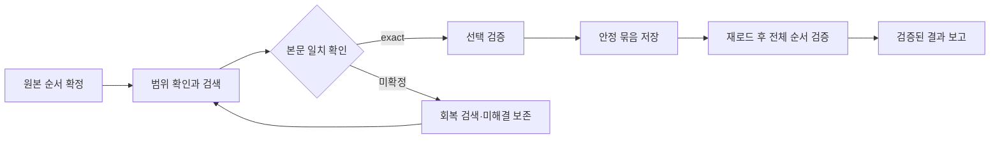

# HDHsubi · 수학비서 문제지 생성

**교사가 가진 원본 시험지에서 같은 본문의 문항을 찾아, 원본 순서대로 저장한 수학비서 문제지를 만든다.** 찾은 문항은 검증해서 남긴다. 못 찾았거나 판정이 끝나지 않은 문항은 구분해서 보존한다.

이 프로젝트의 기준은 실제 수업에 쓸 수 있는 결과다. 빠른 검색, 정확한 본문 대조, 저장 유지가 함께 필요하다. 기록과 검증은 이 제작 과정을 돕기 위해 존재한다.

## 문서 읽기

| 문서 | 내용 |
|---|---|
| [사용자의 염원과 프로젝트 목표](docs/mission.md) | 무엇을 만들고, 무엇을 성공으로 보는가 |
| [구조 변화 과정](docs/history.md) | 초기 성공부터 검증기 연결까지의 변화 |
| [오류와 해결 기록](docs/incidents.md) | 반복 사고, 원인, 수정, 남은 한계 |
| [현재 프로젝트 구조](docs/architecture.md) | 지침·실행 코드·관측·검증·보고의 역할 |
| [현재 상태와 다음 작업](docs/status-and-next.md) | 연결 오류와 성능 문제를 해결할 순서 |
| [근거와 검토 범위](docs/evidence/README.md) | 세션 재검토 방법과 주장의 한계 |
| [공개본의 범위와 실행](docs/publication.md) | 포함한 코드, 제외한 자료, 실행 가능한 검사 |
| [최적화·리팩터링 계획](docs/refactor-plan.md) | 진단, Phase 0~5, 완료 기준, 사용자 결정 항목 (2026-10-11) |
| [Codex 작업 지시서](docs/codex/README.md) | Phase별 구현 프롬프트와 연구 과제 |
| [협업 규칙](docs/collaboration.md) | Claude·Codex·사용자 역할, 브랜치·PR 규칙 |
| [공개 회귀 inventory](docs/evidence/regression-inventory.md) | public 13개와 private-bundle 20개의 실행 범위 |
| [Phase 0 성능 기준선](docs/evidence/phase-0.md) | 합성 입력, 재현 명령, 계측 수치와 한계 |
| [Phase 1 검증 결과](docs/evidence/phase-1.md) | AfterReload 캐시, 변경 전후 동일성, 파일별 해시와 성능 |
| [Phase 1b 검증 결과](docs/evidence/phase-1b.md) | PDF worker 수명, append 재검사 공유, 오류 동일성과 성능 |
| [Phase 2 검증](docs/evidence/phase-2.md) | 관측·판정 조립, simulator 정책 거부, 합성 선택과 상주 검증, Select 시간 비교 |

## 제작 흐름



`exact`는 본문·조건·수식·도형·요구값이 일치하는 문항이다. 사용자의 정책에 따라 객관식 선지 차이는 판정에서 제외한다. 선지와 본문 내부의 `[보기]`는 구분한다.

## 현재 상태 · 2026-10-11

- 최근 제작은 47문항 중 15문항의 저장과 전체 순서를 확인한 상태에서 중단했다.
- Aside REPL, Chrome 연결 후보, IAB에서 실제 판독 또는 일부 조작은 성공했다. 반복 시간 초과가 남았다.
- Chrome로 잘못 분류한 Aside 측정은 정정했다. 브라우저 간 속도 우위는 입증하지 못했다.
- 15문항의 `AfterReload` 검사에서 113.83초를 한 번 관측했다. Phase 1은 추가 저장 이력의 중복 검증을 제거했다. 공개 합성 입력의 측정과 실제 제작 관측은 [별도로 기록한다](docs/evidence/phase-1.md).
- 현재 제작 계약은 Aside REPL을 요구한다. CUA/IAB/Chrome를 지원하는 제작 어댑터는 후속 작업이다.

이 저장소는 **최신 코드와 공개용 프로젝트 기록을 담은 별도 소스 스냅샷**이다. 개인 시험지, 로그인 자료, 원시 세션, 화면 캡처, 비공개 평가 자료는 포함하지 않는다. 원래 비공개 Git 이력도 가져오지 않았다. 전체 설치·전체 회귀에 필요한 일부 자료가 빠져 있으므로 [공개본 실행 범위](docs/publication.md)를 먼저 읽는다.

## 공개본 검사

Python 3와 PowerShell 7이 있는 Windows에서 실행한다.

```powershell
python ./scripts/validate_publication.py
pwsh -NoProfile -ExecutionPolicy Bypass -File ./scripts/run_public_checks.ps1
pwsh -NoProfile -ExecutionPolicy Bypass -File ./scripts/run_offline_regression.ps1
```

첫 명령은 공개 문서의 링크, 파일 목록, 복사 해시와 공개 금지 자료를 확인한다. 둘째 명령은 공개본에 포함한 합성 자료로 선택 저널과 검색어 준비를 검사한다. 실제 수학비서 연결·검색·저장을 검사하는 명령은 아니다.

셋째 명령은 공개 gate 13개를 실행하고, 원래 bundle이 필요한 20개는 이유를 포함한 SKIP으로 표시한다. Python의 Pillow/reportlab/pypdf, Node, Playwright와 Edge/Chrome이 필요하다. 설정과 실행 범위는 [회귀 inventory](docs/evidence/regression-inventory.md)를 따른다. CI는 필요한 의존성을 설치한다.

외부 서비스의 로그인과 문제 DB 접근 권한은 사용자가 준비한다. `출제하기`는 사용자가 별도로 지시하기 전에는 누르지 않는다.
