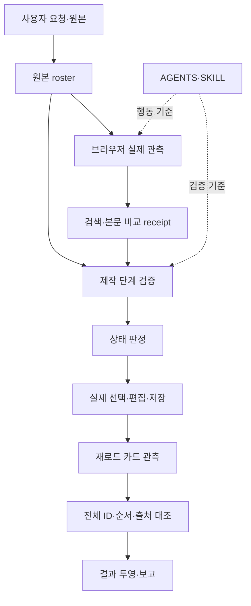
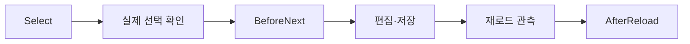
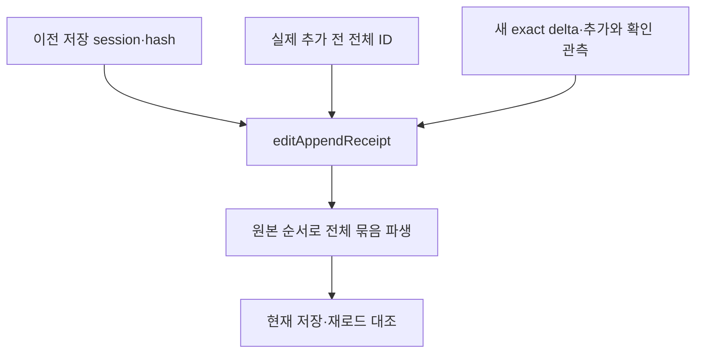

# 현재 프로젝트 구조

이 프로젝트는 수학비서 웹 서비스를 직접 구현하는 앱이 아니다. 에이전트의 제작 절차, 실제 관측 자료, 상태 검증, 결과 보고를 연결하는 도구와 규칙을 관리한다.

## 책임의 연결

브라우저와 에이전트가 실제 사실을 관측한다. 검증기는 관측 자료의 형식과 결합 관계를 검사한다. 검증기가 실제 클릭이나 본문 일치를 대신 만들어 주지는 않는다.

## 디렉터리와 역할

| 경로 | 역할 | 공개본 상태 |
|---|---|---|
| `mathsecr-paper-builder-kit/AGENTS.md` | 세션 정책, 브라우저 소유권, 복구, 보고 규칙 | canonical 문서 포함. 원래 workspace root mirror와는 별개로 보관 |
| `skills/mathsecr-paper-builder/SKILL.md` | 검색·선택·저장·검증의 재사용 절차 | kit 원본 포함 |
| `scripts/` | 계약 검증, 실행 진입점, installer, 회귀 코드 | kit 스크립트 포함 |
| `docs/`, `prompts/` | 스키마 설명과 재사용 프롬프트 | kit 문서 포함 |
| `test-fixtures/` | 합성 입력과 실제 관측을 고정한 자료 | 합성·관측 도구용 일부만 포함 |
| 원래 `.omo/evidence/` | 세션 보고, 실제 관측, 해시, 사고와 복구 기록 | 원본 비공개. 공개 요약과 근거 목록 제공 |
| 원래 `evaluation-sets/`, `output/`, `tmp/` | 시험지 렌더, 평가 원본, 생성 결과, 임시 환경 | 미포함 |

여기서 `scripts/` 등 kit 내부 경로는 `mathsecr-paper-builder-kit/` 아래를 뜻한다. 공개본 root `scripts/`는 공개본 검사 도구다.

## 핵심 실행 코드

| 소유자 | 담당 판단 |
|---|---|
| [db_inference.ps1](../mathsecr-paper-builder-kit/scripts/db_inference.ps1) | DB 미지정 원본의 범위 추론과 근거 검증 |
| [search_query_plan.ps1](../mathsecr-paper-builder-kit/scripts/search_query_plan.ps1) | 원본 순서와 literal 검색어 준비 |
| [search_observation.js](../mathsecr-paper-builder-kit/scripts/search_observation.js) | 필요한 DOM 정보의 읽기 전용 수집 |
| [search_observation_contract.ps1](../mathsecr-paper-builder-kit/scripts/search_observation_contract.ps1) | 서로 독립된 판독과 freshness 판단 |
| [search_attempt_contract.ps1](../mathsecr-paper-builder-kit/scripts/search_attempt_contract.ps1) | 칩 provenance, 검색 순서, backoff, 후보 회복, miss closure |
| [body_comparison_contract.ps1](../mathsecr-paper-builder-kit/scripts/body_comparison_contract.ps1) | 원본·후보 artifact와 본문 비교 기록의 결합 |
| [selection_journal.ps1](../mathsecr-paper-builder-kit/scripts/selection_journal.ps1) | 요청·시간 초과·재시도·ACK와 재개 |
| [state_machine.ps1](../mathsecr-paper-builder-kit/scripts/state_machine.ps1) | 원본 위치, 선택, 순서, 저장, 미해결의 상태 전이 |
| [production_validation.ps1](../mathsecr-paper-builder-kit/scripts/production_validation.ps1) | 실제 제작 단계에 여러 계약을 연결 |
| [report_contract.ps1](../mathsecr-paper-builder-kit/scripts/report_contract.ps1) | 내부 보고와 사용자 요약 검증 |
| [ground_truth_contract.ps1](../mathsecr-paper-builder-kit/scripts/ground_truth_contract.ps1) | 평가 주장의 독립 근거와 허용 범위 |
| [regression_evidence_contract.ps1](../mathsecr-paper-builder-kit/scripts/regression_evidence_contract.ps1) | PASS 출력과 당시 입력 파일의 결합 |

## 규칙의 단일 소유자

같은 규칙을 AGENTS, SKILL, README, 프롬프트, 검증기에서 따로 정의하면 서로 어긋날 수 있다. 현재 구조는 행동 절차와 실행 판정을 구분한다.

| 영역 | 사람과 에이전트의 절차 | 실행 판정 |
|---|---|---|
| 검색 시도 | SKILL `Search Attempt Contract` | search_attempt_contract |
| DB 추론과 공식 collection | SKILL의 해당 절 | db_inference와 스키마 문서 |
| metadata rescue·lazy coverage | SKILL의 해당 절 | state_machine과 search_attempt_contract |
| 본문 exact 선택 | SKILL `Body-Exact Selection Contract` | body 비교·선택 근거 계약 |
| 평가의 독립 정답 주장 | 별도 ground-truth 문서와 registry | ground_truth_contract |
| 세션 소유권과 보고 | AGENTS | production·report 계약 |

원래 root AGENTS는 kit AGENTS의 mirror다. 설치된 SKILL도 kit의 산출물이다. 계약을 바꿀 때는 canonical 파일을 수정한 뒤 공식 installer와 SyncContract로 동기화한다. 이번 공개 작업은 그 production 정책을 수정하지 않았다.

## 제작 단계와 추가 저장

처음 검색 화면에서 편집으로 갈 때는 다음 단계들을 구분한다.

`Select`는 선택 근거를 확인한다. `BeforeNext`는 아직 실행하지 않은 저장 사실을 요구하지 않는다. `AfterReload`는 전체 선택·편집·저장 ID와 순서, raw DB명을 대조한다.

저장된 문제지에 이어서 추가할 때는 최초 Next 묶음을 덮어쓰지 않는다.

이 계약은 기존 저장과 새 문항을 함께 검증한다. 실제 추가 UI의 지원 경로와 action 관측도 필요하다. 옛 검색 화면의 일부 체크 기록과 선택 수만으로 새 전체 delta를 만들면 안 된다.

## 서로 다른 두 identity

- `occurrenceKey`: 원본의 각 위치다. 같은 인쇄 번호가 반복돼도 위치는 다를 수 있다.
- `problemId`: 수학비서 DB 카드의 ID다. 서로 다른 원본 위치가 같은 ID에 대응할 수 있다.

같은 카드를 다시 클릭하는 동작은 중복 삽입이 아니라 선택 해제일 수 있다. 반복 문항을 성공으로 두 번 세려면 실제 duplicate/add 제어와 selected/edit/persisted occurrence 순서 증거가 있어야 한다.

## 검증의 한계

`receipt`는 관측과 판정의 연결 기록이다. 해시는 그 자료의 바이트를 식별한다. 둘 다 실제 화면과 수학적 본문 일치를 독립적으로 증명하지 않는다.

`offline-contract`는 합성 입력으로 지역 규칙과 거부 동작을 검증한 결과다. `dated-characterization`은 특정 시점의 관측을 보존한 결과다. 독립 원본·후보·판정 근거가 없는 자료를 외부 정답 검증으로 승격하지 않는다.

## 현재 구조의 비용

추가 저장 경로에는 과거 AfterReload 재귀, state machine의 과거 상태 재귀, 최종 append receipt 재검사가 함께 있다. 동일 과거 session과 artifact를 한 호출에서 여러 번 검증할 수 있다.

이 중복 경로는 현재 코드에서 확인했다. 15문항 검사에 걸린 113.83초의 정확한 시간 비중은 아직 분리하지 않았다. 최적화는 [후속 계획](status-and-next.md)의 첫 구현 대상으로 남아 있다.
