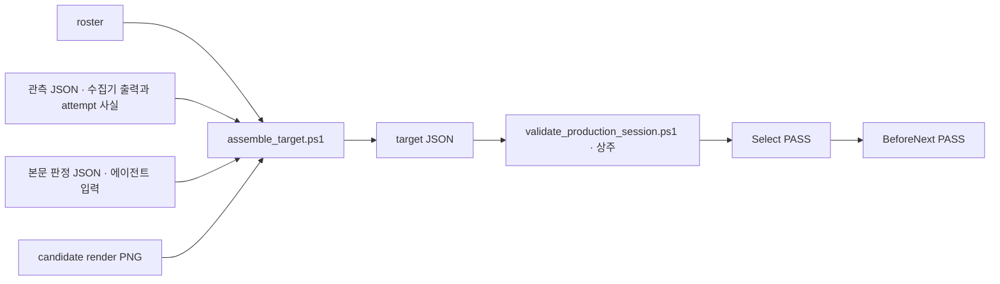

# Phase 2 · 관측 어댑터·조립 자동화·상주 검증

## 목표

문항 1개의 검색 관측에서 Select 입력까지 스크립트 한 번으로 만든다. 에이전트는 검색 attempt 사실과 본문 판정만 JSON으로 쓴다. 해시·파생 필드·결합은 조립기가 계산한다. 검증기는 명령마다 프로세스를 다시 시작하지 않는다. 기존 계약의 거부 동작은 그대로다.



## 선행 조건

Phase 0·1·1b가 `main`에 있다. PR #3·#4·#6이다. `state_machine.ps1:6`의 `$CONTRACT_VERSION`은 `'2026-10-11.2'`다. Phase 1의 Context 규칙은 그대로다. 캐시와 PDF worker는 최상위 검증 호출 하나 안에서만 산다.

결정 D1(surface 정책)은 이 Phase에 필요 없다. 선택 receipt는 `aside-repl`과 `https://www.mathsecr.com/mypaper/<id>` URL만 허용한다(`body_comparison_contract.ps1:57-64`). simulator 관측은 선택 receipt가 될 수 없다. 이 PR은 그 규칙을 바꾸지 않는다. simulator에서 Select PASS까지 잇는 일은 Phase 3의 완료 조건이다.

## 맥락

읽을 파일:

- `docs/refactor-plan.md` 3.2절, Phase 2 절(`:198-220`), 결정 D2·D4(`:281-284`).
- `mathsecr-paper-builder-kit/scripts/search_observation.js`
  - `:1-4` 머리말. live defaults가 없다. selector는 control map에서 온다.
  - `:5` `collectMathSecrSearchObservation(input)`. `input.adapter`는 `id`·`evidenceId`와 descriptor들이다. `input.context`는 `attemptId`·`readEvidenceId`·`submitId`다. 판독 1회의 결과가 observation 1개다.
- `mathsecr-paper-builder-kit/test-fixtures/search-observation/simulator-adapter.json`. simulator용 adapter 전체다. `test-fixtures/search-observation/collector_dom_test.js`가 이것을 쓴다.
- `mathsecr-paper-builder-kit/scripts/search_observation_contract.ps1`
  - `:114` `Test-MathSecrSearchObservation -Packet -AttemptId -Chips -ResultCount`. `:122-130` packet 필수 필드. `schemaVersion`, `attemptId`, `submission`, `beforeSubmit`, `observations`다. `submission.surface`는 `aside-repl` 또는 `offline-dom-test`만 허용한다.
- `mathsecr-paper-builder-kit/scripts/search_attempt_contract.ps1`
  - `:321` `Test-MathSecrSearchAttemptContract`. `:331-334` packet 필수 11개. `:383-386` attempt 필수 11개.
- `mathsecr-paper-builder-kit/scripts/body_comparison_contract.ps1`
  - `:3` `Test-MathSecrSelectedSearchReceipt`. `:57-64` 선택 receipt 조건. `submission.surface='aside-repl'`, `https` + `mathsecr.com` host + `/mypaper/<id>` 경로만 통과한다. 주석이 offline DOM 시험은 선택 receipt가 아니라고 적는다. Select는 `production_validation.ps1:106-107`에서 이를 오류로 돌려준다. `:70` `Test-MathSecrBodyComparisonReceipt`. `:75-80` receipt 필수 16개. `:98-102` `policyVersion='body-only-v1'`, `verdict='exact'`, `unresolvedGlyphs=$false`, `comparedBy`. `:108-117` 비교 항목 7개(`bodyText`, `conditions`, `formulas`, `figures`, `pointLabels`, `requiredValue`, `internalStatements`). 값은 `match` 또는 `not-present`다. `bodyText`와 `requiredValue`는 `match`여야 한다.
- `mathsecr-paper-builder-kit/scripts/prepare_selection_evidence.ps1`. 완성된 target 1개를 받아 해시와 파생값을 채우는 기존 helper다.
  - `:16` 경로 규칙. `:44-50` target 필수 필드. `:52-68` render 해시. `:70-80` `sourceBodyArtifact` 결합. `:82-97` attempt별 freshness 재검사. `:98-105` 파생 필드 6개. `:106-117` 상태 확인과 scope→`resolution`. `:118-125` 직렬화 뒤 최종 검증 2개. `:126-129` `preparation` 블록. `:130-141` CreateNew 쓰기.
  - 이 스크립트의 시험 `test_prepare_selection_evidence.ps1`는 `private-bundle` gate다. 공개 clone에서 SKIP이다. 지원 파일 `test-fixtures/body-comparison/synthetic_selection_test_support.ps1`이 없다.
- `mathsecr-paper-builder-kit/scripts/validate_production_step.ps1`. 현재 CLI다.
  - `:12` 호출마다 `production_validation.ps1`를 dot-source한다. `:14-32` `Resolve-ProductionCliPath`. `:33-37` `Write-ProductionCliNewFile`. `:38-54` 실행과 오류 JSON `{Valid=$false;Step;Error}`.
- `mathsecr-paper-builder-kit/scripts/production_validation.ps1`
  - `:36-52` session과 roster 필수 필드. `:78` `Test-MathSecrProductionSelection`. `:240` `Invoke-MathSecrProductionStep -Step -InputObject -ProjectRoot -TargetOccurrenceKey -HistoryDepth -Context`.
- `mathsecr-paper-builder-kit/scripts/state_machine.ps1`
  - `:364` `Resolve-MathSecrStateArtifactPath`. `:949` `Test-MathSecrTargetRowState`. `:978-1045` `Get-TargetResolution`. `initial='exact'`가 먼저 `initial_selected`를 돌려준다. candidate-recovery·whole-db 경로는 이전 scope의 `missed` 사실이 있어야 한다. `:1549` snapshot 필수 필드.
- `mathsecr-paper-builder-kit/test-fixtures/production-validation/source-roster.json`. roster 예시다. `schemaVersion: 1`, `targets[]`의 `number`, `occurrenceKey`, `sourceBodyArtifact{path, sha256}`다.
- `scripts/perf/append_history_support.ps1`. 공개 합성 fixture 생성기다.
  - `:46` `New-MathSecrBenchmarkObservation`. 관측 packet의 모양이다. `:78` `New-MathSecrBenchmarkTarget`. target 전체 모양이다. `:114` `New-MathSecrAppendHistoryFixture -ProblemCount -HistoryDepth -OutRoot`. roster·PNG·session을 임시 폴더에 만든다.
- `mathsecr-paper-builder-kit/scripts/test_search_observation.ps1`
  - `:2-7` 인자 `-Case`, `-NodePath`, `-PlaywrightModule`, `-BrowserPath`. `:267-290` `Collector` 사례. simulator를 headless로 열고 HTTP(S)를 차단한다.
- `scripts/run_offline_regression.ps1`
  - `:46-48` `mathsecr-paper-builder-kit/scripts/test_*.ps1`은 모두 manifest에 있어야 한다. 없으면 `Unclassified test suite`로 실패한다.
  - `:72-76` `test_search_observation.ps1`에만 `-NodePath`, `-PlaywrightModule`, `-BrowserPath`를 넘긴다.
- `scripts/offline-regression-gates.json:267-283`. `SearchObservationCollector` gate. 새 gate의 필드 예시다.
- `.github/workflows/offline-regression.yaml:35-40`. CI가 Playwright 모듈과 Edge 경로를 넘긴다.
- `mathsecr-paper-builder-kit/skills/mathsecr-paper-builder/SKILL.md:160-161`. control map을 세션마다 관측해서 만든다고 돼 있다. 이 PR에서 바꾸지 않는다.

현재 상태:

- target JSON은 사람이 전부 쓴다. `prepare_selection_evidence.ps1`는 완성된 target만 받는다. 관측·roster·판정에서 target을 만드는 스크립트가 없다.
- 검증 CLI는 호출마다 pwsh 프로세스와 모듈 로드를 반복한다. 문항 47개면 47회다.
- simulator 관측은 `Test-MathSecrSearchObservation`은 통과한다. `Test-MathSecrSelectedSearchReceipt`는 surface와 URL 때문에 거부한다. 2026-10-11 Issue #2 probe로 확인했다.
- 수집기 출력 1개는 `observations[]`의 원소 1개다. `submission`·`beforeSubmit`·attempt 메타데이터(`scope`, `phase`, `chips[].provenance`, `resetBefore`, `clearReceipt`, `removedChips`)는 수집기가 만들지 않는다. 에이전트가 쓴다.

## 작업

1. control map schema를 정한다.
   - 폴더 `mathsecr-paper-builder-kit/test-fixtures/control-map/`. 파일 3개. `schema.json`(JSON Schema draft 2020-12), `simulator.json`(simulator용 실제 값), `mathsecr-current.json`(실제 서비스용 템플릿. selector는 빈 문자열이 아니라 `null`이다).
   - 내용은 `search_observation.js`의 adapter descriptor 전체와 `controlMapVersion`, `observedAtUtc`, `surface`, `pageKind`다. `simulator.json`의 descriptor는 `simulator-adapter.json`과 값이 같다.
   - 실제 selector는 [연구 과제 R2](research-tasks.md)에서 채운다. 이 PR은 비워 둔다.
   - 시험: `simulator.json`이 schema에 맞는다. `mathsecr-current.json`도 맞는다. selector가 `null`인 map으로 수집기를 부르면 `search_observation.js`가 거부한다.
2. `mathsecr-paper-builder-kit/scripts/assemble_target.ps1`를 만든다.
   - 인자: `-RosterPath`, `-OccurrenceKey`, `-ObservationPath`, `-BodyJudgmentPath`, `-CandidateRenderPath`, `-ProjectRoot`, `-OutPath`. 경로 규칙은 `prepare_selection_evidence.ps1:16`과 같다. 출력은 CreateNew다.
   - roster: `OccurrenceKey`로 행 1개를 찾는다. 없거나 둘이면 거부한다. `number`와 `sourceBodyArtifact`를 그 행에서 복사한다. `sourceBodyArtifact.path`의 파일 해시가 roster의 `sha256`과 다르면 거부한다.
   - 관측 JSON(`-ObservationPath`)의 schema를 `docs/search_attempt_input.md`에 정의한다. `{schemaVersion:1, literalEvidence, candidateRecoveryEvidence, attempts:[...]}`다. attempt 1개는 `attemptId`, `scope`, `phase`, `chips[{value, provenance, evidenceReceipt}]`, `resetBefore`, `clearReceipt`, `removedChips`, `submission`, `beforeSubmit`, `observations[]`다. `submission`·`beforeSubmit`·`observations[]`는 수집기 출력 그대로다. 나머지는 에이전트가 쓴 사실이다. `chips[]` 객체는 키를 추리지 않고 그대로 복사한다. `formulaCommitReceipt`·`indexEvidenceReceipt`가 있으면 보존한다.
   - 본문 판정 JSON(`-BodyJudgmentPath`)은 작업 3의 schema다.
   - 자동 계산 필드: `targetBinding`, `submitted`(=`submission` 존재), `resultCount`(마지막 observation의 `raw.result.count`), `freshResultVerified`(`Test-MathSecrSearchObservation` 결과), `inspectedIds`(마지막 observation의 `raw.result.orderedIds`), `commonChips`·`exactMatchIds`·`literalOnlyLadderCompleted`·`resetBackoffPerformed`·`candidateRecoveryCompleted`·`completeCoverageVerified`(`prepare_selection_evidence.ps1:98-105`와 같은 방법), `sourceRenderSha256`·`candidateRenderSha256`(파일 바이트), `resolution`(`:106-117`과 같은 표), `selectedId`(=판정의 `candidateId`).
   - scope 범위: 이 PR의 조립기는 winning attempt(`judgment.searchAttemptId`)의 `scope`가 `initial-scope`인 경우만 지원한다. 다른 scope면 `assembly-scope-unsupported:<scope>`로 거부한다. candidate-recovery·whole-db 경로는 이전 scope의 `missed` 사실을 입력으로 받아야 한다(`Get-TargetResolution`). 그 입력 schema는 다음 Phase에서 정한다. 단일 판정에서 이전 scope의 miss를 추론하지 않는다.
   - 판정에서 오는 필드: `initial`(target route)과 `outcome`은 판정의 `verdict`가 `exact`일 때만 `exact`다. 결과 개수나 ID 일치에서 추론하지 않는다. `exactFound`는 attempt별 Boolean이다. `judgment.searchAttemptId`와 같은 attempt 1개만 `$true`다. 다른 attempt는 같은 ID가 보여도 `$false`다. 판정을 복제하지 않는다. `exactMatchIds`는 winning attempt에서 `verdict='exact'`이고 `candidateId`가 그 attempt의 `inspectedIds`에 있을 때만 `[candidateId]`다. 아니면 빈 배열이다.
   - 구분 규칙: 사람이 보고 판단한 값은 입력이다. 파일·관측에서 계산되는 값은 자동이다. 어느 쪽인지 모호한 필드는 구현 전에 Issue #2에 묻는다.
   - 조립 뒤 `prepare_selection_evidence.ps1:118-125`와 같은 최종 검증 2개를 실행한다. 거부면 파일을 쓰지 않는다. 출력 target에 `preparation` 블록을 넣는다. `helperVersion='assemble-target-v1'`이다. `inputs`에 `roster`, `observation`, `judgment`, `candidateRender` 파일의 SHA-256(소문자 hex)을 넣는다. `inputSha256`은 문자열 `roster:<sha>\nobservation:<sha>\njudgment:<sha>\ncandidateRender:<sha>\n`(LF)의 UTF-8 SHA-256이다. `truthScope`와 `searchObservation`은 `:126-129`와 같다.
   - 출력 계약: 성공은 종료 코드 0, 표준 출력 `{"assembled":true,"path":"...","resolution":"initial_selected"}` 한 줄이다. 거부는 종료 코드 1, `{"assembled":false,"reason":"<token>"}` 한 줄이다. 파일을 쓰지 않는다. reason token: `roster-row-missing`, `roster-hash-mismatch`, `judgment-missing:<key>`, `judgment-invalid:<key>`, `body-not-exact`, `assembly-scope-unsupported:<scope>`, `observation-rejected:<attemptId>`, `search-contract-rejected:<errors>`, `selected-search-receipt-invalid`, `body-comparison-rejected:<errors>`.
   - `prepare_selection_evidence.ps1`는 이 PR에서 바꾸지 않는다. 공유 로직은 새 파일 `mathsecr-paper-builder-kit/scripts/selection_assembly.ps1`에 함수로 두고 `assemble_target.ps1`만 dot-source한다. 기존 helper를 래퍼로 바꾸는 일은 D4 자료로 `test_prepare_selection_evidence.ps1`를 실행할 수 있을 때 한다.
3. 본문 판정 입력 schema를 `docs/body_judgment_input.md`에 정의한다. JSON Schema는 `mathsecr-paper-builder-kit/test-fixtures/body-judgment/schema.json`이다.
   - 필수 키와 계약 필드의 대응: `comparator`→`comparedBy`, `comparedAtUtc`→`comparedAtUtc`(`Z`로 끝남), `policy`→`policyVersion`(값은 `body-only-v1`만), `verdict`(`exact` 또는 `mismatch`), `candidateId`, `searchAttemptId`, `comparison`(항목 7개. 값은 `match`, `not-present`, `mismatch`), `sourceRenderScale`과 `candidateRenderScale`(양의 정수), `unresolvedGlyphs`(bool).
   - 기본값이 없다. 키가 없거나 비어 있거나 형이 다르면 조립을 거부한다. 거부 사유는 `judgment-missing:<key>` 또는 `judgment-invalid:<key>`다.
   - `verdict`가 `mismatch`이거나 항목 하나라도 `mismatch`이거나 `unresolvedGlyphs`가 `$true`면 target을 쓰지 않는다. reason은 `body-not-exact`다. mismatch 행을 session에 기록하는 방식은 이 PR 범위 밖이다. 필요하면 Issue #2에 질문으로 남긴다.
4. `mathsecr-paper-builder-kit/scripts/validate_production_session.ps1`를 만든다. 상주 모드다.
   - 시작할 때 `production_validation.ps1`를 한 번 dot-source한다. 인자는 `-ProjectRoot` 하나다.
   - 표준 입력에서 JSON 한 줄씩 읽는다. 명령은 `{"step":"Select|BeforeNext|AfterReload","inputPath":"...","outPath":"...","summaryPath":"...","targetOccurrenceKey":"..."}`다. `outPath`·`summaryPath`·`targetOccurrenceKey`는 선택이다. `summaryPath`는 AfterReload만 허용한다. `{"step":"exit"}`면 종료 코드 0으로 끝난다. EOF도 같다.
   - 응답은 명령마다 JSON 한 줄이다. 모양은 CLI와 같다. 성공은 `Invoke-MathSecrProductionStep` 결과를 `ConvertTo-Json -Depth 80 -Compress`한 것이다. 실패는 `{"Valid":false,"Step":"...","Error":"..."}`다. 명령 JSON이 깨졌거나 `step`이 없으면 `{"Valid":false,"Step":null,"Error":"..."}`를 쓰고 다음 줄을 읽는다. 검증 실패로 프로세스를 끝내지 않는다.
   - 경로 규칙은 CLI `:14-37`과 같다. `validate_production_step.ps1`는 바꾸지 않는다. 함수 2개를 같은 본문으로 복사한다. 시험이 두 파일의 함수 본문 텍스트가 같은지 비교한다. 입력 해시 재검사(`:46`)도 같다.
   - 명령 사이에 Context, 캐시, PDF worker를 공유하지 않는다. 명령마다 `Invoke-MathSecrProductionStep`를 Context 없이 부른다. 명령 1개가 최상위 호출 1개다. 모듈 로드만 공유한다.
   - 표준 입출력은 UTF-8이다. `[Console]::InputEncoding`과 `OutputEncoding`을 `UTF8Encoding($false)`로 둔다.
5. end-to-end 합성 시험 `mathsecr-paper-builder-kit/scripts/test_assemble_pipeline.ps1`를 만든다. 인자는 `test_search_observation.ps1:2-7`과 같다. 마지막 줄은 `AssemblePipeline PASS`다.
   - session: `New-MathSecrAppendHistoryFixture -ProblemCount 3 -HistoryDepth 0`의 session을 복사한다. `snapshot.nextClicked=$false`로 두고 `snapshot.edit`과 `persistence`를 제거한다. 이 상태에서 Select와 BeforeNext가 PASS한다(2026-10-11 Issue #2 probe). 필요한 helper는 `scripts/perf/assembly_support.ps1`에 둔다. 개인 자료는 쓰지 않는다. paper URL은 `https://www.mathsecr.com/mypaper/123`만 쓴다.
   - 경로 A · simulator 관측. Playwright로 simulator DOM을 열고 `search_observation.js`와 `control-map/simulator.json`으로 관측 3회를 만든다(`beforeSubmit` 1회, `observations` 2회). `submission.surface`는 사실대로 `offline-dom-test`다. 관측과 attempt 사실로 관측 JSON을 쓴다. 합성 판정 JSON을 쓴다. `assemble_target.ps1`를 돌린다. 기대 결과는 거부다. `Test-MathSecrSearchObservation`과 attempt 계약은 통과하고 최종 선택 검사가 거부한다. reason은 `selected-search-receipt-invalid`다. 시험은 이 reason과 출력 파일 없음을 단정한다. 이 사례는 현재 정책의 기록이다. Phase 3가 surface 계약을 넣으면 PASS로 바뀐다. surface나 URL을 바꿔 통과시키지 않는다.
   - 경로 B · 선택 PASS. 관측 packet은 `New-MathSecrBenchmarkObservation`(`append_history_support.ps1:46`)으로 만든다. surface `aside-repl`, URL `/mypaper/123`인 공개 합성 데이터다. 경로 A와 같은 attempt 사실·판정 JSON으로 `assemble_target.ps1`를 돌린다. 종료 코드 0이다. 결과 target을 session의 해당 행에 넣는다. 상주 모드 프로세스 1개에 Select와 BeforeNext 명령을 보낸다. 둘 다 `Valid=$true`다. 경로 A와 B의 관측 JSON은 `submission`·`beforeSubmit`·`observations`만 다르다.
   - 음성 사례 3개. 판정에서 `comparator`를 빼면 `judgment-missing:comparator`로 거부한다. `comparison.bodyText='mismatch'`면 `body-not-exact`로 target이 없다. 관측 JSON의 `resultCount`를 임의로 넣어도 조립기는 무시하고 마지막 observation에서 다시 계산한다. 값이 다르면 거부한다. winning attempt의 `scope`를 `candidate-recovery`로 바꾸면 `assembly-scope-unsupported:candidate-recovery`로 거부한다.
   - 동일성 1개. 경로 B의 target을 `prepare_selection_evidence.ps1`에 넣는다. 출력에서 `preparation`을 뺀 나머지가 조립 결과와 JSON으로 같다. 이 비교가 기존 helper의 공개 시험이다.
   - 상주 모드 시험. 깨진 JSON 한 줄 뒤에 정상 명령을 보내면 응답 2개가 온다. `exit` 뒤 프로세스가 5초 안에 끝난다. 출력 파일이 이미 있으면 CLI와 같은 문장으로 거부한다.
6. 상주 모드와 CLI의 Select 시간을 비교한다.
   - `scripts/perf/measure_select_modes.ps1 -ProblemCount 47 -Repeat 3`을 만든다. `New-MathSecrAppendHistoryFixture -ProblemCount 47 -HistoryDepth 0`의 session으로 Select 47회를 두 방식으로 실행한다. CLI는 pwsh 프로세스 47개다. 상주는 프로세스 1개에 명령 47개다. 둘 다 PASS 47회여야 한다.
   - 3회 중앙값을 `docs/evidence/perf-phase2.json`에 쓴다. 반복별 샘플과 중앙값 둘 다 쓴다. 표는 `docs/evidence/phase-2.md`에 쓴다. `phase-2-checks.json`도 만든다. 열은 방식, 총 시간(초), 명령당 중앙값(ms), PASS 수다.
7. 회귀와 문서를 갱신한다.
   - `scripts/offline-regression-gates.json`에 gate `AssemblePipeline`을 `public`으로 더한다. `requiredPaths`는 simulator·adapter·control map·판정 schema다. `passPattern`은 `AssemblePipeline PASS`다. `publicationStatus`는 `public-new-synthetic`이다.
   - `scripts/run_offline_regression.ps1:72`의 조건을 스크립트 목록으로 바꾼다. `test_search_observation.ps1`와 `test_assemble_pipeline.ps1` 둘 다 Playwright 인자를 받는다.
   - `docs/evidence/regression-inventory.md:3`의 수를 `public` 13개, `private-bundle` 20개로 바꾼다. 표에 새 gate 행을 더한다. 마지막 단락에 Phase 2 한 줄을 더한다.
   - `README.md` 표에 Phase 2 검증 결과 행을 더한다. `docs/publication.md`에 Phase 2 단락을 더한다.
   - `SOURCE_SNAPSHOT.json`은 바꾸지 않는다. 이 PR은 기존 export 파일을 바꾸지 않는다. 바꾸게 되면 그 파일의 해시·크기·transformation만 갱신하고 PR에 쓴다.

## 제약

- 판정·관측·클릭·시각을 자동으로 채우지 않는다. 조립과 해시와 파생 계산만 자동이다. `verdict`, `comparison`, `comparedAtUtc`, `comparedBy`는 입력 그대로다.
- 실제 수학비서에 접속하는 테스트를 만들지 않는다. `출제하기`를 포함한 상태 변경 control을 simulator 밖에서 호출하지 않는다.
- `search_observation.js`, `search_attempt_contract.ps1`, `search_observation_contract.ps1`, `body_comparison_contract.ps1`, `state_machine.ps1`, `production_validation.ps1`, `validate_production_step.ps1`, `prepare_selection_evidence.ps1`를 바꾸지 않는다. 필요한 변경은 Issue #2에 먼저 쓴다.
- SKILL.md와 AGENTS.md를 바꾸지 않는다. 변경 제안은 PR 본문에 적는다. Phase 4에서 반영한다.
- 기존 함수 이름과 반환 구조를 유지한다. 기존 테스트 단정을 지우거나 약화하지 않는다.
- 상주 모드는 명령 사이에 검증 상태를 공유하지 않는다.
- 새 파일 확장자는 `.ps1 .py .js .md .yaml .json .html`만 쓴다. 생성 결과와 fixture는 OS 임시 폴더에만 둔다.

## 완료 조건

```powershell
python ./scripts/validate_publication.py
pwsh -NoProfile -ExecutionPolicy Bypass -File ./scripts/run_public_checks.ps1
pwsh -NoProfile -ExecutionPolicy Bypass -File ./scripts/run_offline_regression.ps1 -PlaywrightModule <module> -BrowserPath <browser>
pwsh -NoProfile -ExecutionPolicy Bypass -File ./mathsecr-paper-builder-kit/scripts/test_assemble_pipeline.ps1 -ProjectRoot . -PlaywrightModule <module> -BrowserPath <browser>
pwsh -NoProfile -ExecutionPolicy Bypass -File ./scripts/test_validation_context.ps1
pwsh -NoProfile -File ./scripts/perf/measure_select_modes.ps1 -ProblemCount 47 -Repeat 3
```

- 공개 gate가 13 PASS, 0 FAIL, 20 SKIP이다. `AssemblePipeline PASS`가 로그에 있다.
- 음성 사례 4개가 거부된다. 경로 A의 reason이 `selected-search-receipt-invalid`다. 경로 B의 Select·BeforeNext가 PASS다. 동일성 비교가 PASS다.
- 상주 모드 Select 47회 총 시간이 CLI 47회보다 짧다. 수치가 `docs/evidence/phase-2.md`와 PR 본문에 있다.
- 기존 Phase 1b 계측은 그대로다. `test_validation_context.ps1` PASS, `AfterReloadIdentity PASS` 24개, CI의 `PdfValidatorProcesses PASS`다.
- 변경하지 않기로 한 파일 8개의 diff가 비어 있다. `SOURCE_SNAPSHOT.json`의 hash drift가 0이다.
- CI가 녹색이다.

## PR

브랜치 `codex/phase-2`. base는 `main`이다. 제목 `Phase 2: 관측 어댑터·조립 자동화·상주 검증`. 추론 노력 `high`. PR 본문에 Select 시간 표, 경로 A·B 결과, 음성 사례 결과, 입력/자동 필드 구분표, SKILL.md 변경 제안을 쓴다. candidate-recovery·whole-db scope 입력 확장은 후속 항목으로 적는다. 모호하면 구현 전에 Issue #2에 질문한다.
