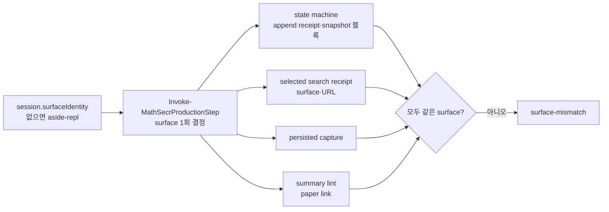

# Phase 3a · surface 계약

## 시작 조건

결정 D1은 2026-10-11 Issue #2에서 승인되었다. Phase 0·1·1b·2가 `main`에 있다(PR #3·#4·#6·#8). 연구 과제 R1·R3는 필요 없다. probe와 문서 변경은 [Phase 3b](phase-3b.md)다.

## 목표

브라우저 surface를 typed 값으로 받는다. 허용값은 `aside-repl`, `codex-iab`, `codex-chrome-ext`, `offline-dom-test`다. 한 session의 surface는 한 번 정한다. 모든 receipt는 그 surface와 같아야 한다. 다르면 `surface-mismatch`로 거부한다. URL 규칙은 surface가 정한다. `aside-repl`은 기본값이다. surface 선언이 없는 session은 지금과 똑같이 동작한다. Phase 0 대비 동일성 24개는 그대로 PASS다. Phase 2의 simulator 경로 A가 `offline-dom-test` session에서 Select·BeforeNext PASS로 바뀐다.



## 맥락

읽을 파일:

- `docs/refactor-plan.md` 3.3절(`:91`), Phase 3 절(`:221-240`), 결정 D1(`:281`).
- `docs/incidents.md` 사고 16~21(`:107-142`). surface 오분류의 이력이다. 19번이 Aside의 Codex 확장 표면을 Chrome로 분류한 사고다.
- surface가 결합된 지점. 현재 `main` 줄 번호다.
  - `mathsecr-paper-builder-kit/scripts/search_observation_contract.ps1:131`. `submission.surface` 허용값이 `@('aside-repl','offline-dom-test')`다.
  - `mathsecr-paper-builder-kit/scripts/body_comparison_contract.ps1:57-64`. 선택 receipt는 `submission.surface -ceq 'aside-repl'`이고 URL이 `https` + `mathsecr.com` host + `/mypaper/<id>`여야 한다. 주석이 offline DOM 시험은 선택 receipt가 아니라고 적는다. 이 PR이 그 주석과 규칙을 바꾼다.
  - `mathsecr-paper-builder-kit/scripts/production_validation.ps1:41`. `session.paper.url`이 `^https://www\.mathsecr\.com/mypaper/[0-9]+$`여야 한다. `:132` persisted capture의 `surface -ceq 'aside-repl'`. `:133` capture URL이 `paper.url`과 같아야 한다.
  - `mathsecr-paper-builder-kit/scripts/state_machine.ps1:1329` `editAppendReceipt.surface`. `:1416` `추가`·`확인` action의 `surface`. `:1450` `addAfter.surface`. `:1464` `confirmBefore`·`confirmAfter`의 `surface`. 네 곳이 `-cne 'aside-repl'`이다. `:1549` snapshot 필수 필드에 `asideRepl`이 있다. `:1566-1575` `asideRepl{available, paperVerified, nonAsideReplLiveManipulation}` 세 boolean 검사. state 이름은 `ASIDE_REPL_READY`다.
  - `mathsecr-paper-builder-kit/scripts/report_contract.ps1:798`. 사용자 요약 0번 줄의 paper 링크가 `https://www.mathsecr.com/mypaper/<digits>`여야 한다.
  - `mathsecr-paper-builder-kit/scripts/validate_mathsecr_docs.ps1:264`, `:417`, `:796`. 문서 marker 검사다. Phase 3b 범위다. 이 PR에서 바꾸지 않는다.
- 함수 시그니처.
  - `state_machine.ps1:1528-1534` `Invoke-MathSecrStateMachine -Snapshot -ProjectRoot -Phase -AppendDepth -Context`.
  - `body_comparison_contract.ps1:3-4` `Test-MathSecrSelectedSearchReceipt -Target -Resolution`. `:70-71` `Test-MathSecrBodyComparisonReceipt -Receipt -Target -ProjectRoot -InspectedIds -AttemptId -Context`.
  - `search_observation_contract.ps1:114-116` `Test-MathSecrSearchObservation -Packet -AttemptId -Chips -ResultCount`.
  - `production_validation.ps1:78` `Test-MathSecrProductionSelection`. `:120` `Get-MathSecrProductionPersistedCapture`. `:220` `New-MathSecrProductionUserSummary`. `:240-246` `Invoke-MathSecrProductionStep`.
  - `report_contract.ps1:773` `Invoke-MathSecrUserSummaryLint -Text -ExpectedProjection -Context`.
- Phase 2 산출물.
  - `mathsecr-paper-builder-kit/scripts/selection_assembly.ps1`. `New-MathSecrAssembledTarget`가 끝에서 `Test-MathSecrSelectedSearchReceipt`와 `Test-MathSecrBodyComparisonReceipt`를 부른다. `assemble_target.ps1`는 그 함수의 CLI다.
  - `mathsecr-paper-builder-kit/scripts/test_assemble_pipeline.ps1`. 경로 A는 `Assert-AssemblyRejection 'observation-a.json' 'judgment.json' 'target-a.json' 'selected-search-receipt-invalid'`다. 경로 B는 `aside-repl` 합성 packet으로 PASS한다.
  - `mathsecr-paper-builder-kit/test-fixtures/control-map/collector_assembly_test.js:39`. simulator 관측의 `surface:"offline-dom-test"`, `url:page.url()`이다. URL은 `file:` URI다. 경로 끝이 `/test-fixtures/iab-simulator/index.html`이다.
- 공개 합성 fixture.
  - `scripts/perf/append_history_support.ps1:46` `New-MathSecrBenchmarkObservation`. `:61`, `:71` URL `https://www.mathsecr.com/mypaper/123`. `:70` surface. `:114` `New-MathSecrAppendHistoryFixture -ProblemCount -HistoryDepth -OutRoot`. `:166` capture surface. `:175` `asideRepl` 블록. `:207`, `:213`, `:214`, `:221` append receipt surface. 모두 `'aside-repl'` 문자열이다.
  - `scripts/perf/assembly_support.ps1`. Phase 2 session helper.
  - `scripts/perf/compare_after_reload.ps1`. Phase 0 commit `961c41105e96f368c48f6a39303e15520e0b3213` 대비 24개 동일성 비교다. 기본 surface의 출력이 바뀌면 실패한다.

현재 상태:

- surface 문자열 `'aside-repl'`이 검증기 4개 파일 8곳에 직접 쓰여 있다. session 수준의 surface 선언이 없다.
- URL 규칙이 surface와 섞여 있다. paper URL은 3곳(`production_validation.ps1:41`, `body_comparison_contract.ps1:61-64`, `report_contract.ps1:798`)에서 각각 검사한다.
- `search_observation_contract.ps1:131`만 `offline-dom-test`를 안다. 그래서 simulator 관측은 관측 계약은 통과하고 선택 계약은 거부된다.

## 작업

1. `mathsecr-paper-builder-kit/scripts/surface_contract.ps1`를 만든다. 다른 계약 파일이 dot-source한다.
   - `$MathSecrSupportedSurfaces = @('aside-repl','codex-iab','codex-chrome-ext','offline-dom-test')`.
   - `$MathSecrSurfaceBrowserFamilies`. surface→browserFamily 허용 쌍 1개씩이다. `aside-repl`→`aside`, `codex-iab`→`codex`, `codex-chrome-ext`→`chrome`, `offline-dom-test`→`playwright`.
   - `Test-MathSecrSupportedSurface -Surface`. 문자열이고 허용값이면 `$true`다. 대소문자를 구분한다.
   - `Test-MathSecrSurfacePaperUrl -Surface -Url`. `aside-repl`·`codex-iab`·`codex-chrome-ext`는 `^https://www\.mathsecr\.com/mypaper/[0-9]+$`다. `offline-dom-test`는 절대 `file:` URI이고 `[Uri]::LocalPath`가 `/test-fixtures/iab-simulator/index.html`(구분자는 `\`도 허용)로 끝나야 한다. 다른 host, scheme, 경로는 `$false`다.
   - `Test-MathSecrSurfaceIdentityReceipt -Receipt -PaperUrl`. 반환은 `{Valid, Surface, Errors}`다. 필수 필드는 `schemaVersion`(1), `surface`, `browserFamily`, `profileOrSessionId`, `tabId`, `url`, `observedAtUtc`다. 규칙: `surface`가 허용값이 아니면 `surface-unsupported`. `browserFamily`가 표의 쌍과 다르면 `surface-browser-family`. `url`이 `PaperUrl`과 Ordinal로 다르거나 `Test-MathSecrSurfacePaperUrl`이 `$false`면 `surface-url`. `profileOrSessionId`·`tabId`가 빈 문자열이거나 앞뒤 공백이 있으면 `surface-identity-invalid`. `observedAtUtc`는 `Z`로 끝나는 UTC 타임스탬프다. 선택 필드 `probeArtifact{path, sha256}`는 있으면 `Get-MathSecrValidationArtifact`로 해시를 검증한다. 없으면 통과한다. Phase 3b가 `offline-dom-test`를 뺀 surface에 필수로 바꾼다.
   - `Get-MathSecrSessionSurface -Session -Context`. `session.surfaceIdentity`가 없으면 `'aside-repl'`을 돌려준다. 있으면 receipt를 검증하고 그 `surface`를 돌려준다. 거부면 `Errors`를 그대로 가진 예외를 던진다. 예외 문장은 `surface-identity-invalid: <errors>`다.
2. surface를 한 번 정하고 아래로 넘긴다.
   - `Invoke-MathSecrProductionStep:240`에서 `$surface = Get-MathSecrSessionSurface -Session $InputObject -Context $Context`를 한 번 부른다. 세 step 모두 같다. 아래 함수에 `-Surface $surface`를 넘긴다.
   - `Invoke-MathSecrStateMachine`에 `[string]$Surface = 'aside-repl'`을 더한다. `:1329`, `:1416`, `:1450`, `:1464`의 `-cne 'aside-repl'`을 `-cne $Surface`로 바꾼다. 거부 토큰은 기존 문장(`edit-append-schema` 등)을 유지한다.
   - snapshot 블록. `$Surface`가 `aside-repl`이면 지금처럼 `asideRepl` 블록을 요구한다(`:1549`, `:1566-1575`). 다른 surface면 같은 구조의 `surfaceState{surface, available, paperVerified, offSurfaceLiveManipulation}` 블록을 요구한다. `surfaceState.surface`는 `$Surface`와 같아야 한다. 규칙은 `asideRepl`과 같다(`available=$true`, `paperVerified=$true`, `offSurfaceLiveManipulation=$false`). `asideRepl`과 `surfaceState`가 함께 있으면 `surface-mismatch`로 `차단`한다. state 이름 `ASIDE_REPL_READY`와 trace 문자열은 이 PR에서 바꾸지 않는다. 이름 정리는 Phase 4다.
   - `Test-MathSecrSearchObservation`에 `[string]$Surface = $null`을 더한다. 값이 있으면 `submission.surface -ceq $Surface`여야 한다. 없으면 `Test-MathSecrSupportedSurface`로 검사한다. `:131`의 고정 배열을 지운다.
   - `Test-MathSecrSelectedSearchReceipt`에 `[string]$Surface = 'aside-repl'`을 더한다. `:60`은 `-cne $Surface`다. `:61-64`의 URL 검사는 `Test-MathSecrSurfacePaperUrl -Surface $Surface -Url $observationReceipt.submission.url`로 바꾼다. 주석을 새 규칙에 맞게 고친다. 내부에서 부르는 `Test-MathSecrSearchObservation`에 `-Surface`를 넘긴다.
   - `Test-MathSecrBodyComparisonReceipt`에 `[string]$Surface = 'aside-repl'`을 더한다. 지금은 surface를 보지 않는다. 호출 경로의 일관성을 위해 받기만 하고 `Test-MathSecrSelectedSearchReceipt`를 부르는 곳이 있으면 넘긴다.
   - `production_validation.ps1:41`을 `Test-MathSecrSurfacePaperUrl -Surface $surface -Url $Session.paper.url`로 바꾼다. `:132`를 `-ceq $Surface`로 바꾼다. `Test-MathSecrProductionSelection`, `Get-MathSecrProductionPersistedCapture`, `Get-MathSecrProductionReportProjection`, `New-MathSecrProductionUserSummary`에 `-Surface`를 더해 넘긴다.
   - `Invoke-MathSecrUserSummaryLint`에 `[string]$Surface = 'aside-repl'`을 더한다. `:798`의 paper 링크 정규식을 surface별로 둔다. `offline-dom-test`는 `(<url>file:[^)]+)`를 받고 `Test-MathSecrSurfacePaperUrl`로 검사한다. 나머지는 지금 정규식이다. `New-MathSecrProductionUserSummary`가 만드는 0번 줄 링크는 `session.paper.url`을 그대로 쓴다. `Invoke-MathSecrTypedUserSummaryLint:292`도 session에서 surface를 읽어 넘긴다.
   - `assemble_target.ps1`와 `New-MathSecrAssembledTarget`에 `[string]$Surface = 'aside-repl'`을 더한다. 최종 검증 2개에 넘긴다. 다른 동작은 바꾸지 않는다.
   - `$CONTRACT_VERSION`을 `'2026-10-11.3'`으로 올린다.
3. 공개 합성 fixture에 surface를 더한다.
   - `New-MathSecrBenchmarkObservation`과 `New-MathSecrAppendHistoryFixture`에 `[string]$Surface = 'aside-repl'`과 `[string]$PaperUrl`을 더한다. `PaperUrl`이 비어 있으면 `https://www.mathsecr.com/mypaper/123`이다. 기본값 호출의 출력 바이트는 지금과 같아야 한다. 이것이 동일성 24개의 전제다.
   - `Surface`가 `aside-repl`이 아니면 session에 `surfaceIdentity`를 넣는다. `browserFamily`는 표의 쌍이다. `profileOrSessionId='synthetic-profile'`, `tabId='synthetic-tab'`, `url=$PaperUrl`, `observedAtUtc='2026-10-11T00:00:00.000Z'`. snapshot에는 `asideRepl` 대신 `surfaceState`를 넣는다. 관측·capture·append receipt의 `surface`와 모든 `url`을 바꾼다.
   - `offline-dom-test`의 `PaperUrl`은 실제 simulator 파일의 `file:` URI다. `[Uri]::new((Join-Path $kit 'test-fixtures/iab-simulator/index.html')).AbsoluteUri`로 만든다. 다른 경로를 쓰지 않는다.
4. 시험을 더한다. `scripts/test_surface_contract.ps1`. 마지막 줄은 `SurfaceContract PASS`다. fixture는 OS 임시 폴더다.
   - 양성 12개. surface 4개 × step 3개(Select, BeforeNext, AfterReload). `New-MathSecrAppendHistoryFixture -ProblemCount 3 -HistoryDepth 1 -Surface <s>`와 Phase 2의 `assembly_support.ps1` 방식으로 Select·BeforeNext session을 만든다. 모두 `Valid=$true`다.
   - 음성 7개. 각각 거부되고 토큰이 Error 또는 Status 메시지에 있어야 한다.
     1. `surfaceIdentity.surface='codex-iab'`, `browserFamily='aside'` → `surface-browser-family`.
     2. `surfaceIdentity.surface='codex-iab'` session에 persisted capture `surface='aside-repl'` → 거부. `production_validation.ps1:132`의 기존 문장이다.
     3. `surfaceIdentity.surface='chrome'` → `surface-unsupported`.
     4. `aside-repl` session(선언 없음)에 search `submission.surface='offline-dom-test'` → `selected-search-receipt-invalid`(조립기) 또는 Select 거부. Phase 2 경로 A의 기존 단정이 이 사례다. 그대로 둔다.
     5. `offline-dom-test` session에 `paper.url='https://www.mathsecr.com/mypaper/123'` → `surface-url`.
     6. snapshot에 `asideRepl`과 `surfaceState`가 함께 있음 → `surface-mismatch`.
     7. `codex-chrome-ext` session의 `editAppendReceipt.surface='codex-iab'` → `edit-append-schema`.
   - `test_assemble_pipeline.ps1` 경로 A를 둘로 나눈다. A1: 기존대로 `-Surface` 없이 `selected-search-receipt-invalid`(혼입 거부). A2: `offline-dom-test` session(작업 3)과 `assemble_target.ps1 -Surface offline-dom-test`로 조립 → 종료 코드 0 → 상주 모드 Select·BeforeNext `Valid=$true`. 기존 단정은 지우지 않는다.
   - `scripts/offline-regression-gates.json`에 `SurfaceContract` gate를 `public`으로 더한다. `passPattern`은 `SurfaceContract PASS`다. 공개 gate는 14개가 된다.
5. 측정과 기록.
   - `measure_after_reload.ps1 -ProblemCount 15 -HistoryDepth 6 -Repeat 3`. H=6 중앙값이 2.2초 이하다. 값을 `docs/evidence/perf-phase3a.json`에 쓴다. `perf-phase1b.json`, `perf-phase2.json`은 덮어쓰지 않는다.
   - `docs/evidence/phase-3a.md`와 `phase-3a-checks.json`을 만든다. surface별 양성·음성 결과 표, 경로 A1·A2 결과, 동일성 24개, H=6 값을 쓴다.
   - `SOURCE_SNAPSHOT.json`에서 바뀐 export(`state_machine.ps1`, `production_validation.ps1`, `body_comparison_contract.ps1`, `search_observation_contract.ps1`, `report_contract.ps1`)의 해시·크기·transformation을 갱신한다. 원본 `sourceSha256`은 유지한다. `surface_contract.ps1`은 새 파일이라 snapshot에 넣지 않는다.
   - `docs/evidence/regression-inventory.md:3`의 수를 `public` 14개로 바꾸고 표에 행을 더한다. `README.md`와 `docs/publication.md`에 Phase 3a 줄을 더한다.

## 제약

- `surfaceIdentity`가 없는 session은 지금과 같은 결과를 낸다. 거부 문장, 상태, trace, 요약 출력이 같다. 동일성 24개로 확인한다.
- surface를 자동으로 추론하지 않는다. receipt의 surface로 session surface를 정하지 않는다. 선언이 없으면 `aside-repl`이다.
- AGENTS.md, SKILL.md, `prompts/*.md`, `validate_mathsecr_docs.ps1`를 바꾸지 않는다. probe 스크립트(`check_aside_repl.ps1`, `aside_preflight.ps1`)를 바꾸지 않는다. 모두 Phase 3b다.
- 실제 브라우저나 실제 수학비서에 접속하는 테스트를 만들지 않는다.
- `search_observation.js`, `search_attempt_contract.ps1`, `prepare_selection_evidence.ps1`, `validate_production_step.ps1`를 바꾸지 않는다.
- 기존 함수 이름과 반환 구조를 유지한다. `-Surface` 인자만 더한다. 기본값은 모두 `'aside-repl'`이다.
- 기존 테스트 단정을 지우거나 약화하지 않는다.
- 새 파일 확장자는 `.ps1 .py .js .md .yaml .json .html`만 쓴다. 생성 결과는 OS 임시 폴더에만 둔다.

## 완료 조건

```powershell
python ./scripts/validate_publication.py
pwsh -NoProfile -ExecutionPolicy Bypass -File ./scripts/run_public_checks.ps1
pwsh -NoProfile -ExecutionPolicy Bypass -File ./scripts/run_offline_regression.ps1 -PlaywrightModule <module> -BrowserPath <browser>
pwsh -NoProfile -ExecutionPolicy Bypass -File ./scripts/test_surface_contract.ps1
pwsh -NoProfile -ExecutionPolicy Bypass -File ./mathsecr-paper-builder-kit/scripts/test_assemble_pipeline.ps1 -ProjectRoot . -PlaywrightModule <module> -BrowserPath <browser>
pwsh -NoProfile -ExecutionPolicy Bypass -File ./scripts/test_validation_context.ps1
pwsh -NoProfile -File ./scripts/perf/compare_after_reload.ps1 -BaselineRoot <961c411 worktree> -CandidateRoot .
pwsh -NoProfile -File ./scripts/perf/measure_after_reload.ps1 -ProblemCount 15 -HistoryDepth 6 -Repeat 3
```

- 공개 gate가 14 PASS, 0 FAIL, 20 SKIP이다. `SurfaceContract PASS`와 `AssemblePipeline PASS`가 로그에 있다.
- 양성 12개 PASS. 음성 7개 거부. 경로 A1 거부, 경로 A2 PASS.
- 동일성 24개가 `AfterReloadIdentity PASS`다. 기준 commit은 Phase 0 그대로다.
- H=6 중앙값이 2.2초 이하다. `pdfValidatorStarts` 1, `appendReceiptValidations` H는 그대로다.
- `validate_publication.py`의 hash drift가 0이다. 바뀐 export 5개의 transformation이 PR에 있다.
- CI가 녹색이다. 마지막 단계의 `PdfValidatorProcesses PASS`가 있다.

## PR

브랜치 `codex/phase-3a`. base는 `main`이다. 제목 `Phase 3a: surface 계약`. 추론 노력 `high`. PR 본문에 surface별 양성·음성 표, 바뀐 export 5개, 동일성 결과, H=6 값을 쓴다. `ASIDE_REPL_READY` 이름 정리와 `probeArtifact` 필수화는 후속 항목으로 적는다. 모호하면 구현 전에 Issue #2에 질문한다.
