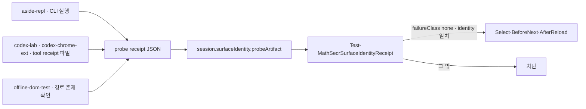

# Phase 3b · surface probe와 문서

보정 2026-10-11. 기준 `main 2a40ce3`(Phase 3a 병합). R1(`docs/research/aside-repl.md`)·R3(`docs/research/codex-browser-surfaces.md`) 결과를 반영했다. 이전 지시서와 다른 점은 끝의 `보정 요약` 절에 있다.

## 시작 조건

Phase 3a가 `main`에 있다. R1·R3 결과가 `main`에 있다. 아래 결정 D5·D6이 Issue #2에서 승인되어 있다. 승인 전에는 시작하지 않는다. probe 명령·identity 필드·진단 문구는 R1·R3가 확인한 값만 쓴다. 미확인 값은 `null` 또는 실패 분기로 둔다.

## 결정

| 번호 | 내용 | 적용값 |
|---|---|---|
| D5 | `codex-chrome-ext`의 `profileOrSessionId` 의미 | BrowserInfo `metadata.extensionInstanceId`. probe receipt에 `identityBasis='extension-instance'`를 같이 적는다. 실제 Chrome profile 디렉터리라고 주장하지 않는다(R3 §5) |
| D6 | Codex surface의 probe 경로 | 독립 PowerShell에서 Codex tool API를 부르는 명령은 미확인이다(R3 §3). probe는 명령을 실행하지 않는다. 세션 안에서 받은 tool 결과를 파일(tool receipt)로 받아 검증한다. 파일이 없으면 `failureClass='install'`로 끝낸다 |

## 목표

surface별 probe를 하나의 스크립트로 받는다. probe 결과를 하나의 receipt 형식으로 쓴다. `offline-dom-test`를 뺀 surface는 session에 probe receipt를 필수로 결합한다. 세션 시작 입력에 surface를 적는다. 문서의 hard stop을 surface 기준으로 바꾼다. Aside 경로의 availability 판정, 고정 응답, 종료 코드는 그대로다.



## 맥락

읽을 파일:

- [Phase 3a 지시서](phase-3.md)와 `docs/evidence/phase-3a.md`. `mathsecr-paper-builder-kit/scripts/surface_contract.ps1:33-78` `Test-MathSecrSurfaceIdentityReceipt`. 선택 필드 `probeArtifact` 검사는 `:63-76`이다.
- `mathsecr-paper-builder-kit/scripts/state_machine.ps1:365-412` `Resolve-MathSecrStateArtifactPath`. `:409`가 확장자를 `.png .jpg .jpeg .webp`로 제한한다. JSON은 지금 통과하지 않는다.
- `mathsecr-paper-builder-kit/scripts/read_contract_json.ps1:115-136` `Get-MathSecrValidationArtifact`. `-Parse`로 JSON을 읽는다.
- `docs/research/aside-repl.md` §2(`listBrowserTabs()` row 필드), §5(identity), §6(종료 진단 미확인), §7. `docs/research/codex-browser-surfaces.md` §3(독립 명령 미확인), §5(BrowserInfo·tab 필드, version 없음, off 진단 미확인).
- `mathsecr-paper-builder-kit/scripts/check_aside_repl.ps1`(`:33` REPL 코드, `:46-84` 실행, `:86` availability, `:88-101` 출력·종료 코드), `aside_preflight.ps1:22-52`(Reason 7종), `test_aside_preflight.ps1`. 이 시험의 fixture `test-fixtures/aside-preflight/*.json`은 비공개다. 공개 clone과 CI에서는 SKIP이다.
- `mathsecr-paper-builder-kit/AGENTS.md:53`, `:56`, `:57`, `:58`, `:106`. `skills/mathsecr-paper-builder/SKILL.md:19`, `:20`, `:160`, `:222`, `:226`. `prompts/start-prompt.md:5`, `:7-9`, `:14`. `prompts/mathsecr_new_paper_prompt.md:23-26`. AGENTS·SKILL에는 `ASIDE_REPL_HARD_STOP` 토큰이 없다. 같은 규칙이 문장(`Aside REPL 실패 차단`, `aside-repl-unavailable block`)으로 있다.
- `mathsecr-paper-builder-kit/scripts/validate_mathsecr_docs.ps1:263-264`, `:416-417`, `:452`, `:785-796`. `:789-791`은 canonical 문장을 뺀 prompt 본문에서 `iab`·`Chrome`·`extension`·`Computer Use` 단어를 거부한다. `codex-iab`·`codex-chrome-ext`도 이 정규식에 걸린다.
- `mathsecr-paper-builder-kit/scripts/test_install_contract.ps1:517-521`, `mathsecr-paper-builder-kit/README.md:114`. canonical 문장 사본이다.
- `mathsecr-paper-builder-kit/docs/production_validation.md:18-26`(probe 호출), `:58-70`(session JSON 예).
- `scripts/test_surface_contract.ps1:109-142`(probeArtifact 사례), `scripts/offline-regression-gates.json:504-516`(public gate 예).
- `docs/incidents.md` 사고 16~21(`:107-142`).

## 작업

### 1. probe 모듈과 스크립트

새 파일 `mathsecr-paper-builder-kit/scripts/surface_probe.ps1`. 함수만 둔다. CLI·브라우저를 부르지 않는다.

| 함수 | 입력 | 출력 |
|---|---|---|
| `ConvertFrom-MathSecrAsideProbeResult` | `-ProbeReceipt -Availability -PaperUrl -CliVersion` | aside-repl probe receipt |
| `ConvertFrom-MathSecrCodexToolReceipt` | `-Surface -ToolReceipt -ToolReceiptArtifact{path,sha256} -PaperUrl` | codex-iab·codex-chrome-ext probe receipt |
| `Get-MathSecrOfflineSurfaceProbe` | `-PlaywrightModule -BrowserPath` | offline-dom-test probe receipt |
| `Test-MathSecrSurfaceProbeReceipt` | `-Receipt` | `{Valid, Errors}` 형식 검사 |

새 스크립트 `mathsecr-paper-builder-kit/scripts/check_browser_surface.ps1 -Surface <name> [-ProbeReceiptPath <json>]`. `-ProbeReceiptPath`는 선택이다. 주면 모든 분기(`off` 포함)에서 작업 2의 probe receipt를 `CreateNew`로 쓴다. 덮어쓰지 않는다. stdout은 surface마다 다르다. `aside-repl`은 지금 stdout을 유지한다. `codex-iab`·`codex-chrome-ext`·`offline-dom-test`는 probe receipt JSON을 stdout에 쓴다.

- `aside-repl`: 인자 `-TimeoutSeconds -HostId -AccountId -RemoteRequested -RemoteRequestEvidence -OutPath -PaperUrl`. `check_aside_repl.ps1:13-84`의 코드를 그대로 옮긴다. 바꾸는 것은 두 가지다. (a) `:33`의 REPL JSON에 `tabs:(await listBrowserTabs()).map(t=>({targetId:t.targetId,url:t.url,title:t.title}))`를 더한다. `kind`·`tabCount`는 그대로다. (b) availability가 `ready`일 때만 `aside --host <HostId> --version`을 한 번 더 실행하고 stdout을 `identity.version`에 적는다. 실패하면 `version=null`이다. 분류는 바뀌지 않는다. `-PaperUrl`을 주면 `tabs`에서 `url`이 Ordinal로 같은 row를 찾는다. 없으면 `failureClass='read'`, `diagnostic='paper-tab-not-listed'`다. `-PaperUrl`이 없으면 `identity.tabId`·`url`은 `null`이다. stdout(`{ProbeReceipt, Availability}`, `check_aside_repl.ps1:87-101`)·`-OutPath` 구조·종료 코드(`ready` 0, `unavailable` 1, `off` 2와 고정 한 줄)는 지금과 같다. 작업 2의 probe receipt는 `-ProbeReceiptPath`에만 쓴다. stdout에는 쓰지 않는다. `aside_preflight.ps1`은 바꾸지 않는다.
- `check_aside_repl.ps1`은 `-Surface aside-repl`을 부르는 래퍼로 남긴다. 인자·종료 코드를 그대로 전달한다. `-ProbeReceiptPath`는 선택이다.
- `codex-iab`·`codex-chrome-ext`: 인자 `-ToolReceiptPath -PaperUrl`(둘 다 필수). 명령을 실행하지 않는다. `-ToolReceiptPath`가 없거나 파일이 없으면 `failureClass='install'`, `diagnostic='standalone-probe-command-unverified; tool receipt required (R3 §3)'`로 끝낸다. 파일은 작업 2의 tool receipt다. 종료 코드는 `none` 0, 그 밖 1이다. 2는 쓰지 않는다. stdout은 probe receipt JSON이다.
- `offline-dom-test`: 인자 `-PlaywrightModule -BrowserPath`. 두 경로가 파일·폴더로 존재하면 `none`이다. 하나라도 없으면 `install`이다. 브라우저를 실행하지 않는다.
- 어떤 분기도 `-Surface` 값을 다른 surface로 바꾸지 않는다. 잘못된 `-Surface`는 `ValidateSet`으로 거부한다.

### 2. receipt 형식

probe receipt(`-ProbeReceiptPath` 파일. codex·offline은 stdout에도 같은 JSON을 쓴다. aside-repl은 파일에만 쓴다):

```json
{
  "schemaVersion": 1,
  "surface": "codex-iab",
  "browserFamily": "codex",
  "probedAtUtc": "2026-10-11T09:00:00.0000000Z",
  "failureClass": "none",
  "browserOff": false,
  "diagnostic": "",
  "source": { "kind": "codex-tool-receipt", "artifact": { "path": ".omo/evidence/current-run/codex-tool-receipt.json", "sha256": "<64 hex>" } },
  "identity": { "identityBasis": "codex-session", "profileOrSessionId": "<codexSessionId>", "tabId": "<tab id>", "url": "https://www.mathsecr.com/mypaper/123", "version": null }
}
```

- `surface`·`browserFamily`는 `surface_contract.ps1:3-6`의 쌍이다.
- `failureClass`는 `none`, `install`, `connect`, `read`, `input` 중 하나다. probe는 `input`을 만들지 않는다. 입력 시험은 R1·R3에 없다. 값은 형식 검사와 음성 시험을 위해 남긴다.
- `browserOff`는 aside-repl에서 `aside_preflight.ps1:36-39`의 기존 문구가 실제로 반환된 경우만 `true`다. R1 §6은 이 문구를 현재 설치본에서 재확인하지 못했다. 그래서 문구를 더하거나 바꾸지 않는다. 다른 surface는 항상 `false`다. R3 §5의 off 진단은 미확인이다. `off`는 `failureClass` 값이 아니다. `browserOff=true`이면 `failureClass='connect'`다.
- `source.kind`는 `aside-cli`, `codex-tool-receipt`, `offline-check` 중 하나다. `source.artifact`는 codex에서 tool receipt 파일의 `{path,sha256}`이다. aside는 `-OutPath`를 쓴 경우 그 파일이다. 없으면 `null`이다.
- `identity.identityBasis`는 `aside-session`, `codex-session`, `extension-instance`, `null` 중 하나다. `version`은 문자열 또는 `null`이다. `null`은 실패가 아니다.

aside-repl 분류(`aside_preflight.ps1` Reason → `failureClass`):

| Reason | failureClass | browserOff |
|---|---|---|
| `repl-reachable` | `none`(paper tab이 있으면) / `read`(없으면) | false |
| `cli-unavailable` | `install` | false |
| `probe-timeout`, `probe-auth-or-transport-failed` | `connect` | false |
| `browser-not-running` | `connect` | true |
| `probe-failed-or-unrecognized`, `invalid-probe-receipt` | `read` | false |

aside-repl identity: `identityBasis='aside-session'`, `profileOrSessionId=null`. probe의 REPL은 제작 REPL과 다른 세션이다. probe가 읽는 `aside.sessions.current().id`는 probe 자신의 ephemeral ID다(R1 §5). 제작 session의 `surfaceIdentity.profileOrSessionId`는 제작 REPL 안에서 에이전트가 같은 host·account 선택과 함께 읽은 값이다. `tabId`는 paper tab row의 `targetId`, `url`은 그 row의 `url`이다.

codex tool receipt(에이전트가 세션 안에서 받은 tool 결과를 그대로 적는 파일):

```json
{
  "schemaVersion": 1,
  "tool": "mcp__cua_repl",
  "capturedAtUtc": "2026-10-11T09:00:00.0000000Z",
  "surface": "codex-chrome-ext",
  "browser": { "id": "<BrowserInfo id>", "type": "extension", "family": "chrome", "name": "Chrome", "metadata": { "extensionInstanceId": "<id>" } },
  "tab": { "id": "<tab id>", "providerTabId": "<optional>", "url": "https://www.mathsecr.com/mypaper/123", "title": "<tab.title()>" }
}
```

`browser`는 `cua.getState().browsers[]`의 해당 항목을 복사한다. `tab.id`는 `cua.listTabs()` 또는 `getState().browsers[].tabs[]`의 `id`다. `tab.url`·`tab.title`은 `tab.url()`·`tab.title()`의 값이다(R3 §3·§5). R3가 확인하지 않은 필드(`profileName`, version, 기본 timeout)는 요구하지 않는다.

codex 분류(위에서 아래로 검사한다. 처음 맞는 행이 결과다):

| 조건 | failureClass |
|---|---|
| tool receipt 없음 | `install` |
| 파일이 JSON이 아니거나 `schemaVersion`·`tool`·`surface`·`browser`·`tab`이 없음, `surface`가 `-Surface`와 다름 | `read` |
| `codex-iab`인데 `browser.type -cne 'iab'`; `codex-chrome-ext`인데 `type -cne 'extension'` 또는 `family -cne 'chrome'` | `connect` |
| `codex-iab`에 `metadata.codexSessionId` 없음; `codex-chrome-ext`에 `metadata.extensionInstanceId` 없음 | `read` |
| `tab.id` 없음 또는 `tab.url`이 `-PaperUrl`과 Ordinal로 다름 | `read` |
| 모두 통과 | `none` |

`identity.profileOrSessionId`는 codex-iab이 `codexSessionId`(`identityBasis='codex-session'`), codex-chrome-ext가 `extensionInstanceId`(`identityBasis='extension-instance'`, D5)다. `tabId=tab.id`, `url=tab.url`, `version=null`이다. IAB와 MCP Apps는 같은 `codexSessionId`를 가질 수 있다(R3 §5). session ID만으로 surface를 판정하지 않는다. `browser.type`·`family` 검사가 먼저다.

### 3. session 검증

- `Resolve-MathSecrStateArtifactPath`(`state_machine.ps1:365`)에 선택 인자 `[string[]]$AllowedExtensions`를 더한다. 기본값은 지금 목록이다. 기존 호출은 바꾸지 않는다. 함수 이름·반환은 그대로다. SOURCE_SNAPSHOT 갱신 규칙은 완료 조건의 `export 목록`을 따른다.
- `Test-MathSecrSurfaceIdentityReceipt`(`surface_contract.ps1:63-76`)를 바꾼다. 반환 `{Valid, Surface, Errors}`는 그대로다.
  - `surface`가 `offline-dom-test`가 아니면 `probeArtifact{path,sha256}`가 필수다. 없으면 `surface-probe-required`.
  - 경로는 `Resolve-MathSecrStateArtifactPath $ProjectRoot $path -AllowedExtensions @('.json')`로 푼다. 내용은 `Get-MathSecrValidationArtifact -Path -ExpectedSha256 -Context -Parse`로 읽는다. 풀리지 않거나 해시가 다르면 지금처럼 `surface-identity-invalid`.
  - 읽은 JSON을 `Test-MathSecrSurfaceProbeReceipt`로 검사한다. 형식이 틀리면 `surface-identity-invalid`.
  - probe의 `surface`·`browserFamily`가 identity receipt와 다르면 `surface-mismatch`.
  - `failureClass`가 `none`이 아니면 `surface-probe-failed:<failureClass>`.
  - probe `identity.tabId`·`url`이 identity receipt의 `tabId`·`url`과 Ordinal로 다르면 `surface-probe-identity-mismatch`. probe `identity.profileOrSessionId`가 `null`이 아닐 때만 같은 비교를 한다. `null`이면 비교하지 않는다.
  - `offline-dom-test`는 `probeArtifact`가 선택이다. 있으면 같은 검사를 한다.
- `Get-MathSecrSessionSurface`는 바꾸지 않는다. 기본 session(선언 없음)은 지금처럼 `aside-repl`이며 probe를 요구하지 않는다. Phase 0 대비 동일성 24개는 그대로여야 한다.
- `snapshot.asideRepl`·`surfaceState`의 boolean 검사(`state_machine.ps1:1554-1599`)는 바꾸지 않는다.

### 4. 문서와 marker

정책 문장은 아래 목록만 바꾼다. 다른 문장은 그대로 둔다.

1. canonical 문장. `prompts/start-prompt.md:7`, `prompts/mathsecr_new_paper_prompt.md:24`의 `ASIDE_REPL_HARD_STOP: ...` 한 줄을 다음 한 줄로 바꾼다. 글자 그대로 쓴다.

   ```text
   SURFACE_HARD_STOP: Stay on the surface declared by the session input. If that surface is unavailable or cannot attach to and verify the live paper, report `차단`. Do not switch that session to any other browser surface.
   ```

2. 세션 입력. `prompts/start-prompt.md:14` `Paper URL:` 앞에 `Surface: <aside-repl|codex-iab|codex-chrome-ext; blank = aside-repl>` 한 줄을 더한다.
3. surface 우선 문장. `start-prompt.md:5`의 첫 문장 `Use Aside REPL first for live MathSecr work.`를 `Use the surface declared by the session input for live MathSecr work. On aside-repl,`로 바꾼다. 나머지 문장은 그대로 잇는다. `mathsecr_new_paper_prompt.md:23`의 첫 문장도 같은 뜻의 한국어로 바꾼다: `live MathSecr 조작은 세션 입력의 surface로 한다. surface가 aside-repl이면 열린 탭을 먼저 조회하고 ...`.
4. AGENTS. `AGENTS.md:57`을 `- <!-- SURFACE_HARD_STOP --> surface 실패 차단: 세션 입력의 surface 밖으로 자동 전환하지 않는다. 그 surface가 unavailable/crash 상태이거나 live paper에 attach하여 URL/title/login을 확인하지 못하면 그 세션은 `차단`으로 보고한다.`로 바꾼다. `:53`의 `Aside REPL로 한다`를 `세션 입력의 surface로 한다`로 바꾼다. `:56` 앞에 `surface가 `aside-repl`이면 ` 을 붙인다. `:106`과 SKILL `:222`, `start-prompt.md:9`, `mathsecr_new_paper_prompt.md:26`의 `check_aside_repl.ps1`을 `check_browser_surface.ps1 -Surface <surface>`로 바꾼다.
5. SKILL. `SKILL.md:19`를 `- <!-- SURFACE_HARD_STOP --> surface-unavailable block: 세션 입력의 surface가 unavailable, crash, live paper 미검증 상태이면 즉시 `차단`으로 보고한다. 같은 세션에서 다른 browser surface로 전환하지 않는다.`로 바꾼다. `:160`의 `Aside REPL을 우선 사용한다.`를 `surface가 aside-repl이면 Aside REPL을 쓴다.`로 바꾼다.
6. `ASIDE_OFF_USER_RESPONSE`. `AGENTS.md:58`, `SKILL.md:20`, `start-prompt.md:8`, `mathsecr_new_paper_prompt.md:25`를 유지한다. 각 줄 끝에 `이 예외는 surface가 aside-repl인 세션에만 적용한다.`(prompt 영문 줄은 `This exception applies only to aside-repl sessions.`)를 더한다. marker `<!-- ASIDE_OFF_USER_RESPONSE -->`와 `aside 키고 다시 오도록.`은 그대로다.
7. `docs/production_validation.md:18-26`의 probe 호출 예를 `check_browser_surface.ps1 -Surface aside-repl -PaperUrl <paper url> -HostId local -AccountId u0 -ProbeReceiptPath '.omo/evidence/current-run/surface-probe.json'`로 바꾼다. codex 예 한 줄을 더한다. `:58-70` session JSON 예에 `surfaceIdentity`(3a 필드 7개)와 `probeArtifact{path,sha256}`를 더한다. 기존 `surface:"aside-repl"` 예(`:84`, `:124`, `:135`, `:141`)는 그대로다.
8. validator. `validate_mathsecr_docs.ps1`에서:
   - `:263` `"Aside REPL 실패 차단"` → `Assert-ContainsOnce ... "<!-- SURFACE_HARD_STOP -->"`와 `Assert-Contains ... "surface 실패 차단"`.
   - `:416` `"aside-repl-unavailable block"` → `Assert-ContainsOnce ... "<!-- SURFACE_HARD_STOP -->"`와 `Assert-Contains ... "surface-unavailable block"`.
   - `:796` canonical 문자열을 작업 4-1의 새 문장으로 바꾼다.
   - `:789-791` 정규식 검사 전에 canonical 문장과 함께 `(?m)^Surface:.*$` 줄도 본문에서 뺀다. 정규식 자체는 바꾸지 않는다. `:864-886`의 합성 자기검사 2건은 새 canonical 문장으로 유지한다. 함수 이름은 바꾸지 않는다. 자기검사 1건을 더한다: `Surface:` 줄 밖에서 `switch to codex-iab`를 쓴 합성 prompt는 거부되어야 한다.
   - 정책 문서 4종(root AGENTS, kit AGENTS, kit SKILL, installed SKILL)과 prompt 2종에 `ASIDE_REPL_HARD_STOP`, `Aside REPL 실패 차단`, `aside-repl-unavailable block`이 남아 있으면 거부한다.
   - `:452` 목록에 `scripts/surface_probe.ps1`, `scripts/check_browser_surface.ps1`를 더한다. 기존 항목은 유지한다.
9. 사본. `test_install_contract.ps1:518`의 canonical 문자열을 새 문장으로 바꾼다. 오류 문구의 `non-Aside-REPL fallback`은 `off-surface fallback`으로 바꾼다. `README.md:114`의 `ASIDE_REPL_HARD_STOP`을 `SURFACE_HARD_STOP`으로, `non-Aside-REPL live-browser fallback`을 `off-surface live-browser fallback`으로 바꾼다.

바꾸지 않는 것: 내부 보고서 템플릿(`AGENTS.md:214-216`, `:265`)의 `비-Aside REPL` 필드, state 이름 `ASIDE_REPL_READY`, `asideRepl.nonAsideReplLiveManipulation`. 모두 Phase 4다.

### 5. 시험

1. 새 파일 `scripts/test_browser_surface_probe.ps1`. 공개 gate다. OS 임시 폴더의 합성 파일만 쓴다. `aside` CLI·브라우저·네트워크를 쓰지 않는다. 마지막 줄 `SurfaceProbe PASS`. `scripts/offline-regression-gates.json`에 `SurfaceProbe` gate(`grade='public'`, `passPattern='SurfaceProbe PASS'`)를 더한다. 사례:
   - aside: 작업 2 표의 Reason 7종 각각 → 기대 `failureClass`·`browserOff`. `tabs`에 paper URL row가 있음 → `none`과 `identity.tabId=targetId`. 없음 → `read`. `-PaperUrl` 없음 → `identity.tabId=null`. `test_aside_preflight.ps1`의 합성 receipt 생성 방식을 따른다. 비공개 fixture는 읽지 않는다.
   - codex: 작업 2 표의 조건 6종. 표 순서대로 판정한다. 교차 사례 2건을 둔다. (a) `surface='codex-iab'`인 receipt를 `-Surface codex-chrome-ext`로 검사 → `read`(표 2행). (b) `surface='codex-chrome-ext'`이고 `browser.type='iab'`인 receipt를 `-Surface codex-chrome-ext`로 검사 → `connect`(표 3행). `identityBasis`·`profileOrSessionId`가 surface별 값과 같은지 확인한다.
   - offline: 두 경로 존재 → `none`. 모듈 없음 → `install`. 브라우저 없음 → `install`.
   - `Test-MathSecrSurfaceProbeReceipt`: `failureClass` 5종 허용. `off`·빈 문자열·`null` 거부. 미지원 surface 거부. `browserFamily` 쌍 불일치 거부. aside가 아닌 surface의 `browserOff=true` 거부. `version=null` 허용. `probedAtUtc` 형식은 3a identity의 `observedAtUtc` 규칙과 같다.
   - 스크립트 smoke: `check_browser_surface.ps1 -Surface aside-repl -ProbeReceiptPath <temp>`를 `aside`가 PATH에 없는 상태로 실행한다. 종료 코드 1, receipt `failureClass='install'`. 같은 경로로 두 번째 실행 → `CreateNew` 거부. `-Surface codex-iab`를 `-ToolReceiptPath` 없이 실행 → 종료 코드 1, `install`.
2. `scripts/test_surface_contract.ps1`. 양성 12개의 live surface 9개 session에 작업 2의 probe receipt JSON과 `probeArtifact`를 더한다. `:127-142`의 선택 probe 양성 사례 1건은 PNG 대신 JSON receipt를 쓴다. 이 대체는 지시서가 허용한다. 해시 변조·경로 이탈 음성 2건은 유지한다. 음성을 더한다: `codex-iab`에 `probeArtifact` 없음 → `surface-probe-required`. `failureClass` 4종(`install connect read input`) 각각 → `surface-probe-failed:<class>`. probe `surface=aside-repl`을 `codex-iab` identity에 결합 → `surface-mismatch`. `tabId` 불일치 → `surface-probe-identity-mismatch`. `offline-dom-test`에 probe 없음 → Valid. 기존 음성 9개는 그대로다.
3. `test_aside_preflight.ps1`은 바꾸지 않는다. `test_validation_context.ps1`, `test_assemble_pipeline.ps1`의 기존 단정은 그대로다.

## 제약

- R1·R3에 없는 명령·필드·진단 문구를 쓰지 않는다. 미확인 값은 `null`이거나 `install`·`read` 분기다. `getTabs()`, timeout setter, raw CDP, `codex browser ...` 같은 명령을 쓰지 않는다.
- 실제 브라우저·실제 수학비서에 접속하는 테스트를 만들지 않는다.
- `aside_preflight.ps1`을 바꾸지 않는다. Reason 문자열, 종료 문구, 고정 응답을 바꾸지 않는다.
- 정책 문장은 작업 4의 목록만 바꾼다.
- 기존 함수 이름·시그니처·반환 구조를 유지한다. 인자 추가는 선택 인자와 기본값으로만 한다. 기존 테스트 단정을 지우거나 약화하지 않는다. 예외는 작업 5-2의 PNG probe 양성 사례 1건이다.
- 새 파일 확장자는 `.ps1 .md .json`이다. 개인 자료·실제 ID·실제 URL을 커밋하지 않는다. 예시 URL은 `/mypaper/123`이다.

## 완료 조건

공개(로컬·CI):

```powershell
python ./scripts/validate_publication.py
pwsh -NoProfile -ExecutionPolicy Bypass -File ./scripts/run_public_checks.ps1
pwsh -NoProfile -ExecutionPolicy Bypass -File ./scripts/run_offline_regression.ps1 -PlaywrightModule <module> -BrowserPath <browser>
pwsh -NoProfile -ExecutionPolicy Bypass -File ./scripts/test_surface_contract.ps1
pwsh -NoProfile -ExecutionPolicy Bypass -File ./scripts/test_browser_surface_probe.ps1
```

- 공개 gate 15개 PASS(`SurfaceProbe` 추가). 동일성 24개 PASS. CI 녹색.
- `validate_publication.py` PASS. `scripts/validate_publication.py:59-65`가 SOURCE_SNAPSHOT의 `exportSha256`과 `transformation`을 검사한다.
- export 목록. 작업 1~4가 바꾸는 기존 파일은 아래 10개다. 모두 SOURCE_SNAPSHOT에 있다. 10개 모두 `exportSha256`을 새 해시로 바꾼다. `sourceSha256`은 유지한다. `transformation`에 `Phase 3b: <한 줄 요약>`을 더한다. 이미 문구가 있으면 뒤에 잇는다. 없으면 새로 쓴다. 비어 있으면 `undeclared transformation`으로 FAIL한다. SOURCE_SNAPSHOT에 있는 기존 파일 중 바뀌는 것은 이 10개뿐이다. SOURCE_SNAPSHOT에 없는 파일은 해시 검사 대상이 아니다: `surface_contract.ps1`(작업 3), `scripts/test_surface_contract.ps1`·`scripts/offline-regression-gates.json`(작업 5), 새 파일 3개(`surface_probe.ps1`, `check_browser_surface.ps1`, `scripts/test_browser_surface_probe.ps1`). 새 파일은 SOURCE_SNAPSHOT에 넣지 않는다.

| # | 파일(`mathsecr-paper-builder-kit/` 아래) | 작업 |
|---|---|---|
| 1 | `scripts/state_machine.ps1` | 3 |
| 2 | `scripts/check_aside_repl.ps1` | 1 |
| 3 | `prompts/start-prompt.md` | 4-1·2·3·4·6 |
| 4 | `prompts/mathsecr_new_paper_prompt.md` | 4-1·3·4·6 |
| 5 | `AGENTS.md` | 4-4·6 |
| 6 | `skills/mathsecr-paper-builder/SKILL.md` | 4-4·5·6 |
| 7 | `docs/production_validation.md` | 4-7 |
| 8 | `scripts/validate_mathsecr_docs.ps1` | 4-8 |
| 9 | `scripts/test_install_contract.ps1` | 4-9 |
| 10 | `README.md` | 4-9 |

비공개(사용자가 로컬에서 실행하고 결과를 Issue #2에 남긴다. PR 본문에 이 사실을 쓴다):

```powershell
pwsh -NoProfile -ExecutionPolicy Bypass -File ./mathsecr-paper-builder-kit/scripts/test_aside_preflight.ps1
pwsh -NoProfile -ExecutionPolicy Bypass -File ./mathsecr-paper-builder-kit/scripts/validate_mathsecr_docs.ps1 -Scenario All
pwsh -NoProfile -ExecutionPolicy Bypass -File ./mathsecr-paper-builder-kit/scripts/test_install_contract.ps1
```

- `test_aside_preflight.ps1` PASS. 공개 clone에서는 fixture가 없어 SKIP이다.
- `validate_mathsecr_docs.ps1 -Scenario All` PASS. 공식 installer `-Force`로 root AGENTS 미러와 Codex home SKILL을 동기화한 뒤 실행한다. `SyncContract` PASS.
- 실제 `aside-repl` probe 1회: `check_browser_surface.ps1 -Surface aside-repl -PaperUrl <사용자 문제지> -ProbeReceiptPath <temp>`. 기대는 `failureClass='none'`, `identity.tabId`에 `targetId`, `identity.version`에 CLI 버전이다. 결과는 URL·ID를 뺀 요약만 적는다.

## PR

브랜치 `codex/phase-3b`. 제목 `Phase 3b: surface probe와 문서`. 추론 노력 `high`. PR 본문에 쓴다: 새 거부 토큰 3개(`surface-probe-required`, `surface-probe-failed:<class>`, `surface-probe-identity-mismatch`), 양성·음성 사례 수, 바뀐 export, SKIP한 비공개 gate 목록, D5·D6 적용 여부, Phase 4로 남긴 항목. 모호하면 구현 전에 Issue #2에 질문한다.

## 보정 요약

| 항목 | 이전 지시서 | 보정 | 근거 |
|---|---|---|---|
| codex probe | "R1·R3가 확인한 명령만 쓴다" | 독립 명령이 없다. tool receipt 파일을 받아 검증한다(D6) | R3 §3 |
| `off` 판정 | "문구는 R1·R3 결과에서 가져온다" | R1·R3 모두 off 문구 미확인. 기존 문구만 유지. `browserOff` boolean으로 분리 | R1 §6, R3 §5 |
| chrome-ext identity | 미정 | `extensionInstanceId` + `identityBasis`(D5) | R3 §5 |
| aside `profileOrSessionId` | probe가 채움 | probe는 `null`. 제작 REPL의 session ID는 에이전트가 3a identity에 적는다 | R1 §5 |
| `version` | 필수 문자열 | codex·offline은 `null` 허용 | R3 §5 |
| probeArtifact JSON | "artifact는 receipt JSON" | 현재 resolver가 JSON을 거부. `-AllowedExtensions` 선택 인자 추가 | `state_machine.ps1:409` |
| identity 대조 | 없음 | probe와 session identity의 `tabId`·`url` Ordinal 대조 | 사고 19 |
| AGENTS·SKILL marker | `ASIDE_REPL_HARD_STOP` 치환 | 토큰이 없다. 문장 2곳을 바꾸고 `<!-- SURFACE_HARD_STOP -->` marker를 둔다 | `AGENTS.md:57`, `SKILL.md:19` |
| validator 정규식 | marker 이름만 | `Surface:` 줄 제외. 사본 2곳(`test_install_contract.ps1`, `README.md`) 추가 | `validate_mathsecr_docs.ps1:789-791` |
| 완료 조건 | `test_aside_preflight.ps1` 공개 실행 | 비공개 fixture. 사용자 로컬 실행 | `offline-regression-gates.json` AsidePreflight |
| 시험 파일 | 미지정 | `test_browser_surface_probe.ps1` 공개 gate 추가 | 공통 제약 |

## 검토 반영(Issue #2 질문 1~3, 2026-10-11)

| 질문 | 판정 | 바뀐 곳 |
|---|---|---|
| 1. 바뀐 export 수 | 10개. `state_machine.ps1` 하나가 아니다 | 완료 조건 `export 목록` 표. 작업 3의 export 문장 |
| 2. iab receipt를 chrome-ext로 검사 | 표는 순서대로 판정한다. `surface` 불일치는 `read`, `browser.type` 불일치는 `connect`. 시험은 두 사례로 나눈다 | 작업 2 codex 분류 표 머리말. 작업 5-1 codex 사례 |
| 3. aside stdout | 기존 stdout 유지. probe receipt는 `-ProbeReceiptPath` 파일에만 쓴다. codex·offline만 stdout에도 쓴다 | 작업 1 스크립트 문단·aside 항목. 작업 2 머리말 |
