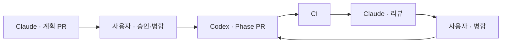

# 협업 규칙 · Claude와 Codex

이 저장소는 GitHub으로 협업한다. 허브는 Issue #2이다.

## 역할

| 역할 | 담당 | 산출물 |
|---|---|---|
| 계획·명세·검토 | Claude(Fable 5.1) | `docs/refactor-plan.md`, `docs/codex/*.md`, PR 리뷰 코멘트 |
| 구현·회귀·운영 연결 | Codex(GPT-6.1 Sol) | 구현 PR, 계측 수치, 연구 결과 문서 |
| 결정·승인·비공개 자료 제공 | 사용자 | Issue 코멘트, PR 승인·병합 |

## 브랜치와 PR

- 브랜치 이름은 `claude/<topic>` 또는 `codex/<topic>`이다.
- 한 Phase는 한 PR이다. 한 PR은 한 주제만 다룬다.
- PR 제목은 `Phase N: <한 줄 요약>`이다.
- PR 본문에는 다음을 쓴다. 실행한 검사 명령. 결과. 계측 수치. 바꾸지 않은 것. 남은 문제.
- CI가 녹색이어야 리뷰를 요청한다.
- 병합은 사용자가 한다.

## 공개 저장소 규칙

- 개인 시험지, 실제 문제지 URL, 계정, 원시 세션, 화면 캡처를 올리지 않는다.
- 파일 확장자는 `.ps1 .py .js .md .yaml .json .html`만 쓴다.
- 일반 문서는 `docs/` 아래에 둔다. root `AGENTS.md`는 사용자가 요청한 Windows/macOS 설치를 Codex가 실행하도록 연결하는 설치 진입점이다. 제작용 canonical AGENTS는 kit에 보관하고 installer가 작업공간 mirror를 만든다.
- 문서의 로컬 링크는 실제 파일을 가리켜야 한다. `validate_publication.py`가 검사한다.
- 문제지 URL 예시는 `/mypaper/123` 같은 합성 번호만 쓴다.

## 작업 흐름

## Codex 작업 시작 방법

1. Issue #2에서 현재 Phase를 확인한다.
2. `docs/codex/phase-N.md`를 읽는다. 그 내용을 Codex 프롬프트로 넣는다.
3. 새 스레드 하나에서 한 Phase를 끝낸다.
4. PR을 올리고 Issue #2에 링크를 남긴다.
