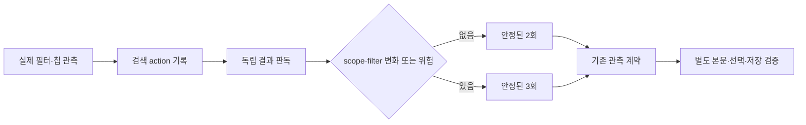

# 활성 필터 수집기 보완 · 2026-10-12

이번 패치는 활성 필터가 검색 서명에서 빠지는 공백을 줄인다. 전체 제작의 속도 개선을 입증한 패치는 아니다. 공개 저장소의 `dc3b19c` 기준선에 적용했다. 테스트가 사용하는 원래 kit와 설치 SKILL은 변경하지 않는다.

## 채택한 변경

기존 `filterChips`는 단일 DOM descriptor 또는 `null`을 받았다. 새 수집기는 descriptor 배열도 받는다. 각 그룹을 `[key, [실제로 읽은 값...]]`의 JSON 문자열로 기록한다. 반환 packet의 `criteria.filterChips: string[]` 형식은 유지한다.

```javascript
filterChips: [
  { key: "subject", selector: observedSubjectSelector, read: "text" },
  { key: "query-polarity", selector: observedQuerySelector,
    read: "attribute", attribute: observedPolarityAttribute },
  { key: "panel", selector: observedPanelSelector,
    read: "attribute", attribute: observedPanelAttribute,
    minCount: 1, maxCount: 1 }
]
```

위 변수는 현재 관측한 selector와 attribute로 바꿔야 한다. 공개 합성 adapter를 실제 화면의 map으로 재사용하지 않는다.

수집기는 다음을 확인한다.

- 그룹 key는 비어 있지 않고 중복되지 않는다.
- `minCount`와 `maxCount`는 실제 visible match 수의 허용 범위다.
- 숨은 template는 읽지 않는다. 그룹 안의 값은 DOM 순서를 유지한다.
- 누락된 attribute, 빈 값, 객체 값, 무한대는 거부한다.
- 실제 JSON attribute에서 읽은 숫자와 Boolean은 형식을 보존한다.
- 단일 descriptor와 `null`의 기존 동작은 유지한다.

누락된 필터를 자동 발견하는 기능은 없다. optional 그룹의 빈 배열은 현재 selector에 visible match가 없다는 뜻이다. 패널이 없어졌거나 selector가 틀린 상태와 같은 뜻으로 쓰면 안 된다. 실제 패널·필터 제어의 존재를 확인하는 singleton anchor와 control-map 검토가 필요하다. anchor key의 이름만으로 존재를 증명하지 않는다.

## 유지한 검증



결과 수만 같은 것으로는 부족하다. 전체 visible ID 순서와 기준도 맞아야 한다. filter 변화가 있으면 전환 전 baseline을 남긴다. zero 결과, count/card 불일치, scope/filter 변화는 기존 3회 요구를 유지한다. capture/action 재사용, stale marker, loading, 제출 후 기준 변화는 계속 거부한다.

Search, Body, Select, BeforeNext, AfterReload의 판정 코드는 완화하지 않았다. 이 변경은 본문 exact, backend 완료, 전체 lazy coverage를 대신 증명하지 않는다.

## 검사 연결

새 합성 수집기 39검사, 필터 계약 36검사, 공식 JSON reader의 ISO 문자열 3검사, 기존 관측 계약 130검사와 restricted-DOM VM 검사를 실행했다. 실제 브라우저를 쓰지 않는 검사다. 공개 실행 진입점은 다음과 같다.

```powershell
pwsh -NoProfile -ExecutionPolicy Bypass -File ./scripts/run_public_checks.ps1
```

완전한 비공개 bundle이 있는 별도 검증 환경에서는 다음 명령을 쓴다.

```powershell
Set-Location <isolated-workspace>
pwsh -NoProfile -ExecutionPolicy Bypass -File ./mathsecr-paper-builder-kit/scripts/run_validations.ps1 `
  -ProjectRoot (Get-Location).Path -CodexHome <isolated-codex-home> -NoBrowser
```

`-NoBrowser`는 실제 브라우저 collector 통합 검사를 실행하지 않는다. 기존 관측 계약과 restricted-DOM 검사, 새 필터 검사는 계속 필수다. 기본 실행에서 이 switch를 빼면 기존 브라우저 collector 검사도 계속 필수다. 실제 브라우저를 실행하지 않은 결과를 브라우저 통합 PASS로 표시하지 않는다. 공개 clone에는 일부 비공개 regression 자료가 없어 이 전체 명령의 자체 실행을 보장하지 않는다.

회귀 명령의 작업 폴더도 ProjectRoot와 같게 둔다. 첫 격리 실행에서는 이 위치가 달라 보고 검사 일부가 동적으로 만든 receipt를 다른 폴더에서 찾았다. 해당 실패를 보존하고 실행 위치를 맞춰 다시 검사했다. 판정 코드를 바꾸거나 누락을 허용하지 않았다.

검사 결과와 해시는 [collector-patch-checks.json](evidence/collector-patch-checks.json)에 기록한다. 원시 회귀 로그와 개인 자료는 로컬에 보존한다.

## 조립 오류의 처리

테스트 담당은 두 가지 조립 오류를 발견해 복구했다. 실행하지 않은 idle blank probe를 실행한 read-only 관측처럼 기록한 것과, PowerShell JSON 왕복이 ISO 문자열의 끝 0을 없앤 것이다. 이 문제 때문에 validator의 기준을 약화하지 않는다.

resolver의 실제 direct output을 상태에 사용한다. 시각 문자열은 기존 공식 reader를 사용해 보존한다.

빈 출처와 특정 작업공간은 검증된 `전체 DB`의 별칭이 아니다. 실제 범위·선택·제거 근거를 확인해야 한다. B군의 출처 조사가 끝났다고 주장하지 않는다.

```powershell
. ./mathsecr-paper-builder-kit/scripts/read_contract_json.ps1
$packet = ConvertFrom-MathSecrContractJson ([IO.File]::ReadAllText($packetPath))
```

`.000Z`, `.160Z`, `.590Z`를 reader로 왕복한 뒤 같은 문자열이 유지되는 합성 검사를 추가했다. 이는 테스트 담당의 실제 cold 조립을 다시 수행했다는 뜻이 아니다.

## 이번에 채택하지 않은 후보

| 후보 | 현재 근거 | 상태 |
|---|---|---|
| persistent PowerShell wrapper | 지역 실행 48쌍과 경계·동등성 검사. v2에는 freeze 검사 비용도 있음 | 운영 반영 보류. 전체 효과 미확정 |
| 4페이지 PDF 준비의 worker 병렬화 | 지역 1·2·4 worker 시간과 crop/hash 재현 | 새 cold 전체 효과 미확정 |
| scale 3에서 2로 낮추기 | 블라인드 12쌍 판독. prime 표본 없음 | 일반 해상도 규칙으로 미채택 |
| 전체 패널 snapshot 축소 | 소수 쌍의 혼합 결과 | 미채택 |
| CLI one-shot와 MCP persistent 비교 | 비대칭 쌍과 탭 소실·복구 | 원인 미확정, 미채택 |
| first-submit prototype | 최초 안내 상태와 독립 postread 연구 | 결과 표시 옵션 바인딩 공백. production에 미반영 |

수집기 lab 전체 파일에는 이번 필터 패치 외의 `stripPrefix`·`emptyResult` 차이도 있었다. 전체 파일을 그대로 복사하지 않았다. `result:null` 최초 안내 상태의 연구 경로도 운영 패치에 넣지 않았다.

## 실험의 현재 범위

테스트 담당은 알려진 1문항에서 완전한 활성 필터 map으로 PrepareEvidence, Select, BeforeNext, AfterReload와 재로드 순서를 확인했다. 이후 A군 새 15문항의 단계 검증과 재로드 순서 일치도 전달했다. 이는 그 테스트 환경의 결과다. 이번 공개 패치에서 해당 브라우저나 새 cold 로그를 다시 조작·검토하지 않았다.

A군에는 용량·연결 중단이 있었다. B군은 진행 중이다. 전체 30문항 비교, 최소 2시간 실행, 70가설 검증, 새 120문항 확인, 전체 속도 15% 개선, 동일 정확도, external-body-exact를 완료 또는 입증했다고 주장하지 않는다.

공개본과 운영 kit는 다른 checkout이다. 원래 55개 동결 파일과 설치 SKILL은 테스트 종료까지 보존한다. 운영 원본의 최신 검색 전략을 이번 패치에 섞어 이식하지 않았다. 원래 프로젝트와 설치본의 동기화는 실험 종료 확인 후 별도 조정한다.

종료 후 승격할 때는 운영 kit의 최신 검색 규칙을 보존한 채 필터 delta와 필요한 테스트 연결만 합친다. 이 공개 기준선의 오래된 SKILL·검색 코드를 운영 원본 전체에 덮어쓰는 동기화는 적용하지 않는다.


## 최신 원격 변경과 통합

원격 main의 `0da38ce` 위에 이 필터 delta를 다시 적용했다. 문서 충돌 두 곳은 양쪽 내용을 모두 보존했다. 통합 후 공개 검사에서 150개 파일, 75개 snapshot 파일, 132개 문서 링크와 필터·기존 관측 검사가 PASS했다. 실제 브라우저 통합 검사는 실행하지 않았다. 위 31개 gate의 격리 회귀는 이전 기준선에서 실행한 결과이며, 최신 원격 구현 전체를 다시 검사한 결과로 바꾸지 않는다.
