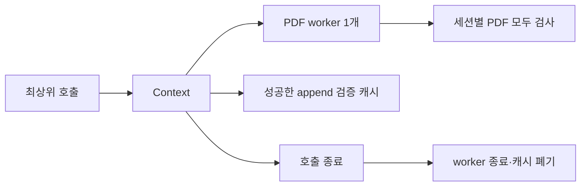

# Phase 1b · PDF 검증 프로세스 통합과 append 재검사 공유

최상위 AfterReload 호출 안에서 PDF 검증 프로세스 1개와 성공한 append receipt 검증 결과를 공유한다. H=6 중앙값은 1.848초로 목표 2.2초를 달성했다. 모든 PDF를 검사하며 호출이 끝나면 worker와 캐시를 정리한다.

## 측정 결과

N=15, H=1/2/6, 각 3회 중앙값이다. H는 과거 저장 세션 수다. [Phase 1 원시 값](perf-phase1.json)을 보존했고 새 값은 [perf-phase1b.json](perf-phase1b.json)에 저장했다.

| H | Phase 1 초 | Phase 1b 초 | StateMachine | pdfValidatorStarts | pdfChecks | appendReceiptValidations |
|---:|---:|---:|---:|---:|---:|---:|
| 1 | 0.930 | 0.982 | 2 | 1 | 1 | 1 |
| 2 | 1.177 | 1.066 | 3 | 1 | 2 | 2 |
| 6 | 2.857 | 1.848 | 7 | 1 | 6 | 6 |

H=6은 Phase 1보다 35.3% 짧다. 3회 값은 1847.5012, 1930.8727, 1845.1257ms다. H=1 중앙값은 약 52ms 늘었다. 프로세스 수가 원래도 1개인 짧은 이력에서는 개선을 주장하지 않는다.

모든 반복에서 `pdfValidatorOneShots=0`, `appendReceiptCalls=2H`, `appendReceiptValidations=H`, `appendReceiptReuses=H`다. Phase 1의 파일 읽기·검증 횟수도 유지한다.

| H | 해시 합계 | JSON parse | artifactCount | maxHashCallsPerPath |
|---:|---:|---:|---:|---:|
| 1 | 42 | 12 | 46 | 1 |
| 2 | 52 | 22 | 58 | 1 |
| 6 | 92 | 62 | 106 | 1 |

각 계측은 모듈과 helper를 준비한 뒤 proxy를 포함한 AfterReload를 실행한다. worker 시작·PDF 검사·worker 종료는 시간에 포함한다. fixture 생성·삭제와 최초 C# helper 컴파일은 준비 단계에 포함하므로 측정에서 제외한다. 공개 합성 입력의 결과이며 실제 제작에서 한 번 관측한 113.83초와 직접 비교하지 않는다.

## 변경과 호환성



`report_contract.ps1`은 같은 Python 검증 함수를 한 번 실행 방식과 JSONL serve 방식에서 사용한다. `strict=True`, marker 정규식, 검증 오류 문장은 유지한다. 요청마다 stdout·stderr를 같은 새 버퍼에 모으므로 pypdf 경고도 응답 전체에 포함된다. 오류는 전체 `message.Trim()`을 사용하고 비어 있을 때만 종료 코드 문장으로 대체한다. 조기 종료도 stderr를 먼저 사용한다. 한글 경로와 진단은 UTF-8로 전달한다.

`read_contract_json.ps1`은 일반 자원 등록과 역순 정리를 제공한다. 한 disposer가 실패해도 나머지를 실행하고 원래 검증 오류를 유지한다. worker는 stdin을 닫고 5초까지 기다린 뒤 필요하면 종료한다. 요청 읽기 제한은 120초다. 같은 Context에서 죽은 worker를 자동 재시작하지 않는다. Context가 없거나 비활성이면 원래 한 번 실행 방식을 사용한다.

`production_validation.ps1`은 summary lint와 PDF 검사까지 Context를 전달한다. 독립 typed summary 호출은 기존 방식으로 실행한다.

`state_machine.ps1`은 기존 append 검증 본문을 유지하며 성공 결과만 공유한다. snapshot 참조, ProjectRoot, Depth, 순서가 있는 기대 ID·key, snapshot JSON의 SHA-256이 모두 같아야 재사용한다. 기대 목록은 `[string[]]`로 복사한다. 내용이 바뀌면 이전 항목을 제거하며 거부 결과는 저장하지 않는다. 계약 버전은 `2026-10-11.2`다.

JSON 직렬화는 정수와 enum, 문자열과 char를 구분하지 못한다. 따라서 전체 CLR 형식 목록도 캐시 조건에 넣었다. C# helper는 이 목록을 만들며 검증 결과나 Context를 전역에 저장하지 않는다. 지원하지 않는 객체, 계산 속성, 반복 참조·순환, 깊이 제한 초과는 캐시를 사용하지 않고 기존 검증기로 넘긴다. 필수 JSON digest는 그대로 계산한다.

선택 작업 4의 PNG 바이트 해제는 적용하지 않았다. 한 호출 안에서 바이트를 보관하며 경로별 해시 1회 조건을 유지한다.

## 검증 범위

공개 회귀는 12 PASS, 0 FAIL, 20 SKIP이다. ValidationContext와 24개 동일성 비교도 PASS이며 검사 종료 후 남은 PDF worker는 0개다. 명령별 상태는 [phase-1b-checks.json](phase-1b-checks.json)에 기록했다. 공개 회귀 gate 수는 그대로다. D4 자료가 없으므로 private-bundle 20개 gate는 실행하지 않는다.

`ValidationContext`는 기존 검사를 유지하고 worker 종료·새 PID, 잘린 PDF의 serve/standalone 전체 오류 동일성, 경고 버퍼 격리, 강제 종료 후 즉시 거부와 다음 호출 복구를 검사한다. append 검사는 같은 객체 재사용, 복사 객체, 기대 목록 순서와 내용 변경, 복사본 보존, snapshot 내용 변조·원복, enum·char 형식 변조·원복의 실제 검증 횟수를 단정한다.

지시서 예시의 `'bad id'`는 기존 ID 계약에서 유효하다. 내용 변조 시험은 기존 계약이 금지하는 쉼표가 있는 `'bad,id'`를 사용한다. ID 문법은 바꾸지 않았다. 별도 진단에서 pypdf 경고 전체 메시지와 import 실패 시 stderr 우선 순위도 확인했다.

`AfterReloadIdentity`는 Phase 0 commit `961c41105e96f368c48f6a39303e15520e0b3213`과 후보를 각각 새 `pwsh` 프로세스로 실행한다. N=15, H=1/2/6에서 정상 3개와 거부 21개, 총 24개를 비교한다. 정상은 전체 JSON과 CLR scalar 목록 723/721/713개를 비교한다. 기존 변조 5종에 가장 최근·가장 오래된 실패 PDF 절단 2종을 더했으며 전체 예외 문장이 같아야 한다.

Windows CI도 같은 24개 비교를 실행하고 마지막에 해당 Python worker가 남지 않았는지 검사한다. 실제 CI 성공은 구현 PR의 해당 commit에 연결된 Actions 결과로 확인한다. 공개 합성 검증은 비공개 전체 회귀나 실제 브라우저 제작 검증을 대신하지 않는다.

## 재현과 출처

Python 3.12, PowerShell 7 및 [공개 회귀 의존성](regression-inventory.md)을 준비한다. baseline checkout과 생성 fixture는 OS 임시 폴더를 사용한다.

```powershell
python ./scripts/validate_publication.py
pwsh -NoProfile -File ./scripts/run_public_checks.ps1
pwsh -NoProfile -File ./scripts/run_offline_regression.ps1
pwsh -NoProfile -File ./scripts/test_validation_context.ps1
pwsh -NoProfile -File ./scripts/perf/compare_after_reload.ps1 -BaselineRoot <temporary-baseline-checkout> -CandidateRoot .
pwsh -NoProfile -File ./scripts/perf/write_perf_baseline.ps1 -Repeat 3 -OutPath <new-measurement.json>
```

기존 perf-baseline, perf-phase1 및 진단 자료는 보존했다. SOURCE_SNAPSHOT 원본 `sourceSha256` 72개를 유지하고 변경한 export 4개(`report_contract.ps1`, `read_contract_json.ps1`, `state_machine.ps1`, `production_validation.ps1`)의 해시·크기·transformation을 갱신했다. 새 계측 자료에는 이 4개와 기존 `body_comparison_contract.ps1`의 현재 해시를 기록한다.
