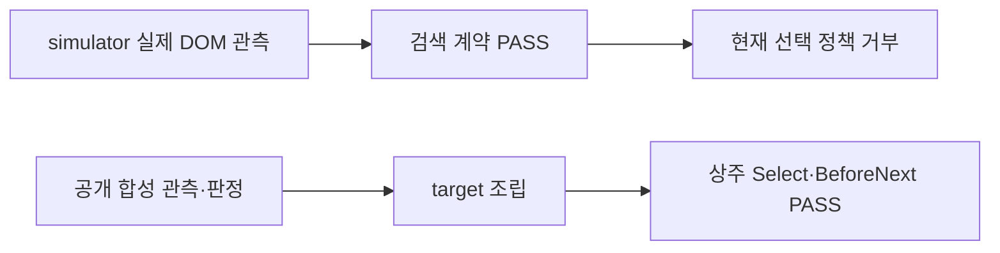

# Phase 2 · 관측·판정 조립과 상주 검증

관측과 본문 판정을 입력하면 기존 계약을 통과한 target을 만든다. 해시와 파생 필드를 계산하며 판정·시각·receipt는 입력 그대로 사용한다. 상주 검증 모드는 모듈을 한 번 로드하고 매 명령을 새 최상위 검증으로 실행한다.

## 입력과 계산

[검색 관측 입력](../search_attempt_input.md)과 [본문 판정 입력](../body_judgment_input.md)이 필수 필드와 거부 이유를 정의한다. winning scope는 initial-scope만 지원한다. candidate-recovery·whole-db는 이전 scope의 miss 사실 schema가 필요하므로 후속 범위다.

| 에이전트·고정 입력 | 자동 계산 |
|---|---|
| roster identity·원본 artifact 기대 해시 | roster 결합, 실제 바이트 해시 검증 |
| 제출·독립 관측, 시각·capture/read identity | 마지막 관측의 resultCount·orderedIds, freshness 검증 |
| attempt scope/phase·chip provenance·reset/clear/removal | targetBinding, submitted, 기존 검색 계약의 파생 필드 6개 |
| 비교자·시각·policy·verdict·항목별 비교·배율·glyph 상태 | candidate ID 결합, render·입력 파일 SHA-256, preparation 묶음 해시 |

원본 SHA-256을 먼저 roster와 대조하고 그 값을 끝까지 유지한다. 입력 JSON과 렌더를 출력 직전에 다시 해시한다. 경로는 ProjectRoot 내부 파일이어야 하며 alternate data stream과 reparse point를 거부한다. CreateNew로 새 파일만 쓴다. 원래 prepare_selection_evidence.ps1과 CLI는 그대로다.

## 두 시험 경로



경로 A는 기존 collector와 simulator control map으로 제출 전 판독 1회와 제출 후 독립 판독 2회를 수집한다. HTTP(S) 요청을 차단한 별도 headless browser에서 실행한다. 관측과 attempt 계약은 통과하지만 offline-dom-test/file URL은 현재 선택 정책에서 selected-search-receipt-invalid로 거부한다. 출력 target은 없다.

경로 B는 기존 공개 합성 generator의 aside-repl/paper-123 receipt를 사용한다. 경로 A와 attempt 사실·판정은 같고 submission/beforeSubmit/observations만 다르다. 이 합성 receipt는 실제 운영 판독의 증거가 아니다. 조립 결과를 고정 occurrence 행에 넣고 Select와 BeforeNext를 한 resident process로 검증한다. simulator 관측을 합성 receipt로 바꾸지 않았다.

control-map/simulator.json의 descriptor는 기존 simulator-adapter.json과 값이 같다. mathsecr-current.json은 실제 서비스의 관측 전 템플릿으로 selector와 observedAtUtc가 null이다. schema는 이를 허용하며 collector는 판독을 거부한다. 실제 map 작성은 연구 R2다.

## 상주 명령

validate_production_session.ps1은 ProjectRoot 인자 하나를 받는다. UTF-8 stdin/stdout의 JSONL을 사용한다. step은 Select, BeforeNext, AfterReload이고 inputPath는 필수다. outPath, summaryPath, targetOccurrenceKey는 선택이며 Select는 기존 계약에 따라 명시적 targetOccurrenceKey가 필요하다. summaryPath는 AfterReload만 허용한다.

성공과 실패 모두 명령마다 JSON 한 줄을 반환한다. 깨진 JSON·잘못된 root·step 누락·검증 거부 후에도 다음 명령을 처리한다. step=exit 또는 EOF는 응답 없이 종료 코드 0으로 끝난다. 기존 출력이 있으면 CLI와 같은 문장으로 거부한다. 파일 경로와 CreateNew helper 본문은 CLI와 정확히 같다.

Context를 명령 사이에 보관하지 않는다. 매번 Context 없이 Invoke-MathSecrProductionStep를 호출한다. 입력 파일도 읽기 전후 해시를 검사하며 명령마다 다시 읽는다. 오류 후 파일을 원복하면 다음 명령이 정상 검증된다.

## 성능

| 방식 | 총 시간 중앙값 초 | 명령당 중앙값 ms | 반복별 PASS | 반복별 프로세스 수 |
|---|---:|---:|---:|---:|
| CLI | 47.682 | 1009.300 | 47 | 47 |
| 상주 | 7.083 | 134.415 | 47 | 1 |

상주 모드의 총시간은 CLI의 약 14.9%로, 85.1% 감소했다. 약 6.73배 빨랐다. 모든 6개 sample에서 47회가 PASS다.

N=47, 각 3회 실행이다. 각 모드는 같은 합성 session에서 47개 occurrence를 원본 순서대로 한 번씩 Select 검증한다. 반복마다 CLI/resident 순서를 번갈아 실행한다. 총시간에는 child process 시작·모듈 로드·검증·직렬화·응답 parse·종료를 포함한다. fixture 준비와 정리는 제외한다. 명령당 수치는 3회 전체 명령 시간의 중앙값이다. 최초 resident 명령에는 모듈 로드도 포함된다.

각 반복의 명령 47개가 모두 PASS여야 측정을 기록한다. 원시 값과 코드 해시는 [perf-phase2.json](perf-phase2.json)에 있다. 실제 제작 또는 서버 검색 성능을 비교한 결과가 아니다.

## 검증과 남은 범위

공개 회귀는 13 PASS, 0 FAIL, 20 SKIP이다. AssemblePipeline과 ValidationContext가 PASS이며 검사 종료 후 PDF worker와 resident process는 0개다. 명령별 최종 상태는 [phase-2-checks.json](phase-2-checks.json)에 기록했다.

지정 음성 사례 4개는 comparator 누락, bodyText mismatch, resultCount 캐시 변조, 지원하지 않는 winning scope다. 추가로 판정 시각 누락·Boolean 배율·원본 hash 불일치·중복 roster 행을 거부한다. chip의 추가 receipt 보존도 단정한다. 정상 target은 preparation을 제거한 뒤 기존 helper 출력과 전체 JSON이 같다.

상주 시험은 잘못된 JSON과 singleton 배열, 명령 성공, CLI 정상 결과·출력 충돌 문장 동일성, 입력 파일 변경·원복, exit/EOF 후 종료를 검사한다. 기존 ValidationContext와 고정 Phase 0 대비 24개 AfterReloadIdentity는 CI에서 유지한다. 마지막 CI 단계는 남은 PDF worker가 없음을 검사한다. 해당 PR commit의 실제 CI 결과는 PR 본문과 Actions를 확인한다.

기존 export 8개와 SOURCE_SNAPSHOT, AGENTS.md, SKILL.md는 수정하지 않았다. 원본 출처 hash 72개와 Phase 1b 성능 자료를 보존했다. 비공개 fixture가 필요한 20개 gate는 D4 자료가 없어 미실행이다.

Phase 3 이후에는 simulator 경로의 정책 성공과 scope 입력 확장을 별도로 검증해야 한다. 실제 selector 관측, 실제 수학·시각 판정, 운영 paper 생성은 이 공개 합성 결과에 포함하지 않는다.

## 재현

```powershell
python ./scripts/validate_publication.py
pwsh -NoProfile -File ./scripts/run_public_checks.ps1
pwsh -NoProfile -File ./scripts/run_offline_regression.ps1 -PlaywrightModule <module> -BrowserPath <browser>
pwsh -NoProfile -File ./mathsecr-paper-builder-kit/scripts/test_assemble_pipeline.ps1 -ProjectRoot . -PlaywrightModule <module> -BrowserPath <browser>
pwsh -NoProfile -File ./scripts/perf/measure_select_modes.ps1 -ProblemCount 47 -Repeat 3 -OutPath <new-measurement.json>
```

측정 파일을 덮어쓰지 않는다. 생성 fixture는 OS 임시 폴더에서 사용하고 정리한다. helper script와 입력 schema 자체는 공개 저장소에 둔다.
