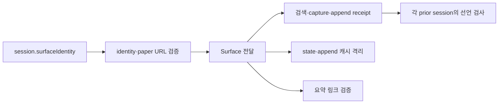

# Phase 3a · surface 계약 검증

session의 surface 선언을 검증한 뒤 선택·저장 관측·append 이력·요약에 전달한다. 선언이 없으면 `aside-repl`이다. receipt로 surface를 추론하지 않는다. 기본 session의 Phase 0 대비 동일성 24개가 PASS이며, 새 surface 시험의 양성 12개와 음성 9개도 PASS다.

## 선언과 전달



지원하는 쌍은 Aside/aside-repl, Codex/codex-iab, Chrome/codex-chrome-ext, Playwright/offline-dom-test다. live surface 3종은 `https://www.mathsecr.com/mypaper/<digits>`만 허용한다. offline surface는 host가 없는 절대 file URI이고 LocalPath가 `/test-fixtures/iab-simulator/index.html`로 끝나야 한다.

identity는 schemaVersion, surface, browserFamily, profileOrSessionId, tabId, url, observedAtUtc를 검증한다. ID는 공백 없는 비어 있지 않은 문자열이고 시각은 Z로 끝나는 UTC 값이다. 선택 probeArtifact는 기존 state artifact 안전 경로와 Context의 단일 읽기·해시 검사를 쓴다. 지정한 resolver의 이미지 확장자 허용 목록도 유지한다. probe가 없어도 Phase 3a에서는 통과한다.

Aside는 기존 asideRepl 블록을 쓴다. 다른 surface는 surfaceState 블록의 같은 boolean 조건을 쓴다. 두 블록의 혼입을 거부한다. state 이름 ASIDE_REPL_READY와 trace는 유지한다.

선택되지 않은 attempt와 metadata rescue bucket의 관측도 같은 surface여야 한다. append prior의 선언이 없으면 Aside다. 현재 session과 다르면 각 재귀 경계에서 surface-mismatch로 거부한다. state cache key와 append cache 항목에 Surface를 포함한다.

## 양성 12개

N=3, H=1의 OS 임시 합성 fixture를 사용한다. Select·BeforeNext는 기존 assembly helper 방식으로 append 완료 target을 새 pre-next snapshot에 넣는다. AfterReload는 원래 append session을 사용한다.

| Surface | Select | BeforeNext | AfterReload |
|---|---|---|---|
| aside-repl | PASS | PASS | PASS |
| codex-iab | PASS | PASS | PASS |
| codex-chrome-ext | PASS | PASS | PASS |
| offline-dom-test | PASS | PASS | PASS |

AfterReload의 typed summary lint도 각 surface에서 통과한다. 기본 session의 identity 선언은 추가하지 않는다. 기본 fixture 함수 반환과 observation의 직렬화 바이트, JSON·PNG artifact 21개가 변경 전 main `b37179d`와 같다. PDF 바이트는 생성 시각의 영향을 받으므로 이 추가 비교에 넣지 않았다. PDF 검증 결과와 오류는 동일성 24개에 포함한다.

## 음성 9개

각 입력을 별도로 복사하고 하나의 조건을 변조한다. 모두 거부되며 지정 토큰 또는 기존 문장을 확인한다.

| 번호 | 조건 | 확인한 거부 |
|---:|---|---|
| 1 | codex-iab identity의 family=aside | surface-browser-family |
| 2 | codex-iab capture의 surface=aside-repl | 기존 Persisted-card capture schema or surface 문장 |
| 3 | identity.surface=chrome | surface-unsupported |
| 4 | 선언 없는 Aside에 offline 검색 receipt | Select의 surface-mismatch; A1 조립기의 기존 selected-search-receipt-invalid |
| 5 | offline session의 paper URL이 https | surface-url |
| 6 | asideRepl·surfaceState 동시 존재 | surface-mismatch |
| 7 | Chrome extension append receipt의 surface=codex-iab | edit-append-schema |
| 8 | codex-iab prior의 identity 없음 | surface-mismatch |
| 9 | Aside의 선택되지 않은 두 번째 attempt가 codex-iab | surface-mismatch |

9번은 변조 전 Select PASS를 확인하고 변조 뒤 Select와 state machine 모두 거부함을 단정한다. 추가 경계 검사로 잘못된 ID·시각·schema 형식, 잘못된 URL, probe 안전 경로·해시와 artifact cache 재사용, metadata bucket 혼입을 검사한다. ValidationContext의 기존 단정을 유지하며 같은 snapshot의 surface 변경 시 실제 재검증과 state cache 격리를 확인한다.

## 조립 경로 A1·A2

A1은 기존대로 Surface 인자 없이 simulator receipt를 조립한다. selected-search-receipt-invalid, 종료 코드 1, 출력 없음이 유지된다. Surface를 관측 검사에도 전달하므로 같은 거부를 더 이른 경계에서 반환한다.

A2는 동일한 실제 file-DOM 관측을 변경하지 않는다. offline-dom-test session과 조립기 Surface 인자를 사용하면 종료 코드 0이다. 그 target의 상주 Select·BeforeNext가 모두 Valid=true다. 기존 isolated collector와 별도 headless 프로필을 재사용하며 HTTP(S) 요청을 차단한다. 실제 수학비서에 접속하지 않는다.

## 동일성과 성능

기준은 Phase 0 commit `961c41105e96f368c48f6a39303e15520e0b3213`이다. 별도 PowerShell 프로세스로 H=1·2·6에서 정상 결과와 변조 7종을 비교했다. JSON 문자열·스칼라 CLR 형식·예외 메시지 24개 모두 AfterReloadIdentity PASS다.

| N=15, H=6, 3회 | 값 |
|---|---:|
| AfterReload 중앙값 | 1915.3255 ms |
| 반복별 시간 | 2036.881 / 1915.3255 / 1791.0483 ms |
| 목표 | ≤ 2200 ms · PASS |
| StateMachine 호출 | 7 |
| PDF worker 시작 / one-shot | 1 / 0 |
| append 호출 / 실제 검증 / 재사용 | 12 / 6 / 6 |
| 파일 해시 / artifact 수 | 92 / 106 |
| 경로별 최대 해시 | 1 |

[perf-phase3a.json](perf-phase3a.json)은 세 sample과 호출·경로별 계측을 담는다. module을 warm한 뒤 함수 proxy를 포함해 AfterReload만 측정했다. fixture 생성·정리는 제외했다. 실제 제작 시간이나 브라우저 간 속도 비교가 아니다. Phase 1b·2 측정 자료는 보존했다.

## 공개 기록과 후속 범위

public gate는 14개다. 이전 비공개 gate 20개는 자료가 없어 SKIP이다. 검사 결과는 [phase-3a-checks.json](phase-3a-checks.json)에 기록한다. 해당 구현 commit의 실제 CI 결과와 마지막 PdfValidatorProcesses PASS는 PR·Actions와 Issue #2 완료 보고를 확인한다.

SOURCE_SNAPSHOT에서 변경한 export는 state_machine.ps1, production_validation.ps1, body_comparison_contract.ps1, search_observation_contract.ps1, report_contract.ps1의 5개다. 각각 Surface 전달·검사 또는 캐시 격리를 transformation에 기록한다. 원본 sourceSha256 72개는 유지한다. 새 surface_contract.ps1은 원본 export 목록에 넣지 않는다.

지시서의 구현 범위와 다른 기능은 추가하지 않았다. A1 거부 위치를 앞당겨 기존 문장을 유지했고 H=1의 pre-next 시험에서는 append 실행 receipt를 제거해 새 선택 경계를 만들었다. ASIDE_REPL_READY 이름 정리, 실제 probe와 비-offline probeArtifact 필수화, canonical 지침 갱신은 후속 Phase 3b·4다.

## 재현

```powershell
python ./scripts/validate_publication.py
pwsh -NoProfile -File ./scripts/run_public_checks.ps1
pwsh -NoProfile -File ./scripts/run_offline_regression.ps1 -PlaywrightModule <module> -BrowserPath <browser>
pwsh -NoProfile -File ./scripts/test_surface_contract.ps1
pwsh -NoProfile -File ./mathsecr-paper-builder-kit/scripts/test_assemble_pipeline.ps1 -ProjectRoot . -PlaywrightModule <module> -BrowserPath <browser>
pwsh -NoProfile -File ./scripts/test_validation_context.ps1
pwsh -NoProfile -File ./scripts/perf/compare_after_reload.ps1 -BaselineRoot <961c411 worktree> -CandidateRoot .
pwsh -NoProfile -File ./scripts/perf/measure_after_reload.ps1 -ProblemCount 15 -HistoryDepth 6 -Repeat 3
```
