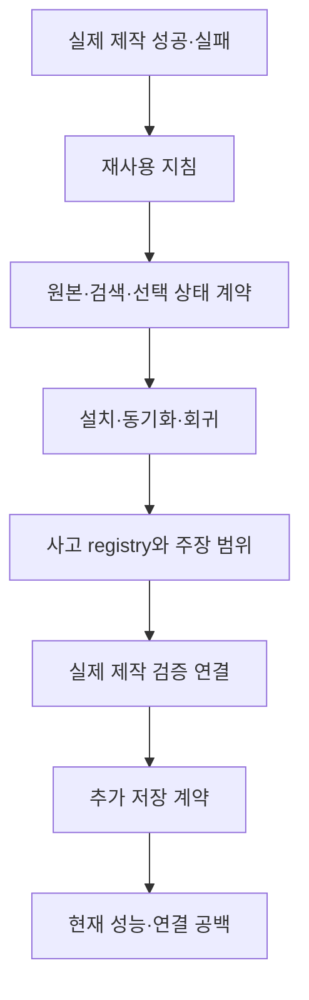

# 프로젝트 구조 변화 과정

이 연표는 세션 보고서, 사고 기록, 실제 커밋 메타데이터를 함께 사용했다. 주 검토 기간은 2026-08-10~10-10이다. 초기 구조를 설명하기 위해 6~7월 기록도 확인했다. 과거 전체 세션을 다시 실행하거나 모든 문제지를 재검증한 연표는 아니다.

## 제작 경험이 검증 구조가 되기까지

| 시기 | 겪은 문제와 사용자 요구 | 구조의 변화 | 확인 범위 |
|---|---|---|---|
| 6월 초 | 일부 후보 불일치가 전체 중단으로 이어졌다. 선택과 저장이 달랐다. | 실제 문제지 완성과 부분 완성을 우선했다. 저장 후 전체 묶음을 확인했다. | 초기 성공·재시작 기록 C01~C02 |
| 6월 5~7일 | 같은 URL의 과거 문항이 새 작업에 섞였다. 텍스트 검색만으로 과거 후보를 다시 못 찾았다. | clean-state, scope, 본문 불일치, 저장 유지 게이트를 정리했다. 같은 출처 후보 회복을 추가했다. | 사고 기록 C02~C03 |
| 6월 7일 | 선지만 다른 동일 본문을 버렸다. | body-only exact 정책을 명확히 했다. | 사용자 정책 C04 |
| 7월 11일 | 여러 세션의 지침과 자료를 재사용할 기반이 필요했다. | Git 기준선과 설치 가능한 kit를 마련했다. | 커밋 `7528646` |
| 7월 29~31일 | DB 미지정, 검색 후 stale 결과, 원본 페이지 순서, 재개와 중복 문제가 있었다. | DB 추론, 관측 계약, PDF 분할 근거, 선택 저널, 설치 동기화를 보강했다. | C05~C06 및 당시 검증 기록 |
| 8월 12~15일 | 같은 DB ID에 반복 원본을 합쳐 계산했다. lazy 결과 일부만 보고 미발견을 닫았다. | occurrenceKey와 DB ID를 분리했다. 메타데이터 회복과 결과 끝 확인을 요구했다. | C07·C09 |
| 8월 21~22일 | 개수는 같아도 앞 문항 순서가 달랐다. 같은 카드를 다시 누르면 선택이 해제됐다. | 전체 ordered bundle 대조와 명시적 duplicate/add 증거를 강화했다. | C08·C09 |
| 8월 26~27일 | 의미를 번역한 AND 칩이 exact 후보를 배제했다. 같은 판정에서 나온 자료끼리 검증했다. | 검색 시도 계약을 단일화했다. target-bound 보고, 사고 registry, 독립 근거와 주장 등급을 연결했다. | C10~C13 |
| 8월 31일 | 단일 규칙으로 합치는 과정에서 짧은 단어 기준이 빠졌다. 문장형 칩 사용이 재발했다. | 단어 길이·공백·문장 형태를 검사했다. 구절 prepass와 단어 검색을 분리했다. | C14 |
| 9월 5일 | PS7에서 실제 선택 저널을 0건으로 읽었다. 성공·보고 경로에 검증 연결 공백이 있었다. | 저널 분할 오류를 수정했다. 실제 파일 왕복과 두 PowerShell 호환 검사를 추가했다. 나머지 연결 공백을 후속 과제로 기록했다. | C06·C15 |
| 9월 20~27일 | 빠른 제작의 오선택을 사용자가 지적했다. | 원본 본문을 다시 비교하고 잘못된 선택과 순서를 복구했다. | C16, 지정 세션 원시 로그 |
| 10월 7일 | 최신 모델 사용 후 전체 구조와 오류를 다시 검토해 달라는 요청이 있었다. | 실제 제작을 `Select → BeforeNext → AfterReload` 검증과 연결했다. 부분 저장과 typed 결과 투영을 구현했다. | C17, 오프라인 검증과 후속 제작을 구분 |
| 10월 7일 이후 | 최초 편집 진입 계약이 저장된 문제지에 계속 추가하는 경로를 거부했다. | 기존 저장 상태와 새 delta를 결합하는 editAppendReceipt를 추가했다. | C18 |
| 10월 9일 | 기기 표시명을 원격 작업으로 잘못 해석했다. 도구로 읽을 상태를 사용자에게 반복 질문했다. | Aside의 기본 host를 local로 고정했다. 원격 요청 표시와 근거를 요구했다. | C19 |
| 10월 10일 | 제작이 느려졌다. 세 브라우저에서 제어 오류가 반복됐다. | 루프와 검증 시간을 분리 측정했다. 잘못된 Chrome 식별을 정정했다. 중복 검증 최적화와 브라우저 어댑터 변경을 제안했다. | C20~C21, 제안은 미구현 |

6월의 일부 초기 대책은 이후 정책으로 바뀌었다. 당시 문헌의 “전체 DB exact에도 승인 필요”나 오래된 칩 수를 현재 규칙으로 재사용하지 않는다. 현재 행동의 기준은 kit SKILL과 실행 계약이다.

## 실제 Git 기록

기존 비공개 원격 저장소에서 다음 8개 커밋을 확인했다. 날짜는 Asia/Seoul 기준이다. 이 공개 저장소는 새 초기 커밋으로 시작한다. 아래 이력을 공개 Git 커밋으로 재현하지 않았다.

| 날짜 | 원래 커밋 | 당시 제목 | 구조상 의미 |
|---|---|---|---|
| 2026-07-11 | `7528646` | Establish MathSecr builder baseline | 재사용 기준선 |
| 2026-07-29 | `2c0ee79` | harden MathSecr builder verification | 검증과 설치 강화 |
| 2026-08-12 | `fe6c63b` | harden MathSecr paper builder workflows | 제작·보고·반복 occurrence 계약 강화 |
| 2026-08-27 | `79613e9` | harden MathSecr search and evidence contracts | 검색·증거 계약 보강 |
| 2026-08-27 | `c8d3d1d` | centralize MathSecr search attempt contracts | 검색 시도 판단의 단일 소유자 |
| 2026-08-27 | `48037b9` | gate postmortem lessons with re0 memo | 사고와 회귀 runner 연결 |
| 2026-08-27 | `3f6885c` | guard validation claims with independent ground truth | 독립 정답 근거와 주장 범위 |
| 2026-08-27 | `bb0b4d4` | expand MathSecr learning gates from recent sessions | 최근 사고와 문서 소비자 정리 |

9~10월의 최신 파일에는 이 커밋 뒤 작업이 포함되어 있다. 공개본의 파일 해시는 [SOURCE_SNAPSHOT.json](../SOURCE_SNAPSHOT.json)에 기록했다. 이 해시는 내용을 식별하며 실제 제작 정확도를 증명하지 않는다.

## 현재 구조로 이어진 흐름

계약이 늘면서 실패를 더 잘 구분하게 됐다. 동시에 실제 작업에 붙이는 비용도 늘었다. 다음 변화는 검증 내용을 없애는 방향이 아니라, 같은 관측을 재사용하고 중복 계산을 줄이는 방향이어야 한다.

## 복구와 공개 이력의 경계

10월 7일 기록은 누락된 파일 131개를 체크포인트와 비교해 복구했다고 남겼다. 당시 원래 `.git`은 변경하지 않았다. 10월 10일 이번 공개 준비에서도 `.git/HEAD`가 없고 Git 명령이 저장소로 인식하지 못하는 상태를 확인했다.

따라서 이 공개 저장소는 원래 `.git`을 고치거나 그 이력을 덮어쓴 결과가 아니다. 현재 파일을 검사한 뒤 별도로 만든 공개 스냅샷이다. 원본 로그와 Git 자료는 로컬에 보존했다.
