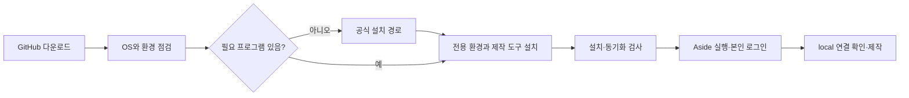

# GitHub에서 설치하기

이 저장소의 공개 runtime은 Windows 11과 macOS에서 설치한다. 별도 비공개 자료가 필요 없다. Git은 소스 전달 수단이다. 첫 설치에는 Python 패키지와 공개 한글 글꼴 다운로드를 위한 인터넷 연결이 필요하다.

## Codex에 보낼 설치 요청

아래 문장을 친구에게 보내면 된다.

> https://github.com/HDHhhdhh/HDHsubi 를 다운로드하고 root AGENTS.md와 docs/installation.md에 따라 이 PC에 설치해줘. OS를 확인하고 필요한 Python, PowerShell 7, Aside 앱과 CLI도 함께 준비해줘. 별도 작업공간에 공개 runtime과 skill을 설치하고 설치 검사를 실행해줘. 로그인 등 내가 해야 하는 단계만 알려줘. 비공개 과거 테스트 자료는 요구하지 마.

Codex가 clone 또는 ZIP 다운로드 후 root AGENTS를 읽고 bootstrap을 실행한다. 인증이 필요한 로그인과 OS 설치 화면은 수신자가 직접 완료한다. 기존 파일이 다르면 기본 설치는 멈춘다. 검토 후 `--force` 또는 `-Force`로 갱신하면 기존 관리 파일을 `.hdhsubi/backups`에 보존한다. 사용자 원본과 기존 custom 파일은 삭제하지 않는다.



설치 검사가 통과해도 실제 문제지 로그인과 제작은 따로 확인한다.

## 필요한 환경

| 항목 | 설치 방식 | 역할 |
|---|---|---|
| Codex | 수신자가 사용하는 Codex 환경 | skill과 작업공간 실행 |
| Python 3.10 이상 | Windows WinGet / macOS Homebrew. 검사 기준 3.12 | 설치기와 PDF 처리 |
| PowerShell 7 | installer `--install-tools`의 WinGet/Homebrew | 기존 제작 검증기 |
| Aside Browser | Windows 공식 앱 설치 / macOS Homebrew cask | 로그인한 수학비서 UI 조작 |
| Aside CLI | 공식 signed Windows installer / 공식 macOS installer | local REPL 연결 |
| Pillow, reportlab, pypdf, PyMuPDF | 전용 venv에 자동 설치 | 크롭·PDF 생성·검증·페이지 렌더 |
| 나눔고딕 regular/bold와 OFL | 고정 commit·SHA-256 검증 후 자동 다운로드 | 두 OS의 한글 PDF |

Node, Playwright, 브라우저 simulator는 개발 회귀용이다. 제작 runtime 설치에는 필요하지 않다. 원본 시험지와 수학비서 계정·DB 이용 권한은 수신자가 제공한다. 과거 사용자의 시험지나 로그인 자료는 설치하지 않는다.

## Windows 11

Git이 있으면 다음을 실행한다. Git이 없으면 GitHub의 Code → Download ZIP으로 받고 압축을 푼 폴더에서 실행해도 된다.

```powershell
git clone https://github.com/HDHhhdhh/HDHsubi.git
cd HDHsubi
powershell -NoProfile -ExecutionPolicy Bypass -File ./scripts/bootstrap.ps1 -ProjectRoot "$env:USERPROFILE/Documents/HDHsubi-workspace" -InstallDependencies
```

Windows에 기본 내장된 PowerShell 5.1에서 bootstrap을 시작할 수 있다. 누락된 Python 3.12는 WinGet으로 설치한다. Python 설치 경로를 다시 탐색한 뒤 공개 installer가 PowerShell 7과 Aside CLI를 준비한다. WinGet이 없는 관리 PC에서는 [Python 공식 설치](https://www.python.org/downloads/windows/)와 [PowerShell 공식 안내](https://learn.microsoft.com/en-us/powershell/scripting/install/install-powershell-on-windows)를 따른다. 환경 변경 후 새 터미널에서 재시도할 수 있다.

Aside **앱**은 [공식 다운로드](https://aside.com/download)에서 Windows 설치 파일을 실행한다. CLI만 설치한 상태로는 브라우저를 조작할 수 없다. [공식 CLI 안내](https://docs.aside.com/help/developers)의 서명·게시자·타임스탬프 검사를 그대로 적용했다. 서명 검사가 실패하면 우회하지 않는다. 앱 Developer 설정의 CLI 설치 경로로 복구하거나 관리 담당자에게 확인한다.

## macOS

기존 Homebrew가 있으면 다음을 실행한다. [Homebrew](https://brew.sh/)가 없으면 공식 안내에 따라 먼저 설치한다. 시스템 Python이나 전역 pip 환경은 바꾸지 않는다.

```bash
brew install python@3.12
git clone https://github.com/HDHhhdhh/HDHsubi.git
cd HDHsubi
python3 ./scripts/install.py --project-root "$HOME/Documents/HDHsubi-workspace" --install-tools
```

installer는 누락된 PowerShell을 `brew install --cask powershell`, Aside 앱을 `brew install --cask aside`로 준비한다. CLI가 없으면 [공식 Aside macOS 설치 스크립트](https://docs.aside.com/help/developers)를 사용한다. 다운로드가 실패하면 실제 오류를 보고하고 Aside 앱 Developer 설정의 CLI 설치 경로를 사용한다. Apple Silicon과 Intel의 venv 실행 파일 경로는 동일하게 처리한다. OS 지원 범위는 설치 시 [PowerShell](https://learn.microsoft.com/en-us/powershell/scripting/install/install-powershell-on-macos)과 [Aside cask](https://formulae.brew.sh/cask/aside)의 현재 요구사항을 확인한다.

## 설치 확인과 첫 제작

소스 checkout에서 다음을 실행한다. macOS는 `python3`을 써도 된다.

```bash
python scripts/install.py --project-root <설치한-작업공간> --check
python scripts/install.py --project-root <설치한-작업공간> --check --require-browser
```

첫 명령은 배포 파일·AGENTS·installed skill의 SyncContract, 전용 Python 패키지와 글꼴, 제작 모듈 로드를 검사한다. 두 번째는 `--host local`의 read-only Aside REPL 연결을 추가로 검사한다. 연결 검사는 서비스 로그인이나 특정 문제지 identity를 증명하지 않는다.

설치한 작업공간을 Codex에서 열고 [start prompt](../mathsecr-paper-builder-kit/prompts/start-prompt.md)에 원본 파일과 문제지 URL을 넣는다. 모든 helper는 다음 runner를 통해 실행한다. Runner가 전용 Python과 local Aside CLI 경로를 전달한다.

```bash
python scripts/run.py mathsecr-paper-builder-kit/scripts/check_aside_repl.ps1 -HostId local
python scripts/run.py mathsecr-paper-builder-kit/scripts/validate_production_step.ps1 <단계별-인수>
python scripts/run.py mathsecr-paper-builder-kit/scripts/create_failed_problem_report.py <보고서-인수>
```

기존 kit `scripts/install.ps1`과 `check.ps1`도 공개 checkout에서는 새 경로로 연결된다. 과거 전체 회귀 환경을 가진 개발자가 `-PrivateBundle` 또는 `-EvidenceRoot`를 명시한 경우에만 기존 비공개 installer를 사용한다. 공개 설치 PASS를 과거 전체 회귀 PASS로 보고하지 않는다.

## 개발 검증

`python scripts/test_installation.py`는 경로 이탈, 원본 누락·해시 변경, 기존 파일 충돌과 보존, skill 동기화 실패를 검사한다. `python scripts/test_installation.py --integration`은 별도 임시 작업공간과 Codex home에 실제 venv·패키지·글꼴을 설치하고, 재설치와 reload 검증·한글 PDF를 검사한다. 설치 CI는 Windows와 macOS runner에서 이 경로를 실행한다. CI에는 Aside 앱 로그인이나 실제 수학비서 제작이 포함되지 않는다.
