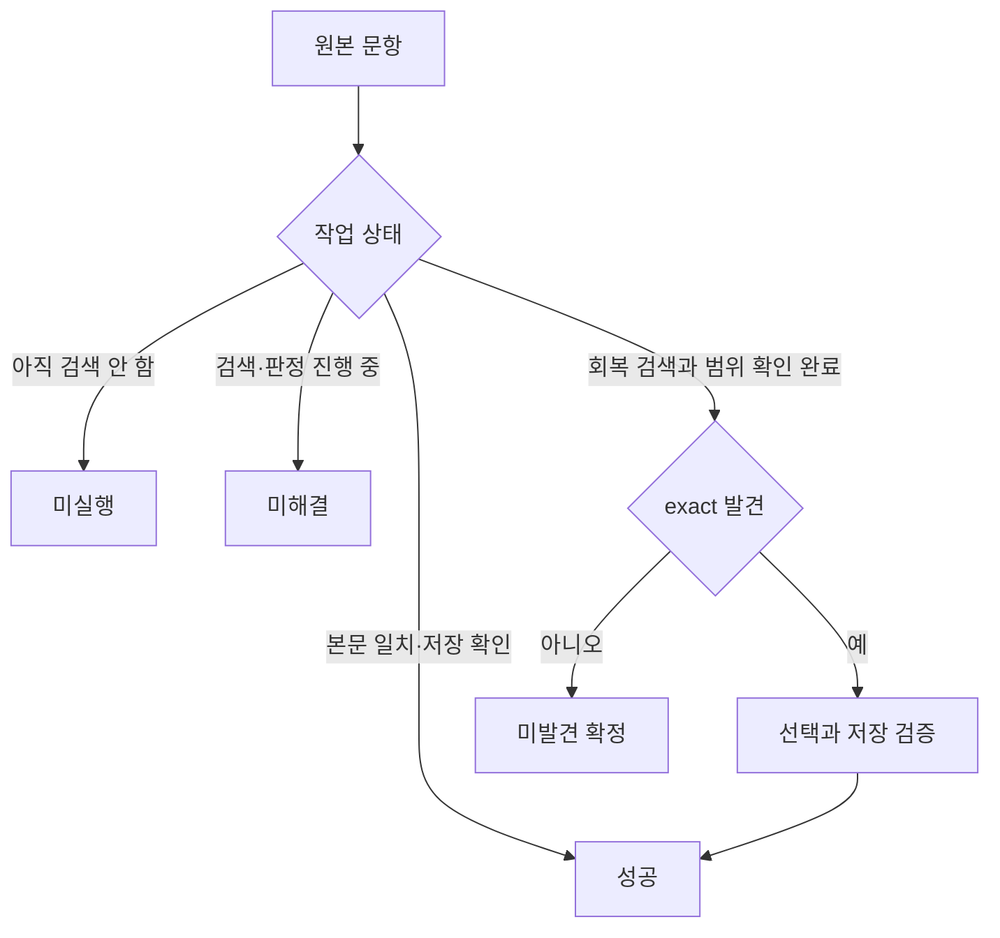

# 사용자의 염원과 프로젝트 목표

## 사용자가 원하는 결과

사용자는 이미 가진 시험지와 프린트를 수학비서에서 다시 만들고 싶다. 에이전트가 원본을 읽고 같은 문항을 찾아야 한다. 원본 순서도 유지해야 한다. 교사는 반복 검색과 저장 확인에 시간을 쓰지 않고 수업 준비에 집중할 수 있어야 한다.

사용자는 이전에 잘 되던 제작 속도를 기대한다. 최근 대화에서 약 40분이면 끝낼 작업이라는 기대를 표현했다. 이 시간은 사용자의 기대치다. 같은 입력과 절차로 측정한 성능 보장은 아니다.

사용자의 요구를 다음처럼 정리한다.

1. 계획과 오프라인 검사에서 멈추지 않고 실제 문제지를 만든다.
2. 같은 본문의 문항을 고른다. 보기 좋은 유사 문항으로 채우지 않는다.
3. 찾은 문항은 원본 순서대로 저장한다. 저장 후 다시 읽어 확인한다.
4. 일부 문항을 못 찾아도 검증한 결과는 부분 저장한다.
5. 미해결 문항, 아직 검색하지 않은 문항, 검색을 마친 미발견 문항을 구분한다.
6. 도구로 볼 수 있는 탭·URL·로그인·기기 상태는 직접 확인한다.
7. 특정 브라우저에 대한 선호는 측정 결과로 판단한다.
8. 문제가 생기면 원인과 수정 결과를 설명한다. 반복 질문과 재설치 요청으로 작업을 대신하지 않는다.

## 성공의 기준

검색 결과에 후보가 있다는 사실만으로 제작은 성공하지 않는다. 선택한 수와 저장한 수도 다를 수 있다.

| 판단 대상 | 필요한 확인 |
|---|---|
| 원본 | 인쇄된 문항 번호와 읽는 순서가 정리되어 있다. |
| 범위 | 사용자가 지정한 과목·단원·출처가 실제 UI에 적용되어 있다. |
| 문항 일치 | 원본과 후보의 본문·조건·수식·도형·요구값을 실제로 대조했다. |
| 선택 | 실제로 선택된 ID와 원본 위치가 대응한다. |
| 편집 | 전체 ID와 순서가 선택 묶음과 맞는다. |
| 저장 | 재로드 또는 새 탭에서 전체 ID와 순서가 유지된다. |
| 보고 | 같은 검증 결과에서 성공 수, 실패 번호, 출처를 계산한다. |

전체 문항을 검증해서 저장하면 완료다. 일부만 검증해서 저장하면 부분 완료다. 판정이 끝나지 않은 문항을 미발견 확정으로 바꾸면 안 된다.

## exact의 의미

사용자는 2026-06-07에 객관식 선지 차이를 무시하고 본문이 같으면 exact로 취급하도록 정했다. 이는 후보를 무조건 넓게 허용한다는 뜻이 아니다.

- 본문, 조건, 수식, 그래프, 표, 도형, 점 이름, 요구값은 일치해야 한다.
- 본문 내부의 `[보기]`와 ㄱ·ㄴ·ㄷ 진술도 일치해야 한다.
- 객관식 답안 선지의 값·문구·순서는 거부 사유가 아니다.
- 작은 수학 기호가 불명확하면 확대해서 다시 본다. 끝내 읽을 수 없으면 미해결로 남긴다.
- 과거 세션의 후보 ID는 회복 검색의 단서다. 현재 본문 대조를 대신하지 않는다.

이 정책의 근거는 [사례 C04](evidence/README.md#c04)에 정리했다.

## 부분 저장이 필요한 이유

한 문항의 불확실성 때문에 이미 찾은 문항까지 버리는 것은 사용자의 목적에 맞지 않는다. 따라서 검증된 exact 묶음을 먼저 저장할 수 있어야 한다.

부분 저장은 성공 문항을 남기고 나머지 상태를 보존한다. 검색 시간 예산이 끝난 사실만으로 미발견을 확정하지 않는다.

## 효율과 신뢰를 함께 지키기

검증 자료를 자세히 만드는 일 자체가 목표는 아니다. 필요한 관측을 한 번 수집하고 검색·선택·보고에서 재사용해야 한다. 제작 중에 입력 형식이나 도우미를 계속 고치는 상황은 줄여야 한다.

검증을 줄일 때도 실제 본문 대조와 저장 후 전체 순서 확인은 유지한다. 최적화 대상은 같은 근거를 여러 번 계산하는 부분과 중복된 UI 판독이다. 원본·후보·범위가 달라졌는데 과거 PASS를 재사용하는 방식은 허용하지 않는다.

사용자의 자유로운 브라우저 시험 요청과 현재 Aside 전용 제작 계약은 아직 일치하지 않는다. 이번 공개 작업에서 제작 정책을 바꿨다고 주장하지 않는다. 필요한 변경은 [다음 작업](status-and-next.md)에 명시했다.
