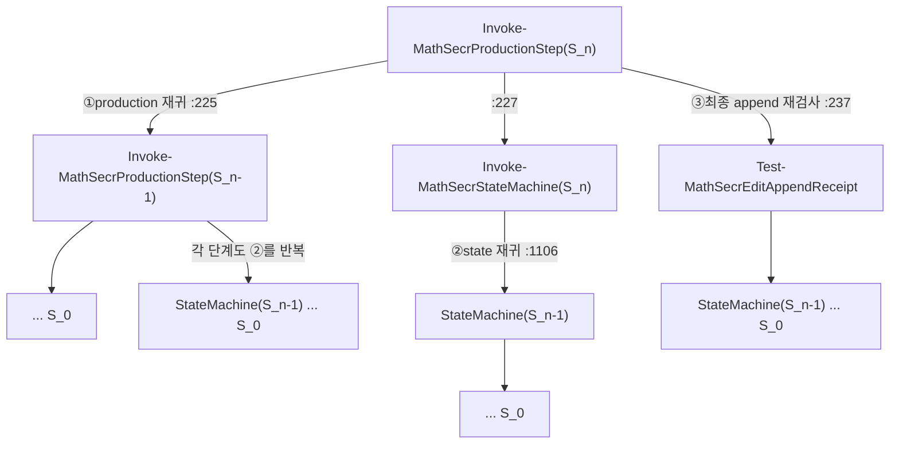
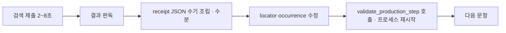
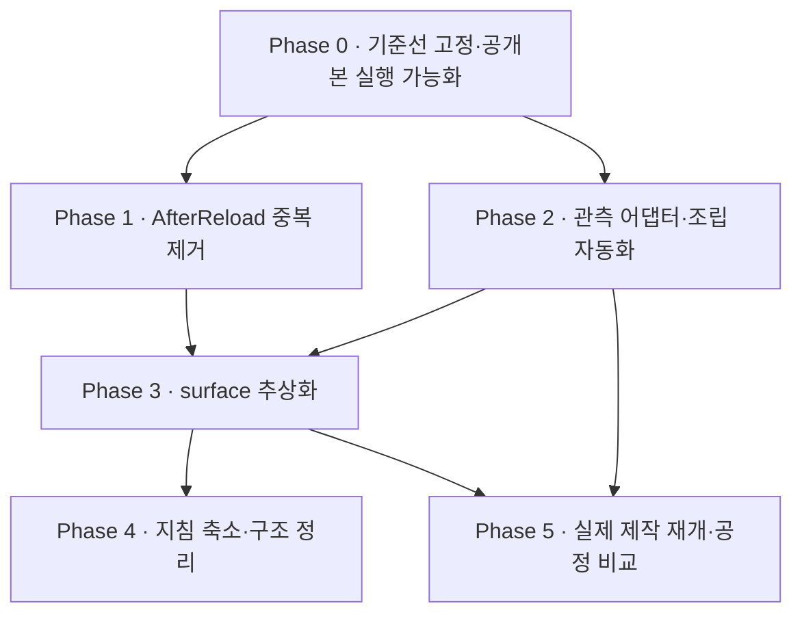

# HDHsubi 최적화·리팩터링 계획

작성일 2026-10-11. 작성자 Claude(Fable 5.1). 구현자 Codex(GPT-6.1 Sol).
이 문서는 계획이다. 구현 완료를 뜻하지 않는다. 각 Phase의 작업 지시는 [docs/codex/](codex/README.md)에 있다.

## 1. 목적과 범위

목적은 하나다. 실제 문제지 제작 속도를 올린다. 정확도 보장은 유지한다.

이 계획은 다음을 다룬다.

- 검증기의 중복 계산 제거.
- 제작 중 수기 JSON 조립 제거.
- 브라우저 표면(surface) 고정 해제.
- 공개 저장소에서 실행 가능한 회귀와 CI.
- 지침 문서 축소와 코드 구조 정리.

이 계획은 다음을 다루지 않는다.

- 수학비서 서비스 자체의 변경.
- 본문 exact 판정의 자동화. 판정은 계속 에이전트가 한다.
- 언어 전면 교체. PowerShell 계약 코드는 유지한다.

## 2. 진단 요약

| 번호 | 문제 | 근거 | 영향 | 우선순위 |
|---|---|---|---|---|
| P1 | AfterReload 검증이 과거 세션을 3중으로 재귀 검증한다 | `production_validation.ps1:225`, `:227`, `:237`; `state_machine.ps1:1106`, `:1849` | 15문항·과거 6세션에서 113.83초. 세션이 쌓일수록 제곱으로 증가 | 최상 |
| P2 | 같은 파일을 두 번 읽고 두 번 해시한다 | `production_validation.ps1:38-40`, `:100-102`, `:215-217`; `state_machine.ps1:1085`, `:1087` | 파일 I/O 2배. OneDrive 경로에서 더 느림 | 상 |
| P3 | 원본 crop 47개를 검증 호출마다 다시 해시한다 | `production_validation.ps1:53-54` (`Assert-MathSecrProductionRoster`) | 재귀 단계마다 47회 PNG 해시 반복 | 상 |
| P4 | 제곱 비용 루프와 JSON 직렬화 비교 | `production_validation.ps1:137`, `:152`; `state_machine.ps1:1115`, `:1127`, `:1134`, `:1146-1147` | 문항 수가 늘면 비선형 증가 | 중 |
| P5 | 검증 CLI가 호출마다 새 pwsh 프로세스로 4,100줄 모듈을 다시 로드한다 | `validate_production_step.ps1:12` → `production_validation.ps1:3-5` | Select를 47회 호출하면 모듈 로드 47회 | 중 |
| F1 | 제작 중 문항마다 receipt JSON을 수기로 조립한다 | `docs/incidents.md` 사고 22, `docs/status-and-next.md` | 검색은 2~8초인데 문항 간 수분 소요. 흐름 단절의 주원인 | 최상 |
| F2 | control map을 세션마다 다시 관측해 만든다 | `SKILL.md` Browser 안정화 2항, `search_observation.js` 머리말 | 매 세션 준비 비용. locator 수정 반복 | 상 |
| S1 | 브라우저 surface가 `aside-repl`로 코드·문서·validator에 하드코딩됐다 | `state_machine.ps1`(:1098, :1162, :1196, :1210), `production_validation.ps1:104`, `body_comparison_contract.ps1:60`, `search_observation_contract.ps1:131`, `validate_mathsecr_docs.ps1:416`, AGENTS/SKILL/start-prompt | Chrome·IAB 비교 실험이 계약상 불가 | 상 |
| S2 | 브라우저 probe가 Aside 전용이다 | `check_aside_repl.ps1` | 다른 surface의 설치·연결·판독·입력 실패를 구분할 코드가 없다 | 중 |
| R1 | 공개본에서 회귀 대부분이 실행 불가다 | 참조 fixture·evidence 60여 개 미포함. 예: `test-fixtures/body-comparison/synthetic_selection_test_support.ps1`, `test-fixtures/lessons/`, `test-fixtures/evaluation/` | Codex가 구현 뒤 회귀를 돌릴 수 없다. CI 불가 | 최상 (전제 조건) |
| R2 | CI가 없다 | `.github/` 없음 | PR마다 사람이 수동 실행 | 상 |
| M1 | 단일 파일이 너무 크다 | `state_machine.ps1` 2,173줄 40함수, `test_re0_memo.ps1` 1,711줄, `validate_mathsecr_docs.ps1` 931줄 | 변경 범위 파악과 리뷰가 어렵다 | 중 |
| M2 | 세션 시작 지침이 길다 | AGENTS 286줄 + SKILL 251줄. 세션마다 전체 읽기와 SHA 기록 요구 | 에이전트 컨텍스트 소모. 지침 drift 검사 비용 | 중 |
| M3 | installer가 비공개 evidence에 결합됐다 | `install.ps1`, kit README Bundle Contract | 공개 clone만으로 설치·검사 불가 | 중 |
| M4 | PS5.1/PS7 호환 사고가 반복됐다 | `docs/incidents.md` 사고 11 | 같은 유형 회귀 위험 | 낮음 |

근거는 공개본 코드의 줄 번호다. 실제 시간 비중은 Phase 0의 계측으로 확정한다.

## 3. 핵심 문제 상세

### 3.1 P1 · 3중 재귀

`editAppendReceipt`가 있는 AfterReload 입력은 세 경로로 과거 세션을 다시 검증한다.

과거 세션 수를 H라 한다. production 단계 k는 state 재귀로 k+1회, 최종 재검사로 k회 state machine을 돌린다. 합계는 `(H+1)²`다.

| H | state machine 실행 | production 검증 | 원본 crop 해시(47문항, production 단계만) |
|---:|---:|---:|---:|
| 1 | 4 | 2 | 94 |
| 2 | 9 | 3 | 141 |
| 6 | 49 | 7 | 329 |

state machine 안의 artifact 해시는 이 표에 넣지 않았다. 실제 횟수는 Phase 0 계측으로 확정한다.

정책상 과거 PASS 재사용은 금지다. 그러나 **한 호출 안에서** 같은 바이트를 여러 번 검증하는 것은 정책이 요구하지 않는다. 해결은 호출 범위 캐시다. 캐시 key는 (artifact 경로, SHA-256, 단계, 계약 버전)이다. 호출이 끝나면 캐시를 버린다.

### 3.2 F1·F2 · 제작 흐름 병목

병목은 브라우저가 아니다. 에이전트가 관측값을 state machine 입력 형식으로 손으로 옮기는 구간이다. 해결은 관측 → 입력 자동 조립 어댑터다. 본문 판정, 비교자, 시각은 계속 에이전트가 넣는다. 자동으로 채우지 않는다.

### 3.3 S1·S2 · surface 경직

현재 계약은 `aside-repl`만 허용한다. 사용자는 측정 결과로 브라우저를 고르길 원한다. 측정을 하려면 다른 surface의 관측도 검증기를 통과해야 한다. 코드, 문서 marker, validator를 같은 PR에서 바꿔야 한다. 이것은 정책 변경이다. 사용자 승인이 필요하다.

### 3.4 R1·R2 · 공개본 실행 불가

Codex는 이 공개 저장소에서 작업한다. 회귀가 돌지 않으면 구현 결과를 검증할 수 없다. 따라서 Phase 0이 모든 Phase의 전제 조건이다.

## 4. 설계 원칙

1. 기존 계약(contract)의 거부 동작을 유지한다. 음성 테스트는 모두 통과해야 한다.
2. 캐시는 한 검증 호출 안에서만 산다. 파일의 `Valid=true`를 믿지 않는다.
3. 판정·관측·클릭·시각을 자동으로 만들지 않는다. 조립만 자동화한다.
4. 정책 변경은 코드·문서·validator를 한 PR에서 함께 바꾼다. 사용자 승인 뒤에 한다.
5. 한 Phase는 한 PR이다. PR은 공개본 회귀와 CI를 통과해야 한다.
6. 새 파일 확장자는 `.ps1 .py .js .md .yaml .json .html`만 쓴다. `validate_publication.py`가 다른 확장자를 거부한다. GitHub Actions 파일도 `.yaml`로 만든다.

## 5. Phase 계획

Phase 1과 Phase 2는 서로 독립이다. 병렬로 진행할 수 있다.

### Phase 0 · 기준선 고정과 공개본 실행 가능화

목표: 클린 clone에서 오프라인 회귀가 돈다. 성능 기준선 수치가 저장소에 남는다.

작업:

1. 합성 지원 파일을 공개본에 추가한다. 대상은 개인 자료가 없는 fixture다. 예: `test-fixtures/body-comparison/synthetic_selection_test_support.ps1`, `test-fixtures/lessons/re0-memo-registry.json`, `test-fixtures/evaluation/ground-truth-claims.json`. 개인 PDF·실제 inventory·실제 세션은 추가하지 않는다. 로컬 비공개 bundle에서 가져올 때는 사용자가 파일을 Codex에 제공한다.
2. 각 테스트를 두 등급으로 나눈다. `public`은 공개본만으로 돈다. `private-bundle`은 비공개 자료가 필요하다. 새 runner `scripts/run_offline_regression.ps1`가 `public` 등급만 실행한다. 기존 `run_mathsecr_regression.ps1`는 그대로 둔다.
3. `.github/workflows/offline-regression.yaml`을 만든다. runner는 `windows-latest`다. 단계는 `validate_publication.py` → `run_public_checks.ps1` → `run_offline_regression.ps1`다. Python 의존성 `Pillow reportlab pypdf`를 설치한다.
4. 성능 벤치 입력 생성기 `scripts/perf/new_append_history_fixture.ps1`를 만든다. 입력은 문항 수 N과 과거 세션 수 H다. 출력은 `Invoke-MathSecrProductionStep -Step AfterReload`가 PASS하는 합성 세션 묶음이다. 생성 결과는 임시 폴더에만 둔다.
5. 계측 스크립트 `scripts/perf/measure_after_reload.ps1`를 만든다. 측정 항목은 총 시간, `Invoke-MathSecrStateMachine` 호출 수, `Get-FileHash` 호출 수, `ConvertFrom-MathSecrContractJson` 호출 수다. N=15, H=1/2/6을 각 3회 측정한다.
6. 결과를 `docs/evidence/perf-baseline.json`에 기록한다. 측정 환경(OS, PS 버전, CPU)을 함께 쓴다.

완료 기준:

- 클린 clone에서 CI가 녹색이다.
- `perf-baseline.json`이 존재한다. H=6 값에 state machine 호출 수가 기록돼 있다.
- 기존 테스트 코드의 단정(assertion)을 삭제하지 않았다.

금지:

- 개인 시험지, 실제 문제지 URL, 계정 자료, 원시 세션을 추가하지 않는다.
- 테스트를 통과시키려고 단정을 약화하지 않는다.

### Phase 1 · AfterReload 중복 검증 제거

목표: 과거 세션 수 H에서 state machine 실행이 H+1회다. 결과는 기존과 동일하다.

작업:

1. `read_contract_json.ps1`에 `Read-MathSecrArtifactBytes`를 추가한다. 파일 바이트를 한 번 읽는다. 그 바이트로 해시와 파싱을 모두 한다. 결과는 `{Path, Sha256, Bytes, Value}`다. 기존 "읽기 전 해시, 읽기 후 해시" 패턴을 이 함수로 바꾼다. 변조 감지는 바이트 기준이므로 보증이 같다.
2. 검증 컨텍스트 `New-MathSecrValidationContext`를 추가한다. 내용은 artifact 캐시와 state 결과 캐시다. `Invoke-MathSecrProductionStep`, `Invoke-MathSecrStateMachine`, `Test-MathSecrEditAppendReceipt`, `Assert-MathSecrProductionRoster`에 선택 인자 `-Context`를 추가한다. 인자가 없으면 새 컨텍스트를 만든다. 호출이 끝나면 컨텍스트를 반환하지 않는다.
3. artifact 캐시 key는 `경로 + SHA-256`이다. state 결과 캐시 key는 `세션 artifact SHA-256 + Phase + 계약 버전 상수`다. 계약 버전 상수를 `state_machine.ps1` 상단에 둔다. 계약 코드가 바뀌면 상수를 올린다.
4. production 재귀(`:225`)가 만든 `priorValidation.StateResult`를 state machine에 전달한다. state 재귀(`:1106`)는 컨텍스트에 같은 key가 있으면 재계산하지 않는다. 최종 append 재검사(`:237`)도 같은 컨텍스트를 쓴다.
5. 핫스팟을 고친다. `Where-Object` 중첩은 `HashSet`·`Dictionary`로 바꾼다. 배열 `+=`는 `List[string]`으로 바꾼다. `ConvertTo-Json -Depth 100` 비교는 구조 비교 함수로 바꾼다.
6. 원본 crop 해시는 컨텍스트 캐시로 한 호출에 1회만 한다.

완료 기준:

- Phase 0의 N=15, H=1/2/6 입력에서 결과 JSON이 변경 전과 바이트 단위로 같다. 시각 필드는 제외한다.
- `test_production_validation.ps1`, `test_partial_save_phases.ps1`, `test_state_machine.ps1`의 모든 음성 사례가 계속 거부된다.
- 계측에서 state machine 호출 수가 H+1이다. `Get-FileHash` 호출 수가 artifact 수 이하다.
- H=6 총 시간이 기준선 대비 1/5 이하다. 이 목표는 계측 뒤 조정할 수 있다. 조정하면 이유를 PR에 쓴다.
- 캐시가 호출 사이에 남지 않는다는 테스트가 있다. 같은 프로세스에서 변조 입력을 두 번째로 넣으면 거부돼야 한다.

금지:

- 과거 결과 파일의 `Valid` 값을 읽어 재사용하지 않는다.
- 해시 검사를 생략하지 않는다. 횟수만 줄인다.

### Phase 2 · 관측 어댑터와 조립 자동화

목표: 문항 1개의 검색 관측에서 Select 입력까지 스크립트 한 번으로 만든다. 수기 JSON 작성이 0이다.

작업:

1. control map을 버전 있는 파일로 고정한다. 경로는 `test-fixtures/control-map/mathsecr-current.json`이다. 내용은 `search_observation.js`가 받는 adapter descriptor다. 실제 수학비서 DOM에서 selector를 채우는 일은 Codex의 운영 세션이 한다. 이 PR은 schema와 simulator용 map을 만든다. 실제 map은 [연구 과제 R2](codex/research-tasks.md)의 결과로 채운다.
2. `scripts/assemble_target.ps1`를 만든다. 입력은 roster, occurrenceKey, 관측 JSON(검색 제출 receipt와 독립 판독 배열), 에이전트가 적은 본문 비교 판정 JSON이다. 출력은 `session.snapshot.targets[i]`에 넣을 target JSON이다. 해시와 파생 필드는 자동 계산한다. `prepare_selection_evidence.ps1`의 기능을 흡수한다. 기존 스크립트는 얇은 호환 래퍼로 남긴다.
3. 본문 비교 판정 입력 schema를 정의한다. 필수는 비교자, 시각, 항목별 판정, 배율, 미해결 glyph 여부다. 기본값을 두지 않는다. 비어 있으면 거부한다.
4. 상주 검증 모드를 추가한다. `scripts/validate_production_session.ps1`는 모듈을 한 번 로드한다. 표준 입력으로 JSON 한 줄씩 명령을 받는다. 명령은 `{step, inputPath, outPath, targetOccurrenceKey}`다. 응답은 JSON 한 줄이다. 기존 CLI는 그대로 둔다.
5. `test-fixtures/iab-simulator/index.html`로 end-to-end 합성 테스트를 만든다. 흐름은 검색 → 관측 수집 → 조립 → Select PASS → BeforeNext PASS다.

완료 기준:

- 합성 simulator에서 위 흐름이 스크립트 한 번으로 PASS한다.
- 조립기가 판정·시각·비교자를 자동으로 채우지 않는다. 비어 있으면 거부하는 테스트가 있다.
- 상주 모드의 Select 47회 총 시간이 CLI 47회보다 짧다. 수치를 PR에 기록한다.

금지:

- 실제 수학비서에 접속하는 테스트를 만들지 않는다.
- `출제하기`를 포함한 상태 변경 control을 simulator 밖에서 호출하지 않는다.

### Phase 3 · surface 추상화

목표: `aside-repl`, `codex-iab`, `codex-chrome-ext`, `offline-dom-test`를 typed surface로 받는다. 잘못된 surface 혼입을 거부한다.

전제: 사용자가 정책 변경을 승인한다. 승인 전에는 Phase 3를 시작하지 않는다.

작업:

1. `scripts/surface_contract.ps1`에 `Test-MathSecrSupportedSurface`와 surface identity receipt 검증을 둔다. identity receipt는 surface 이름, 브라우저 종류, 프로필 또는 세션 식별자, 탭 식별자, URL, 판독 시각이다.
2. 하드코딩 6곳을 새 함수 호출로 바꾼다. 대상 파일은 2절 S1의 목록이다.
3. `check_aside_repl.ps1`를 `check_browser_surface.ps1 -Surface <name>`로 일반화한다. Aside probe 동작은 그대로 둔다. IAB와 Chrome probe를 추가한다. 실패 분류는 `install`, `connect`, `read`, `input`이다. 각 surface의 probe 명령은 [연구 과제 R1·R3](codex/research-tasks.md) 결과로 채운다.
4. 문서를 바꾼다. AGENTS, SKILL, `prompts/start-prompt.md`, `prompts/mathsecr_new_paper_prompt.md`의 `ASIDE_REPL_HARD_STOP`을 `SURFACE_HARD_STOP`으로 바꾼다. 규칙은 "세션에 지정된 surface 밖으로 자동 전환하지 않는다"로 유지한다. surface 지정은 세션 시작 입력이다. `validate_mathsecr_docs.ps1`의 marker 검사를 맞춘다.
5. 교차 혼입 음성 테스트를 만든다. 예: IAB identity receipt에 `surface=aside-repl`을 적으면 거부한다.

완료 기준:

- 네 surface의 합성 receipt가 production validation을 통과한다.
- 혼입 음성 테스트가 거부된다.
- `run_offline_regression.ps1`와 CI가 녹색이다.

### Phase 4 · 지침 축소와 구조 정리

목표: 세션 시작 읽기 분량을 줄인다. 큰 파일을 역할별로 나눈다. 동작은 바뀌지 않는다.

작업:

1. `state_machine.ps1`를 분할한다. `state/identity.ps1`(토큰·key 검사), `state/receipts.ps1`(receipt 검증), `state/transitions.ps1`(상태 전이), `state_machine.ps1`(진입점·dot-source)이다. 함수 이름과 시그니처는 유지한다.
2. AGENTS와 SKILL을 두 층으로 나눈다. 세션 시작에 읽는 핵심 계약은 각 80줄 이하다. 나머지는 참조 문서다. `세션 근거 인덱스`는 `docs/evidence-index.md`로 옮긴다. Required Refresh 규칙은 핵심 계약만 대상으로 한다.
3. `validate_mathsecr_docs.ps1`의 문구 검사를 분류한다. 계약 marker 검사는 유지한다. 단순 문구 존재 검사는 `record-only`로 내린다.
4. `install.ps1`에서 evidence bundle을 선택 사항으로 바꾼다. 없으면 경고만 한다. `-RequireEvidence`로 기존 동작을 유지한다.
5. PS5.1/PS7 호환 검사를 CI에 추가한다. `windows-latest`의 `powershell.exe`와 `pwsh` 둘 다로 `public` 등급을 실행한다.

완료 기준:

- 회귀와 CI가 녹색이다.
- 세션 시작 읽기 분량(줄 수)이 PR에 전후로 기록돼 있다.

### Phase 5 · 실제 제작 재개와 공정 비교

이 Phase는 코드 작업이 아니다. Codex의 운영 세션이 한다. 조건만 적는다.

1. 기존 15문항을 보존한다. 미해결 문항 일부로 시작한다.
2. 같은 source, scope, 시작 칩, 저장 상태, 검증 단계로 A/B를 한다. 순서를 바꿔 반복한다. 양쪽이 모두 완료한 쌍만 비교한다.
3. 핵심 값은 재로드 검증 exact 수, 오선택, 재시도, 전체 경과 시간이다.
4. 결과는 `docs/evidence/`에 공개 가능한 요약만 남긴다.

## 6. 검증 전략

| 단계 | 검사 | 실행 위치 |
|---|---|---|
| 모든 PR | `validate_publication.py`, `run_public_checks.ps1`, `run_offline_regression.ps1` | CI |
| Phase 1 | 결과 동일성 비교, 호출 수 계측, 캐시 격리 테스트 | CI + PR 본문 수치 |
| Phase 2 | simulator end-to-end, 자동 채움 거부 테스트 | CI |
| Phase 3 | surface 양성 4종, 혼입 음성 | CI |
| 계약 변경 시 | `test_re0_memo.ps1`, `validate_mathsecr_docs.ps1 -Scenario All` | 비공개 bundle이 있는 로컬 |

## 7. 사용자 결정 필요 항목

| 번호 | 결정 | 권고 |
|---|---|---|
| D1 | Phase 3 정책 변경(Aside 전용 → typed surface) 승인 여부 | 승인. 측정 없이는 브라우저 선택이 불가 |
| D2 | 새 어댑터 코드 언어 | 조립기는 PowerShell 유지. 브라우저 안에서 도는 수집기는 JS 유지 |
| D3 | CI runner | `windows-latest`. 스크립트가 Windows 경로·폰트에 의존 |
| D4 | 비공개 fixture 중 공개 가능한 합성 파일 제공 | 사용자가 로컬 bundle에서 목록을 확인해 Codex에 전달 |

## 8. 위험과 대응

| 위험 | 대응 |
|---|---|
| 캐시가 변조 감지를 약화한다 | 캐시 key에 SHA-256 포함. 호출 범위 밖 생존 금지 테스트 |
| 합성 벤치가 실제 입력과 다르다 | 사용자가 비공개 실제 입력으로 로컬 재측정. 수치만 공유 |
| surface 변경이 기존 Aside 제작을 깨뜨린다 | Aside 경로는 default surface로 유지. 회귀 유지 |
| 문서 축소가 규칙을 잃는다 | 삭제가 아니라 이동. `validate_mathsecr_docs`가 참조 문서까지 marker 검사 |
| Codex가 회귀 없이 PR을 올린다 | CI 필수. PR 템플릿에 실행 명령과 결과 요구 |
