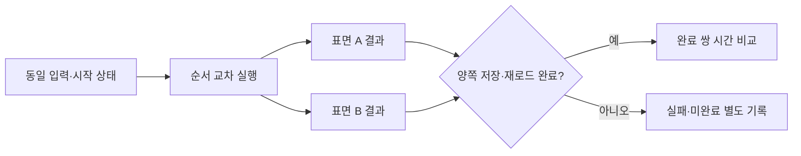

# R3 · Codex 브라우저 표면 비교와 probe 인계

확인 날짜: **2026-10-11 (Asia/Seoul)**. 조사 기준: `main e016ab7`. 이 PR은 이 문서만 추가한다. 코드·fixture·정책을 바꾸지 않는다.

현재 세션의 내장 제어 도구 `mcp__cua_repl`로 **IAB와 Chrome 확장 모두** simulator의 DOM·URL·제목·스크린샷을 읽었다. 기존 수집기의 명시적 `date-now`·`read-evidence-id` 경로는 양쪽에서 통과했다. 브라우저 연결 목록만으로 profile·로그인·실제 문제지 검증을 완료했다고 보고해서는 안 된다.

## 1. 공식 출처와 확인 방법

| 출처 | URL / 확인 방법 | 확인 날짜 |
|---|---|---|
| 공식 브라우저 문서 | [Browser](https://learn.chatgpt.com/docs/browser) 본문 열람 | 2026-10-11 |
| 공식 확장 문서 | [Browser extension](https://learn.chatgpt.com/docs/chrome-extension) 본문 열람 | 2026-10-11 |
| 공식 Computer Use 문서 | [Computer Use](https://learn.chatgpt.com/docs/computer-use) 본문 열람 | 2026-10-11 |
| 현재 도구의 API | `mcp__cua_repl` 첫 호출의 문서, 각 브라우저를 선택한 뒤 반환된 Browser API Reference | 2026-10-11 |
| 실제 확인 | `cua.getState()` → 새 연구용 simulator 탭 → 두 표면에서 read-only evaluate와 screenshot | 2026-10-11 |
| 기존 사고 기록 | [incidents.md](../incidents.md) 사고 19~21 | 2026-10-11 |

OpenAI Developers에서 검색한 현재 desktop 브라우저의 상세 사용 문서는 OpenAI의 `learn.chatgpt.com`에 있다. 공개 웹 문서는 사용자용 기능을 설명한다. 아래 JavaScript API는 **현재 도구가 반환한 문서와 이 세션의 관측**에 근거한다. 이를 모든 Codex 버전이나 독립 shell CLI의 공개 API로 일반화하지 않는다.

## 2. 지원 표면과 로그인 처리

| 항목 | `codex-iab` | `codex-chrome-ext` |
|---|---|---|
| 사용자 진입 | `@Browser` 또는 내장 브라우저 요청 | `@Chrome` 또는 명시한 탭 |
| 세션 | 일반 브라우저와 별도 profile·탭·로그인 상태 | 확장이 설치된 기존 Chrome profile의 탭·로그인 상태 사용 |
| 로그인 | 필요하면 IAB 안에서 로그인 | 기존 로그인 사용 가능. 실제 로그인 여부는 현재 페이지에서 확인 |
| 탭 목록 / 이동 / 종료 | 현재 tool API에서 확인 | 현재 tool API에서 확인 |
| DOM | 현재 도구의 read-only Playwright evaluator와 locator | 같은 evaluator·locator 계약 |
| screenshot | 이번 simulator 호출 PASS | 이번 simulator 호출 PASS |
| UI 문서와 제공 범위 | desktop에 포함. CLI·IDE 확장에서는 내장 브라우저가 제공되지 않음 | desktop과 연결된 지원 브라우저 사용. 배포·workspace 설정에 따라 가용성 달라짐 |

위 profile·로그인·진입·가용성 정보는 공식 [Browser](https://learn.chatgpt.com/docs/browser)와 [Browser extension](https://learn.chatgpt.com/docs/chrome-extension)에서 확인했다. 확장 문서는 Chrome 외에 Edge·Brave·Opera·Vivaldi도 다룬다. 이 저장소의 `codex-chrome-ext`는 승인된 Chrome 계약 값이다. 다른 family를 그 값으로 바꾸지 않는다.

공식 [Computer Use](https://learn.chatgpt.com/docs/computer-use)는 desktop의 macOS·Windows 지원을 설명한다. 이번 시험은 Windows에서만 실행했다. macOS에서 동일 API를 실행한 결과와 Linux desktop의 동일 두 표면 지원은 **미확인**이다. 현재 세션은 native-app API가 비활성인 반면 두 browser surface는 활성이다. 두 가용성을 같은 것으로 취급하지 않는다.

로그인/2FA 화면에서 사용자가 인증해야 하는 조건을 모든 desktop 동작에 대해 한 문장으로 확정할 근거는 **미확인**이다. 실제 계정에 로그인하거나 자격 증명을 읽는 시험을 수행하지 않았다. 연결 성공, 탭의 존재, 로그인 화면의 부재만으로 로그인 성공을 단정하지 않는다.

## 3. 현재 지원되는 probe 호출

처음에는 현재 session의 제어 도구를 사용한다. 새 runtime·독립 Playwright CLI·옛 `node_repl`을 설치하는 경로가 아니다. 다음은 현재 반환 문서에서 확인한 호출이다.

```javascript
// 현재 활성 표면과 identity metadata. 첫 호출에 이 API 하나만 실행한다.
await cua.getState();

// 초기 문서를 읽은 뒤 현재 브라우저와 탭 목록을 조회한다.
await cua.listBrowsers();
await cua.listTabs({ browser: browserId });

// 사용자 @-mention이 있으면 해당 complete plugin URL을 우선 사용한다.
const tab = await cua.getTab({ mention: tabMentionUrl });
// 이미 확인한 tab ID / URL과 browser ID를 사용해도 된다.
const knownTab = await cua.getTab(tabId, { browser: browserId });

await knownTab.getAXState();
await knownTab.playwright.domSnapshot();
await knownTab.title();
await knownTab.url();
```

실제 조사에서는 `cua.createBrowserTab('iab', simulatorUrl, {visible:false})`와 `cua.createBrowserTab('chrome', simulatorUrl, {sessionName:'🔎 R3 연구'})`로 새 연구 탭을 만들었다. 열린 사용자 탭에 attach하거나 이동하지 않았다. loopback 서버는 공개 kit만 제공했다. 외부 실제 수학비서에는 접속하지 않았다.

`getAXState()` 또는 `domSnapshot()`으로 **현재 URL·페이지 이름·로그인/오류 화면과 기대한 paper UI**를 읽는 것이 로그인/paper 확인의 시작점이다. 수학비서의 검증된 로그인 selector는 R2 결과가 없어 **미확인**이다. 그 selector나 합성 `loggedIn=true`를 probe에 만들지 않는다.

**독립 PowerShell에서 위 tool API를 부르는 공식 CLI/RPC 명령은 미확인**이다. 현재 `mcp__cua_repl` 내부에서 성공한 호출을 `codex browser ...` 같은 명령으로 바꿔 쓰지 않는다. Phase 3b가 별도 `.ps1` probe를 요구하면, 확인된 tool receipt를 전달하는 연결 방식 또는 미확인 명령 분기의 명시적 실패가 필요하다.

## 4. 페이지 JavaScript와 기존 수집기

현재 tool 문서의 시그니처는 양쪽 모두 다음과 같다.

```typescript
evaluate<TResult, TArg>(
  pageFunction: string | ((arg: TArg) => TResult | Promise<TResult>),
  arg?: TArg,
  options?: { timeoutMs?: number }
): Promise<TResult>;
// read-only page scope
```

함수와 인자 전달, URL·제목 판독을 실제로 확인했다.

```javascript
await tab.playwright.evaluate(
  arg => ({ title: document.title, url: location.href, marker: arg.marker }),
  { marker: 'r3-read' },
  { timeoutMs: 5000 }
);
```

`search_observation.js`의 기존 `collectMathSecrSearchObservation` 함수를 같은 simulator map과 함께 양쪽 evaluator에 전달했다. 기본 clock 경로와 저장소가 이미 제공한 대체 경로를 구분해서 시험했다. 입력 adapter의 selector는 공개 simulator 소스에서 확인한 값이다.

| 시험 | IAB | Chrome 확장 |
|---|---|---|
| 기본 context: UUID/monotonic clock | `capture UUID unavailable` 거부 | 같은 거부 |
| `typeof crypto`, `typeof performance` | 둘 다 `undefined` | 둘 다 `undefined` |
| 명시적 `clockSource='date-now'`, `captureSource='read-evidence-id'` | PASS | PASS |
| 명시적 경로의 출력 | `schemaVersion=2`, `mathsecr-search-observation-v2` | 동일 |
| 결과 수 | 8 | 8 |
| ordered IDs | `7231357, 7231365, 7231367, 7232191, 7232217, 7232220, 7232227, 7232230` | 동일 |
| screenshot 호출 반환 크기 | 62,875 bytes | 83,016 bytes |

수집기 원본 SHA-256은 `a7452efa0f3a1b11472d5d2f504d136dc5414b7d4fb3e754edc58c62ae8a1ecf`다. 두 표면에 전달한 함수의 실행 논리는 그대로이며 코드·fixture를 변경하지 않았다. 기본 경로의 거부는 tool의 read-only evaluator에 관한 관측이다. 브라우저 엔진 자체가 crypto/performance를 지원하지 않는다는 뜻이 아니다.

Simulator 초기 상태의 source 선택은 false였다. 관측 호출의 성공은 search submit·freshness·선택 허가가 아니다. `schemaVersion=2`의 caller read ID와 wall clock은 독립 UUID·monotonic clock 증명이 아니다. 이번 시험에는 카드 선택·저장·실제 본문 판정이 없다.

## 5. identity와 시간 초과

| 필요한 필드 | 현재 확인한 제공자 / 읽는 법 | 상태 |
|---|---|---|
| browser kind | BrowserInfo `type`, `family`, `name`, `id` | IAB의 `type='iab'`; Chrome의 `type='extension'`, `family='chrome'`, `name='Chrome'` 확인 |
| IAB session ID | BrowserInfo `metadata.codexSessionId` | 값 존재 확인. 사용자 식별자는 공개하지 않음 |
| Chrome 연결 identity | BrowserInfo `metadata.extensionInstanceId` | 값 존재 확인. extension instance이며 실제 profile directory라는 증거는 아님 |
| profile name | BrowserInfo의 선택 필드 `profileName` | 이번 Chrome 목록에는 값 없음. **미확인** |
| tab ID | `cua.listTabs()` / `getState().browsers[].tabs[]`의 `id`, `providerTabId` | 현재 도구가 발급한 값. AX element index·Aside targetId와 교환하지 않음 |
| paper URL / 제목 | `tab.url()` / `tab.title()`와 현재 AX/DOM | simulator에서 확인. 실제 paper 확인은 별도 |
| 로그인 상태 | 현재 페이지의 인증 UI와 검증된 paper 화면 | 이번 연구는 실제 계정 미시험. **미확인** |
| 제품·확장 버전 | 현재 기본 BrowserInfo에 version 필드 없음 | 이 API로 읽는 확정 명령은 **미확인** |
| 기본 동작 timeout | 공개 제품 문서와 현재 기본 API에 전체 기본값 없음 | **미확인** |
| timeout 변경 | evaluate·locator 등 지원된 options의 `timeoutMs` | evaluate에 5,000 ms를 전달해 성공. 실제 timeout 발생은 미시험 |
| screenshot timeout 변경 | 현재 screenshot options는 `clip`, `fullPage` | timeout 인자는 문서화되지 않음. **미확인** |
| “실행 중 아님” 문구 | 현재 연결은 정상 | 정확한 off 진단은 **미확인**. 일반 timeout으로 off를 채우지 않음 |

`codex-chrome-ext`의 `profileOrSessionId`에 extensionInstanceId를 자동으로 넣는 규칙은 아직 없다. 연결 ID와 profile/session ID의 의미를 먼저 정해야 한다. IAB와 MCP Apps가 같은 codexSessionId를 공유할 수 있으므로 session ID만으로 surface를 결정하지 않는다. surface·browser kind·탭·URL과 함께 결합한다.

현재 양쪽 탭의 optional capability 목록에 `cdp`가 있다. 공식 [Browser](https://learn.chatgpt.com/docs/browser)는 full CDP를 Developer mode·조직 설정·추가 승인과 결합한다. 이번 연구는 raw CDP를 호출하거나 권한을 확대하지 않았다. `Runtime.evaluate`, browser version, 실제 profile 경로, 입력의 raw CDP 호출 가능 여부는 **미확인**이다. read-only evaluator의 성공과 raw CDP 허용을 같다고 보지 않는다.

## 6. 사고 19~21 재해석

| 사고 | 현재 근거로 말할 수 있는 것 | 남은 불확실성 |
|---|---|---|
| 19 · Aside 확장 표면을 Chrome로 오분류 | browser family 또는 Chromium UA만으로 표면을 결정하면 부족하다. 현재 identity에는 type·connection/session ID·tab ID·URL을 결합할 수 있다 | 당시 전체 identity 결합을 이번 연구에서 재현하지 않음. 원인 확정은 **미확인** |
| 20 · 오래된 snapshot 호출 | Aside의 현재 guide는 `snapshot(page, options)`다. Codex 현재 API는 `tab.getAXState()` / `tab.playwright.domSnapshot()`다. surface 사이에서 signature를 복사하면 안 된다 | 예전 TypeError가 이후 screenshot timeout을 일으켰다는 인과는 **미확인** |
| 21 · 세 브라우저의 반복 timeout | 목록·DOM·screenshot·입력을 분리해 성공/실패를 기록해야 한다. 이번 양쪽 simulator DOM·screenshot 성공은 현재의 작은 시험 결과다 | 당시 장애의 복구 여부·실제 paper 입력 성공·근본 원인은 **미확인** |

**메모리 commit 94.3%와 timeout의 인과관계는 미확인**이다. 당시 관측값을 현재 상태나 단일 원인으로 쓰지 않는다. 비교 전에 같은 작업에서 DOM·screenshot·입력을 각각 확인하고, 실패 분류와 시각을 보존하는 설계가 필요하다. 이는 사고 기록과 현재 기능 차이에서 도출한 제안이다.

## 7. 공정 비교 설계 제안

이 절은 연구 결과에 근거한 **제안**이며 실제 성능 측정 결과가 아니다. 동일 source hash·문항 occurrence 순서·scope·시작 칩·저장 상태를 양쪽에 고정한다. 한쪽의 기존 로그인이나 stale 선택 묶음을 다른 시작점으로 두지 않는다. 실물 원본과 사용자 계정이 필요한 비교는 별도 승인된 Phase 5 운영 세션에서 수행한다.



1. Pair ID를 만들고 AB/BA 순서를 교차한다. 동시 실행은 하지 않는다. 비교 범위 밖의 모델·추론·입력 자료 변경도 금지한다.
2. 시작 시 source/scope/chip/save-state digest, 현재 surface identity, 실제 로그인 확인을 기록한다. 한쪽 준비가 다르면 해당 pair를 시작하지 않는다.
3. source 준비·관측·입력·search submit·fresh read·본문 판정·선택·편집·저장·reload·보고 단계를 별도 시각으로 기록한다. API read 비용과 사람/모델 판정 시간을 합쳐 숨기지 않는다.
4. 완료 기준은 원본 occurrence와 최종 persisted/reloaded 묶음의 순서·개수·ID 결합이다. click·ACK·로컬 receipt 생성만으로 완료 쌍을 만들지 않는다.
5. 양쪽 완료 pair만 같은 범위의 총 시간과 단계별 시간 중앙값으로 비교한다. 완료율·실패 유형·timeout·재시도 횟수는 전체 시도를 분모로 별도 보고한다. 미완료 pair를 제거한 사실과 수를 공개한다.

제안하는 기록 형식은 다음과 같다. 실제 ID·URL·원문은 비공개 evidence에 두고 공개 보고에는 익명 키와 hash를 쓴다.

| 필드 묶음 | 필드 |
|---|---|
| pair / 조건 | `pairId`, `order=AB/BA`, `sourceSha256`, `occurrenceKeys`, `scopeDigest`, `startingChipsDigest`, `startingPersistedBundleDigest`, `model`, `effort` |
| identity / 실행 | `surface`, `browserFamily`, `profileOrSessionId`, `tabId`, `paperUrlDigest`, `identityObservedAtUtc`, `startedAtUtc`, `completedAtUtc` |
| 측정 | `phaseDurationsMs`, `totalElapsedMs`, `readCount`, `actionCount`, `retryCount`, `timeoutCount` |
| 결과 / 증거 | `outcome=completed/partial/blocked`, `failureClass`, `diagnosticArtifactSha256`, `persistedBundleDigest`, `reloadVerified`, `pairEligible`, `exclusionReason` |

Phase 3b의 남은 결정은 Chrome의 profile/session identity 의미와 독립 PowerShell에서 현재 tool receipt를 받는 연결 방식이다. 확인된 DOM API는 재사용할 수 있다. 미확인 외부 명령·off 진단·raw CDP 입력을 새 probe의 성공 분기로 만들어서는 안 된다.
