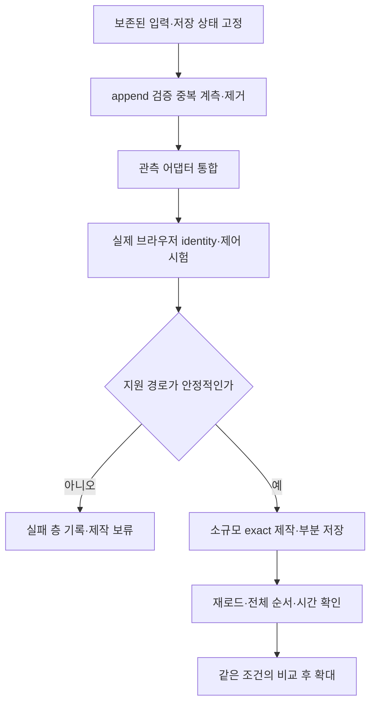

# 현재 상태와 더 나은 구현 과정

기준 시각은 2026-10-10의 마지막 연결 검사다. 이번 Git 공개 작업에서는 새 문항을 검색·선택·저장·출제하지 않았다. 이 문서의 계획을 구현 완료로 읽으면 안 된다.

## 실제로 확인한 상태

| 항목 | 확인 결과 | 남은 한계 |
|---|---|---|
| 최근 문제지 | 원본 47개 중 저장된 15개의 전체 ID와 순서를 재확인 | 나머지는 미해결·미실행. 모두 final miss로 닫지 않음 |
| Aside REPL | local 경로, 탭 조회, 재로드 뒤 15개 판독 | 화면 캡처 timeout. 안정 속도 개선 미확인 |
| 새 Chrome 연결 후보 | DOM 판독, 보기 메뉴 열기·닫기, 화면 캡처 | 검색 진입 timeout. 실제 Chrome identity 결합 미확정 |
| IAB | 15개 전체 순서 판독과 과거 검색 시험 일부 성공 | 반복 DOM·캡처·탭 생성 오류 |
| 설치 진단 | 실제 사용자 환경의 Chrome 확장 활성·native-host 등록 확인 | 실제 제어 연결 복구와 다름 |
| 검증기 | 실제 보존 입력의 Select·BeforeNext·AfterReload 통과 | append history 중복 계산 비용 |
| 브라우저 비교 | 실제 시험을 수행하고 오식별을 정정 | 같은 시작 상태에서 양쪽 완료 A/B 쌍 0개 |

오프라인 PASS는 현재 연결 복구를 증명하지 않는다. 메뉴 한 번의 빠른 조작도 문항 제작 처리량을 증명하지 않는다.

## 비교할 수 있는 값과 없는 값

| 기록 | 결과 | 경과 시간 | 해석 |
|---|---|---:|---|
| 9월 20일 최초 IAB 제작 | 17/17로 보고했으나 뒤에 오선택 지적 | 14분 2초 | 정확한 성공 속도 기준에서 제외 |
| 9월 27일 Aside 재제작 | 본문 대조, 저장·재로드 17/17 | 58분 22초 | 당시 성공 기록 |
| 10월 9일 최근 Aside 제작 구간 | 저장 3개에서 시작, 중단 때 15/47 | 3시간 54분 49초 | 다른 원본·검증·작업량의 기록 |

모델, 추론 수준, 입력, 검증 절차가 함께 달라졌다. 시간 비율을 모델 성능 비율로 계산하지 않는다. 이전에 잘 되던 검색 규칙이 전부 삭제됐다는 근거도 없다. 실제 추가 저장 호환성과 작업 흐름을 유지하지 못한 회귀는 확인했다.

| 검증 단계 | 1회 실행 시간 | 측정 범위 |
|---|---:|---|
| Select | 2.04초 | 기존 실제 입력, 모듈 로드 제외 |
| BeforeNext | 7.45초 | 기존 실제 입력, 모듈 로드 제외 |
| AfterReload | 113.83초 | 15문항과 연결된 과거 session 6개 |

이 값은 통계적 대표값이 아니다. 파일 cache와 OneDrive 영향도 통제하지 않았다. 전체 지연을 이 검사 하나로 설명하지 않는다.

## 권하는 구현 순서

코드 개선과 실제 연결 시험은 서로 독립된 사실이다. 한쪽의 통과를 다른 쪽의 완료로 쓰지 않는다.

### 1. append 검증 중복 제거

production 재귀, state 재귀, 최종 append 재검사가 읽는 의존 관계를 먼저 계측한다. 한 검증 호출 안에서 동일 의존 노드의 결과를 공유한다.

재사용 key에는 입력 내용, 원본 roster, 단계와 버전, 실제 surface, 모든 의존 artifact의 해시가 들어가야 한다. 다른 원본·후보·순서·출처·action이나 파일 변경에는 cache를 재사용하지 않는다. 과거 파일의 `Valid=true`만 읽는 방식은 쓰지 않는다.

완료 기준은 정상 입력의 결과 동일성, 변조 입력의 거부 유지, 재귀 history 1·2·6개에서 실제 검증 횟수와 시간을 확인하는 것이다. 현재 113.83초 입력과 잘못된 후보 대조를 반드시 포함한다. 목표 수치는 계측 뒤 정한다.

### 2. 제작용 관측 어댑터 안정화

입력값, 칩, 범위, 결과 signature, 선택 ID를 필요한 한 관측으로 수집한다. 독립 결과 판독은 계약에 맞게 유지한다. 본문 비교는 실제 원본과 후보를 보고 수행한다.

어댑터가 roster와 occurrence를 결합하고 Select 입력을 만들게 한다. 제작 중 문항별로 새 receipt 형식을 고치는 일을 줄인다. timeout 뒤에는 실제 반영 상태부터 확인한다. 이미 반영된 클릭을 다시 실행하지 않는다.

### 3. 브라우저 정책과 계약을 함께 변경

사용자는 Aside가 더 빠르다는 증거가 없다면 Chrome 또는 IAB로 바꿔도 된다고 했다. 그러나 현재 canonical 제작 계약은 Aside REPL을 요구하고 IAB 입력을 거부한다.

실제 지원되는 CUA/IAB/Chrome의 관측을 typed surface로 받는 어댑터와 validator를 함께 변경해야 한다. IAB 근거를 Aside라고 기록하지 않는다. 브라우저의 실제 identity, tab, URL, 로그인, 본문 판독, 입력·후속 판독을 직접 확인한다.

서로 다른 설치·연결·판독·입력 실패를 구분한다. 현재 도구가 제공하지 않는 native 제어나 helper 경로로 제한을 우회하지 않는다.

### 4. 기존 15개를 보존한 소규모 실제 제작

새 경로가 지원되고 안정성을 확인한 뒤 미해결 문항 일부에서 시작한다. 원본 순서, exact 판정, Select, 실제 추가 action, 부분 저장, AfterReload 전체 bundle을 확인한다.

완료 기준은 새로 저장된 exact 수와 기존 15개 유지다. 새 선택 수만으로 성과를 세지 않는다. 오류로 아직 검색하지 못한 문항은 not-started로 남긴다.

### 5. 공정한 비교 뒤 나머지 제작

같은 source, scope, 시작 칩, 저장 상태, 결과 판정, 검증 단계를 사용한다. A/B 순서를 바꾸고 반복한다. 두 루프가 모두 완료한 쌍만 속도 비교에 쓴다. 실패 시도와 복구 시간도 따로 기록한다.

핵심 값은 재로드로 검증된 exact 문항 수, 오선택, 재시도, 전체 경과 시간이다. 검색 submit 시간, 본문 검토, 기록 조립, 검증 시간은 보조 값이다. Chrome와 IAB를 포함하되 실제 identity와 지원 여부가 확인된 경로만 이름을 붙인다.

## 검사를 확대할 조건

이번 공개 작업은 정책·validator 기능을 변경하지 않았다. 그래서 과거 전체 production 회귀를 다시 실행하지 않는다. 공개 파일 해시, 문서 링크, 개인정보·비밀정보, 새 공개본의 제한된 합성 검사를 실행한다.

후속 계약·실행 코드를 변경하면 관련 음성 회귀와 연결 검사를 실행한다. canonical 정책을 바꾸면 공식 설치·SyncContract도 확인한다. 그 변경 범위에 필요한 전체 runner를 실행하되 같은 PASS를 새 이유 없이 반복하지 않는다.
