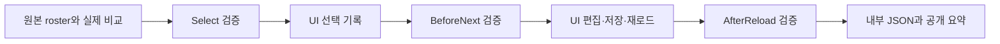
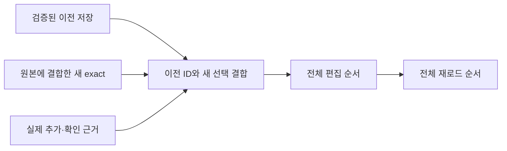

# 실제 제작 검증 연결

`scripts/production_validation.ps1`은 기존 검색·본문·상태 검증기를 세 번의 실행 지점에 연결한다. 브라우저를 조작하지 않으며, 판정·관측·클릭·시각을 만들어 넣지 않는다. 검증 결과는 receipt 구조와 파일 identity를 확인한다. 실제 본문 일치의 독립 정답률이나 라이브 동작의 수행 사실을 자동으로 증명하지 않는다.



검증에 실패하면 해당 UI 행동이나 보고를 진행하지 않는다. `Select`의 PASS는 선택할 근거가 유효하다는 뜻이며 실제 선택 클릭을 대신하지 않는다. 저장 이후에는 실제 카드 목록을 다시 입력해야 한다.

## 호출

먼저 현재 Aside 응답을 검사한다. `HostId`를 생략하면 `--host local`을 명시한다. 저장된 원격 기본 host를 상속하지 않는다. `AccountId`를 생략하면 CLI의 기본 account를 사용한다. 실제 제작 REPL이 `--host local --account u0`를 사용하면 검사에도 같은 값을 전달한다. 이 인수는 각 검사 명령에만 적용하며 전역 host/account 설정을 바꾸지 않는다.

```powershell
& ./mathsecr-paper-builder-kit/scripts/check_aside_repl.ps1 `
  -HostId local -AccountId u0 `
  -OutPath '.omo/evidence/current-run/aside-probe.json'
```

검사는 읽기 전용 `skills list`와 `listBrowserTabs()`만 실행한다. 현재 실행 PC는 `executionMachineName`, 지정한 경로는 `effectiveHostId`와 `hostSelectionBasis`에 기록한다. 이 필드는 실제 연결된 원격 PC를 증명하지 않는다. 기기 이름만으로 원격 작업을 추론하지 않는다. 사용자가 원격 작업을 명시 요청한 경우에만 `-RemoteRequested -RemoteRequestEvidence '<실제 사용자 지시>'`를 함께 전달한다. 둘 중 하나라도 없으면 CLI를 조회하거나 실행하기 전에 거부한다. 요청 여부는 호출자가 실제 사용자 지시에서 확인해야 하며 문자열 존재만으로 증명하지 않는다. 시간 초과나 연결 실패는 `unavailable`이다. 브라우저 종료 진단이 실제 반환된 경우에만 고정 종료 문구를 사용한다.

일반 텍스트 검색 target은 기존 `prepare_selection_evidence.ps1`로 실제 입력을 조립할 수 있다. 이 helper는 해시와 파생 필드만 계산한다. metadata-rescue target은 기존 metadata receipt 경로를 사용한다.

```powershell
& ./mathsecr-paper-builder-kit/scripts/validate_production_step.ps1 `
  -Step Select -InputPath '.omo/evidence/current-run/session-before-select.json' `
  -TargetOccurrenceKey 'source-row-1' `
  -OutPath '.omo/evidence/current-run/select-validation.json'

& ./mathsecr-paper-builder-kit/scripts/validate_production_step.ps1 `
  -Step BeforeNext -InputPath '.omo/evidence/current-run/session-before-next.json' `
  -OutPath '.omo/evidence/current-run/before-next-validation.json'

& ./mathsecr-paper-builder-kit/scripts/validate_production_step.ps1 `
  -Step AfterReload -InputPath '.omo/evidence/current-run/session-after-reload.json' `
  -OutPath '.omo/evidence/current-run/after-reload-validation.json' `
  -SummaryPath '.omo/evidence/current-run/user-summary.md'
```

`ProjectRoot`는 기본 workspace root다. 다른 root를 쓰면 명시한다. 입력과 출력 경로는 root 내부여야 한다. 출력 폴더는 먼저 있어야 하며, 기존 결과는 덮어쓰지 않는다. 실패는 종료 코드 1과 진단 JSON을 반환한다. `SummaryPath`는 AfterReload에서만 허용한다.

직접 호출은 `Invoke-MathSecrProductionStep -Step Select|BeforeNext|AfterReload -InputObject $session -ProjectRoot $root`를 쓴다. Select에만 실제 대상의 `-TargetOccurrenceKey`를 추가한다. 다른 단계에서 이 인수를 쓰거나 Select에서 생략하면 거부한다.

## 입력

Select도 고정 원본 roster에 결합된 session을 받는다. 조립한 target을 `session.snapshot.targets`의 해당 원본 행에 넣고 그 행의 실제 occurrenceKey를 명시한다. target만 단독 제출하는 경로는 지원하지 않는다. `number`, `occurrenceKey`, `selectedId`, `sourceBodyArtifact`, `bodyComparisonReceipt`가 필요하다. 일반 검색은 `searchAttemptReceipt`, metadata-rescue는 기존 `metadataRescue` receipt를 받는다. 원본/후보 파일 해시와 실제 비교자·비교 시각을 이미 기록해야 한다. 공통 `Test-MathSecrTargetRowState`가 route의 scalar enum과 모순을 확인하고 `Get-TargetResolution`의 파생값을 반환한다. 선택적으로 기록한 `resolution`은 파생값과 Ordinal 일치해야 한다. `not-started`에 caller resolution을 붙여 선택 경로로 바꿀 수 없다. 기존 exact-producing resolution과 inspected candidate의 결합을 검증하며, source crop을 target와 body receipt 양쪽에서 바꿔도 고정 roster와 다르면 거부한다.

선택 target에는 실제 진행 상태의 `initial` 및 필요한 recovery/whole-DB 필드를 기록한다. 초기 상태가 없으면 미실행으로 해석한다. 조립 helper의 `resolution` 필드만으로 실행 상태를 대신하지 않는다.

세 단계는 같은 versioned session을 사용한다. 최종 카드 관측과 실패 PDF 필드는 AfterReload에서 필요하다.

```json
{
  "schemaVersion": 1,
  "sessionId": "current-session",
  "paper": { "name": "문제지 이름", "url": "https://www.mathsecr.com/mypaper/123" },
  "sourceRosterArtifact": { "path": ".omo/evidence/current-run/source-roster.json", "sha256": "실제 파일의 SHA-256" },
  "sourceTargets": [ { "number": "1", "occurrenceKey": "source-row-1", "sourceBodyArtifact": { "path": ".omo/evidence/current-run/source-1.png", "sha256": "실제 원본 크롭 SHA-256" } } ],
  "snapshot": { "targets": [ { "number": "1", "occurrenceKey": "source-row-1", "sourceBodyArtifact": { "path": ".omo/evidence/current-run/source-1.png", "sha256": "실제 원본 크롭 SHA-256" } } ] },
  "persistedCardObservationArtifact": { "path": ".omo/evidence/current-run/persisted-capture.json", "sha256": "실제 관측 JSON SHA-256" },
  "persistedCards": [ { "problemId": "actual-id", "occurrenceKey": "source-row-1", "rawVisibleDbName": "실제로 보이는 DB명" } ],
  "failureReportPdf": "없음"
}
```

위 예시는 필드 구조만 보여준다. `snapshot`과 target에는 기존 상태·검색·본문 계약의 실제 필드가 모두 필요하다. BeforeNext에는 아직 발생하지 않은 `nextClicked`, edit, persistence 사실을 채우지 않는다. 실제 `nextClicked=false`를 기록하며 edit/persistence 필드는 생략할 수 있다. 검증된 BeforeNext 결과만 `CanNextStep=true`를 반환한다.

원본 inventory를 마친 시점에 `source-roster.json`을 별도로 보존한다. 구조는 `schemaVersion: 1`과 원본 순서의 `targets` 배열이다. 각 행에는 문자열 `number`, 고유 `occurrenceKey`, 실제 원본 크롭의 `sourceBodyArtifact` 경로·해시가 있다. 미검색 행도 이미 보존한 원본 크롭에 결합한다. 이 생산 경로의 `number`는 기존 공개 요약이 요구하는 양의 정수 보고 번호다. 일반 인쇄 문제번호를 그대로 쓸 수 있으면 그 번호를 기록한다. EBS의 `26009-0002` 같은 출처 코드만 있으면 실제 원본 inventory에서 확인한 문제 위치를 보고 번호로 명시하고 출처 코드는 별도 `printedLabel` 또는 printed metadata에 보존한다. 두 값을 같다고 가정하거나 문제 위치를 추측해 자동 생성하지 않는다. session의 `sourceTargets`와 snapshot targets는 고정 roster의 전체 행과 같은 순서여야 하며 원본 크롭 결합도 같아야 한다. 해시는 보존한 파일 identity를 결합하며, inventory 자체가 정확하다는 독립 판정은 아니다.

AfterReload의 `persistedCardObservationArtifact`는 최종 카드 판독을 보존한 JSON의 상대 경로·해시다. 원시 관측은 실제 UI를 읽은 뒤 별도 파일로 저장한다. 최소 schema는 다음과 같다. 아래 ID·시각·제목은 구조 예시이며 실제 실행 값으로 대체한다.

```json
{
  "schemaVersion": 1,
  "captureId": "실제 관측 ID",
  "collectorVersion": "사용한 판독기의 버전",
  "surface": "aside-repl",
  "capturedAtUtc": "2026-10-07T00:00:00.000Z",
  "url": "https://www.mathsecr.com/mypaper/123",
  "title": "실제 탭 제목",
  "readEvidenceId": "실제 판독 근거 ID",
  "cards": [ { "problemId": "actual-id", "rawVisibleDbName": "실제로 보이는 DB명" } ]
}
```

관측의 URL은 session의 문제지 URL과 같아야 한다. `cards`는 최종 persisted 화면의 전체 카드 순서다. 각 ID와 `rawVisibleDbName`을 session의 `persistedCards`와 전량 대조한다. 이후 검증된 selected/edit/persisted 묶음에도 ID와 로컬 occurrence mapping을 대조한다. UI에서 occurrenceKey를 보여 주지 않으면 원시 capture에 만들지 않는다. 원본과의 `occurrenceKey` 결합은 session의 로컬 `persistedCards`에 보존한다. 출처는 검증된 capture의 raw DB명에서 계산한다.

실제 판독 없이 관측 ID·시각·제목을 채우거나 과거 결과를 재사용하지 않는다. 새 capture/read identity와 시각은 실제 판독마다 기록한다. 해시는 저장한 JSON bytes의 integrity를 증명한다. 적힌 DOM 값이 실제로 관측되었는지, 실제 reload가 수행되었는지, 그 관측이 최신 상태인지는 해시만으로 증명하지 않는다. Primary agent의 실제 UI·저장·재로드 검증과 근거 기록은 그대로 필요하다.

출처 정규화는 조직 root를 `교육청` 또는 `평가원`으로 묶는다. 다른 DB는 `>` 앞 root에서 선행 발행 연도를 제거한다. 빈도 내림차순으로 최대 3개를 출력하며 동률은 원본 순서의 첫 등장 순서를 쓴다. 출처가 4개 이상이면 top3 수의 합이 성공 수보다 작을 수 있다.

## 부분 저장과 보고

`snapshot.requestedAction="partial-save"`는 검증된 exact subset을 저장하면서 미해결 원본 행을 보존한다. 미검색 행은 `initial="not-started"`로 기록한다. 없는 검색 receipt를 만들어 채우지 않는다. 상태 검증기는 `ClosedMissedSourceNumbers`와 `UnresolvedSourceNumbers`/`UnresolvedReasons`를 따로 반환한다.

공개 성공 수는 persisted exact 원본 수다. 실패 수는 전체 원본 수에서 성공 수를 뺀 값이다. 따라서 공개 실패 번호에는 미해결 행도 포함되며 내부 JSON에서 미해결 진단을 유지한다. 실패가 하나라도 있으면 그 번호와 순서에 맞는 실제 크롭 보고서 PDF의 절대 경로가 필요하다. 기존 PDF 페이지·번호 검사를 그대로 수행한다. 실패가 없으면 `failureReportPdf="없음"`을 쓴다.

AfterReload는 `ReportProjection` 근거 JSON과 0–4 형식의 `UserSummary`를 함께 만든다. `ReportProjection`은 기존 필수 `MathSecr 세션 보고서`의 개수·순서·출처·미해결 진단을 재사용하는 입력이다. 전체 내부 보고서의 목표·위험·복구·도구 메모 등 실제 세션 필드는 기존 템플릿대로 별도 기록한다. 이 모듈이 전체 내부 보고서 생성을 완료한다고 주장하지 않는다. 기존 text-only lint는 형식 검사로 유지한다. production 요약은 고정 roster·상태 결과·persisted 카드에서 계산한 projection과 출처 이름, 개수, 동률 순서, 실패 번호, 문제지 링크, PDF 경로를 대조한다. 수정된 요약을 검사할 때는 `Invoke-MathSecrTypedUserSummaryLint -Text $text -Session $session -ProjectRoot $root`를 사용한다. 이 함수는 session을 다시 검증한 뒤 비교한다.

Aside off에 대한 한 줄 응답은 별도 availability probe 정책을 따른다. 이 모듈은 사용할 수 없는 브라우저에 대해 제작 완료 보고를 생성하지 않는다.

## 저장한 문제지에 추가

편집의 `문제·개념 추가` 경로는 최초 `다음 단계`와 별도 전이다. `selectionBeforeNextIds`와 `nextClicked`는 실제 최초 동작을 유지한다. 이후 전체 선택 ID를 그 필드에 덮어쓰지 않는다. 추가 후에는 `AfterReload`에서 `snapshot.editAppendReceipt`를 함께 검사한다. `BeforeNext`는 이 receipt를 받지 않는다.



전체 묶음은 이전 persisted occurrence와 새 delta occurrence를 원본 순서로 합쳐 파생한다. 최초 Next의 묶음은 별도로 보존한다.

`editAppendReceipt`는 `schemaVersion:1`, 고유 `appendId`, `surface:"aside-repl"`, 아래 파일 receipt와 `deltaTargets`를 가진다. 파일 receipt는 모두 `{path,sha256}`이며 프로젝트 내부 실제 JSON bytes에 결합한다.

| 필드 | 실제 근거 |
| --- | --- |
| `priorSessionArtifact` | 같은 session·문제지·고정 roster의 이전 AfterReload 입력. 캐시 PASS를 믿지 않고 capture·검색·본문·실패 PDF까지 다시 검증한다. |
| `beforeObservationArtifact` | 추가 전 `capturedAtUtc`, `url`, 전체 `priorEditIds`, modal의 `modalSelectedIds`, `action:"추가"`. |
| `deltaTargets` | 새로 선택한 원본 순서의 `{sourceProblemNumber,occurrenceKey,problemId}`. UI에 없는 원본 identity는 이 로컬 결합에만 둔다. |
| `addActionArtifact` | 실제 `추가` 클릭의 action JSON. |
| `confirmActionArtifact` | 실제 부모 `확인` 클릭의 action JSON. |
| `draftObservationArtifact` | 확인 종료 후 전체 `capturedAtUtc`, `url`, `draftIds`. |

action JSON은 `actionId`, `surface:"aside-repl"`, `startedAtUtc`, `completedAtUtc`, `timingBasis`, `url`, `controlName`, `action:"click"`, `evidenceArtifact:{path,sha256}`, `executionBinding`을 가진다. `evidenceArtifact`는 그 실행 명령과 응답을 보존한 실제 JSON이다. `executionBinding`은 `{commandRecordKey,resultRecordKey,completionMarker}`다. 실행 JSON은 `schemaVersion:1`과 실제 `{key,value}`의 `records` 배열을 가진다. 명령은 문자열 또는 `value.output` 문자열이며 클릭 호출과 controlName을 포함한다. 응답도 같은 문자열 형식이며 실제 완료 marker를 포함한다. 두 key는 각각 정확히 한 record에 결합한다. 관련 없는 JSON, 없는 명령·응답, 없는 완료 marker는 거부한다.

확인은 `timingBasis:"recorded-execution"`과 실제 시작·완료 UTC를 사용한다. action의 `beforeObservationArtifact`와 `afterObservationArtifact`도 필수다. 두 실제 관측의 URL, surface, controlName, 전체 draft IDs를 검사한다. after 관측에는 `schemaVersion:1`, `action:"click"`, 실제 `startedAtUtc`·`completedAtUtc`가 있으며 typed action과 정확히 같아야 한다. before 관측은 시작 전, after 관측은 완료 후여야 한다. 이 결합은 별도의 판독이나 클릭 재실행을 요구하지 않는다.

추가 클릭의 정확한 시각을 수집하지 않았다면 `timingBasis:"observation-window"`를 사용한다. `startedAtUtc`는 before 관측 UTC, `completedAtUtc`는 실제 추가 후 관측 UTC다. 이 경우 `afterObservationArtifact`도 action JSON에 포함하며 해당 파일은 `capturedAtUtc`, `url`, 전체 `draftIds`를 가진다. 이는 클릭이 관측 구간 사이에 있었다는 기록이다. 클릭 순간의 시각으로 해석하지 않는다.

추가 클릭에 `recorded-execution`을 쓰면 실제 after 관측에도 `schemaVersion:1`, `surface:"aside-repl"`, `controlName:"추가"`, `action:"click"`, 실제 시작·완료 UTC를 보존한다. typed action과 정확히 대조한다. 이후 실제 확인 전후 관측과 전체 재로드 관측으로 이어지는 시각 순서도 검사한다.

검증기는 이전 저장 ID 누락·치환, 새 선택과 modal delta 불일치, 원본 결합 오류, 추가·확인 근거 누락, 동작 시각 역전, 편집·재로드 순서 오류를 차단한다. 이전 선택 target의 검색·본문 receipt도 바꿀 수 없다. 새 final capture는 확인 후 draft보다 이르지 않아야 하며 이전 capture/read identity를 재사용할 수 없다. 해시와 typed action은 기록의 결합을 검증한다. 실제 클릭 수행의 독립 oracle는 아니다.

unique ID 경로의 occurrence bundle은 기존처럼 모두 생략할 수 있다. 전체 bundle을 기록하면 `snapshot.selectionAfterAppendOccurrenceKeys`, `edit.draftOccurrenceKeys`, `persistence.occurrenceKeys`를 모두 전체 원본 선택 순서로 기록한다. 최초 `selectionBeforeNextOccurrenceKeys`는 이전 값 그대로 둔다. 반복 DB ID에는 기존 고유 occurrence·typed duplicate/add control·세 bundle 게이트를 그대로 적용한다. `StateResult.SelectedIds`는 새 전체 묶음이며 `SelectionBeforeNextIds`는 과거 실제 Next 묶음이다.

추가 전이 회귀는 같은 `test_production_validation.ps1`에서 실행한다. 전체 runner의 기존 `Production Validation` label에 직접 연결되어 있다. 역사 Next 덮어쓰기, 이전 capture/PDF의 false-green, delta 누락·잘못된 원본, 행동 근거 누락, 관측 구간 변조, 시각 역전, 전체 순서 오류, occurrence 일부 누락을 거부한다. 고유 ID와 검증된 반복 occurrence의 양성 경로도 검사한다. 합성 receipt에만 근거한 offline-contract 검사이며 라이브 성공을 주장하지 않는다.

## 회귀

```powershell
& ./mathsecr-paper-builder-kit/scripts/test_production_validation.ps1
```

회귀는 합성 관측·판정과 실제 PNG/PDF 파일을 사용하는 offline-contract 검사다. Select의 source/body crop 동시 바꿔치기, 단독 target, mismatch/다른 후보/stale/IAB 변형, 미래 사실 없는 BeforeNext, 전체 원본 행 누락, roster 해시, 최종 capture 해시·URL·surface·UTC·순서·raw DB명, 저장 수 감소, 출처 변조, top3 동률, 미검색 partial-save, PDF 요구, CLI 재실행의 덮어쓰기 거부를 검사한다. 라이브 MathSecr를 조작하지 않는다.
